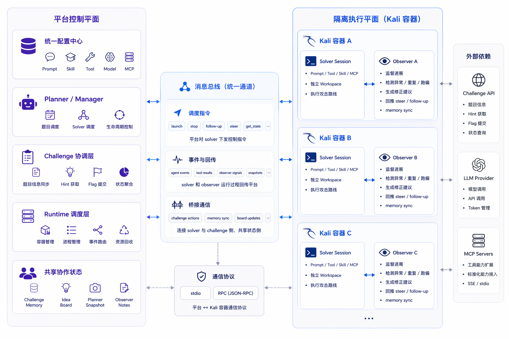

# BreachWeave

BreachWeave 是面向智能渗透测试场景的多 Agent 协作平台。它以本地项目和资产为中心，由 Planner 持续调度 Solver，并通过 Observer 监督执行过程，最终沉淀共享情报、验证记录和渗透测试报告。

## 核心能力

- **本地项目与资产管理**：统一管理 URL、IP/主机资产及各资产的扫描状态，项目数据保存在本地。
- **自动化 Planner 调度**：持续为待扫描资产规划任务，按并发上限启动 Solver，并处理超时和资源回收。
- **多 Agent 并行执行**：多个 Solver 可以同时探索不同方向，Observer 负责旁路监督与轻量纠偏。
- **项目级知识共享**：通过 `Memory` 保存事实、证据和约束，通过 `Idea` 管理假设、战术和待验证方向。
- **报告交付闭环**：Solver 按资产提交 Markdown 报告；报告提交后自动更新资产状态，全部资产完成后项目自动结束。
- **实时执行可视化**：通过 Attack Flow 查看攻击活动、情报图谱、Agent 协作动态和聚合视图，并支持时间线回放。
- **统计与导出**：提供资产完成率、模型/Prompt 表现、耗时和 Token 用量统计，并支持导出报告及 Solver Session。
- **用户认证**：Web 端支持注册、登录和 JWT 鉴权，密码使用 Argon2id 哈希保存。

## 快速开始

### 环境要求

- [Bun](https://bun.sh/)
- Docker（运行容器化 Solver 时需要）

### 克隆项目

```bash
# 克隆项目（含 submodule）
git clone --recurse-submodules git@github.com:m-sec-org/BreachWeave.git BreachWeave

# 如果已经克隆但没拉 submodule，补拉：
git submodule update --init --remote

# 后续更新 submodule 到最新 master：
git submodule update --remote
```

### 安装并启动 Web

```bash
bun run install
# 编译二进制
bun run build
bun run web
```

开发模式使用：

```bash
bun run dev
```

## 创建用户

用户默认写入 `~/.tch-agent/config/users.json`：

```bash
bun run create-user <username> [password]
```

密码未作为命令参数提供时，需要通过 `TCH_USER_PASSWORD` 环境变量传入。也可以使用 `--config-dir` 指定配置目录：

```bash
TCH_USER_PASSWORD='change-me' bun run create-user <username> --config-dir <path>
```

Web 登录页也支持开放注册。需要关闭时，在 Host 配置中将 `tch.auth.registrationEnabled` 设置为 `false`。

## 基本工作流

1. 使用管理员创建的账号登录 Web。
2. 在项目页面创建项目，填写名称、描述以及 URL、IP/主机资产。
3. 为项目配置 Planner Prompt，并决定是否启用自动 Planner。
4. 在 Planner 配置页选择模型，设置 Solver 并发数、调度间隔、过期时间和 Docker 网络模式。
5. Planner 根据待扫描资产启动 Solver；Solver 与 Observer 会将有效信息同步到项目级 `Memory` 和 `Idea`。
6. 在 Attack Flow 中实时查看执行事件、知识演进和 Agent 协作状态，或使用回放功能复盘历史过程。
7. Solver 为对应资产提交报告。全部资产完成后，可以查看统计、下载报告或导出 Solver Session ZIP。

## 常用命令

| 命令 | 用途 |
| --- | --- |
| `bun run web` | 启动 Web 服务 |
| `bun run dev` | 以 HMR 模式启动 Web 开发服务 |
| `bun run tui` | 启动终端界面 |
| `bun run create-user <username> [password]` | 创建本地用户 |
| `bun test` | 运行测试 |
| `bun run typecheck` | 执行 TypeScript 类型检查和目录导入检查 |
| `bun run build` | 构建 Linux、macOS 和 Windows 可执行文件 |

项目使用 Bun Workspace。构建时会优先解析仓库中的本地包，并在构建阶段生成内置 Skill、Prompt 等资源及嵌入式 Linux Solver 二进制。

## 配置与数据目录

默认数据根目录为 `~/.tch-agent/`：

| 路径 | 内容 |
| --- | --- |
| `~/.tch-agent/config/` | Provider、模型、MCP、Prompt、Skill、用户与 Host 配置 |
| `~/.tch-agent/challenge/` | 当前项目、资产、Attempt 和 Report 数据 |
| `~/.tch-agent/archive_challenge/` | 已删除项目的归档数据 |
| `~/.tch-agent/solvers/` | 正在运行的 Solver 数据 |
| `~/.tch-agent/archive_solvers/` | 已结束 Solver 的归档数据 |

项目目录可以通过 `TCH_CHALLENGE_DIR` 覆盖，项目归档目录可以通过 `TCH_CHALLENGE_ARCHIVE_DIR` 覆盖。

### Planner 默认参数

| 参数 | 默认值 | 说明 |
| --- | --- | --- |
| Max Solvers | 7 | 全局最多同时保留的 Solver 数；设为 `0` 可暂停自动调度 |
| Tick Interval | 30 秒 | Planner 完成一轮同步后进入下一轮规划的间隔 |
| Stale Timeout | 60 分钟 | Solver 超过该时间后可被视为 stale 并参与资源回收 |
| Docker Network Mode | `host` | 可切换为 `bridge` |

## 竞赛成绩

| 起始日期   | 结束日期   | 竞赛                                                                                                            | 赛段     | 获奖情况 | 排名    |
| ---------- | ---------- | --------------------------------------------------------------------------------------------------------------- | -------- | -------- | ------- |
| 2026-04-13 | 2026-04-17 | [腾讯云黑客松智能渗透测试挑战赛（第二期）](https://zc.tencent.com/competition/competitionHackathon?code=cha004) | 线上初赛 | N/A      | 1 / 613 |
| 2026-04-25 | 2026-04-25 | [腾讯云黑客松智能渗透测试挑战赛（第二期）](https://zc.tencent.com/competition/competitionHackathon?code=cha004) | 线下决赛 | 一等奖   | 1 / 613 |

<a href="https://zc.tencent.com/competition/competitionHackathon?code=cha004">
    
</a>




https://github.com/user-attachments/assets/b051927e-b64f-4bdf-833d-d542e328ad20


## 架构核心

项目整体采用 `Manager / Planner / Solver / Observer` 的多角色架构。

### Manager / Planner

`Manager` 提供项目、资产和 Solver 生命周期管理，`Planner` 负责持续规划与全局编排。

它们不亲自执行具体测试动作，而是站在项目视角完成：

- 识别待扫描资产并生成下一轮计划
- 分配、限制和回收 Solver
- 汇总 Attempt、Report、Memory、Idea 和运行统计
- 根据并发、调度间隔和 stale 状态组织多 Agent 协作

可以把它理解成整套系统的控制平面。

### Solver

`Solver` 是真正执行任务的主体。

它面向具体资产推进实际动作，例如：

- 信息收集
- 漏洞验证
- 利用链推进
- 证据整理与报告提交

一个项目可以同时存在多个 Solver，并行探索不同资产或不同验证方向。

### Observer

`Observer` 不直接代替 Solver 解题，而是作为旁路监督角色持续观察任务执行过程。

它重点解决的是复杂任务里最容易出现的几个问题：

- 执行路径逐渐偏移
- 状态不断累积后变得混杂
- 模型在阶段性停顿时过早结束任务
- 上下文越来越重，影响后续推进

Observer 的作用，是让系统具备持续监督、轻量纠偏和状态维护能力。

## 系统能力详解

围绕上面的架构，项目重点构建了几类能力：

### 1. 项目与资产状态

每个资产拥有稳定的 `asset_hash` 和独立的 `scanned` 状态。项目是否完成由全部资产的扫描状态决定，而不是由单个 Agent 主观判断。

删除项目时，系统会先停止关联 Solver，再将项目移动到归档目录，避免直接丢失历史数据。

### 2. 自动规划与多 Agent 协作

Planner 周期性读取待扫描资产、上一轮规划、共享知识、已有报告和 Solver 性能，再决定启动哪些 Solver。系统支持多个 Solver 并发探索不同方向，并通过全局并发上限控制资源使用。

### 3. 运行态监督

Observer 持续检查最近几轮执行轨迹和反馈，不替代 Solver 做决定，而是在发现明显低效或偏移时进行轻量纠偏。

当 Solver 已经获得可交付证据却长期停滞时，Observer 也可以提醒其整理并提交报告。

### 4. 两级知识维护

系统把“方向”和“事实”拆开维护：

- `Idea` 关注当前值得继续推进的方向
- `Memory` 保留可复用的事实、证据与约束

Solver 既有自己的本地知识板，也可以通过 `publish_to_challenge` 将内容发布到项目共享层。共享内容会广播给其他活跃 Solver，新启动的 Solver 也会自动加载已有知识，减少重复工作。

### 5. 报告驱动的结束条件

每份报告必须关联具体 `asset_hash`。报告成功提交后，对应资产会自动标记为已扫描；全部资产完成后，项目进入完成状态。

没有发现有效漏洞时，也应提交包含验证过程、失败边界和无发现结论的报告，使测试过程保持可审计。

### 6. Attack Flow 与执行复盘

Attack Flow 聚合 Solver、Observer、Tool、Memory、Idea 和 Report 事件，提供：

- 攻击活动时间线
- Memory/Idea 情报图谱
- Solver-Agent 协作动态图
- 多视图聚合工作台
- 播放、暂停、单步、倍速和循环回放
- 全屏展示、多窗口同步以及事件详情查看

### 7. 统计与交付

项目统计覆盖资产完成率、Solver/Attempt/Report 数量、首次报告时间、活动时长、模型/Prompt 表现以及输入、输出、缓存和推理 Token 用量。

报告可以在 Web 中预览和下载，Solver Session 可以按项目导出为 ZIP，便于复盘和归档。

### 8. 上下文压缩与降噪

系统不会把原始工具输出和历史会话无限堆进上下文，而是通过改写、压缩、摘要等方式，尽量让后续决策始终建立在高信号、低噪音的信息之上。

## 仓库结构

```text
packages/
  core/       @tch/core：配置、项目管理、Planner、Runtime、Solver 与 Observer
  ui-web/     @tch/ui-web：Web UI、REST API、SSE 和用户认证
  ui-tui/     @tch/ui-tui：终端界面
apps/
  cli/        @tch/cli：命令行入口
scripts/      安装、构建、用户管理和校验脚本
```

更完整的分层、数据流和包依赖说明请参阅 [ARCHITECTURE.md](./ARCHITECTURE.md)。
