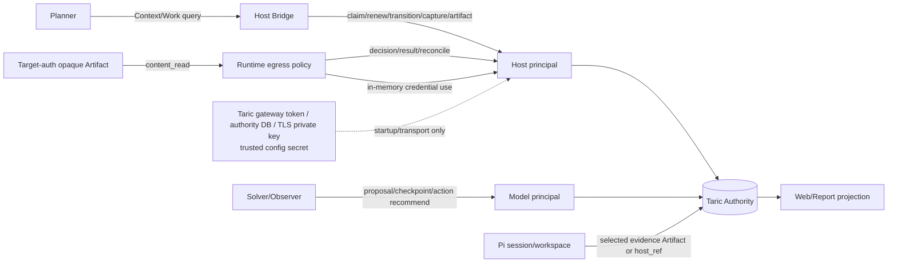

# BreachWeave 优化方案：以 Taric 1.0.3 构建可恢复的授权渗透测试控制面

## 1. 文档目的

本方案把 BreachWeave 的 Taric 接入从“外置 Memory/Idea 存储”推进到“Taric 管理治理事实、BreachWeave 管理执行”的完整边界。方案基于：

- Taric GitHub `main` 最新提交 `2314880`（2026-10-30）。仓库当前没有 GitHub Release tag，因此以源码组件版本 `1.0.3` 作为发布基线；不能写成 npm 或 GitHub Release 已发布。
- Taric API `1.3.0`、adapter `1.1`、schema `1.0.0`、`authority-storage/3`、`authority-sql/4`，57 个 operation。
- 当前 BreachWeave 工作区的 ChallengeManager、Taric adapter、Host Bridge、`AuthorizedPentestGovernance`、Web API 和现有运行材料。

相关上游依据：[Taric 最新提交](https://github.com/m-sec-org/Taric/commit/2314880)、[Taric README](https://github.com/m-sec-org/Taric/blob/main/readme.md)、[Agent Integration](https://github.com/m-sec-org/Taric/blob/main/docs/agent-integration.md)。

本方案不是 Taric 的替代设计。Taric 不运行模型、不启动 worker、不执行目标请求、不发放授权，也不负责目标凭据的签发、验证、刷新、轮换、撤销或保留生命周期。Taric 仍可以在授权 task-session 内把目标系统认证材料作为 opaque Artifact 原文存储，并仅向显式获 `content_read` 的可信 host/operator 提供读取能力；凭据来源和使用策略仍由 BreachWeave、operator 或独立凭据系统负责。

本次复审的四个结论是：

1. Taric 作为外置记忆扩展和唯一治理事实源的目标架构可以达成，但当前 BreachWeave 尚未完成事实切换。
2. Taric 支持并应启用授权 task-session 的 Artifact 原文存储；当前 BreachWeave 业务仍未把 `commitArtifact()` 接入 Taric catalog/session。
3. 渗透测试目标凭据由 Taric 的绑定 task-session Artifact 承担原文存储和 `content_read` 读取边界，不放进普通领域 JSON 或模型视图。
4. Taric gateway token、authority DB 凭据、TLS 私钥等是独立接入配置 secret；本机开发使用 fixture/local profile，不因生产部署、责任人或轮换条件阻塞功能实现和验收。

## 2. 目标和非目标

### 2.1 目标

完成迁移后，Taric 是以下内容的唯一事实源：

| 事实 | Taric 对象 | BreachWeave 的职责 |
| --- | --- | --- |
| 授权范围和目标版本 | Engagement、Scope、Resource、Revision | 将项目/挑战业务 ID 映射为稳定 ID，执行目标请求 |
| 测试计划和租约 | WorkItem、WorkRun、Attempt、Checkpoint | Planner 生成计划，worker 调度和工具运行 |
| 观察和证据 | Observation、Evidence、Artifact catalog 与完整性元数据 | 采集、语义校验、报告投影和外部依赖管理 |
| 覆盖和关闭依据 | Coverage cell、`coverage.gate`、审计水位 | 将 gate 结果投影到 Web/报告，执行人工关闭 |
| 动作审计 | ActionIntent、host decision/result/reconcile | 在真实 egress 路径强制授权，处理 unknown |
| 候选和结论 | Proposal、Admission、Review、Claim/Finding | 模型提出候选，operator/reviewer 处理信任晋升 |
| 渗透测试目标系统认证材料 | 绑定 Engagement/task-session 的 Taric-managed opaque Artifact 原文、metadata、content ref 和 hash | 按授权会话取用，仅读入目标执行路径，不把原文复制到模型或普通事实记录 |

Pi session JSONL、容器、workspace、活动端口、模型调用和运行时缓存仍是 BreachWeave 的执行态，不是任务事实源。目标凭据原文是专门的 Artifact 例外：通过 task-session spool 进入 Taric-managed content；普通 session/workspace 不因此整体迁移。Taric gateway token、authority DB 凭据、TLS 私钥/证书私密材料、registry/outbox key 等接入配置凭据只存于可信 host/gateway 配置 secret，不属于任务 Artifact 或 canonical state。

**当前与目标的判定。** 目标架构可以让 Taric authority 加 Taric-managed Artifact content 成为授权渗透测试的唯一事实源；Web、Planner、stats、challenge 文件和本地 Map 只能是可删除、可重建的 projection/cache。当前实现尚未达到该状态：Planner/报告状态仍依赖本地挑战文件，治理 runs/coverage/reviews/readSeq 仍有进程内 Map，`commitArtifact()` 仍写本地 `artifactRoot`。因此本方案中的“唯一事实源”是迁移目标，不是当前完成声明。

### 2.1.1 凭据边界

| 凭据类别 | 存储对象/位置 | 允许路径 | 明确不承担的职责 |
| --- | --- | --- | --- |
| 目标系统认证材料：用户名、密码、目标 token、Cookie、SSH key、SSO 材料等 | 授权 Engagement 绑定的 task-session Taric-managed opaque Artifact；Artifact catalog 只保存 ref、类型、hash、绑定和完整性元数据 | `artifact.session.bind` → `artifact.store.begin/append/commit`；仅显式获 `content_read` 的可信 host/operator 通过 `artifact.content.read` 按需读取，临时注入 egress runner | Taric 不解析、脱敏、扫密、签发、验证、刷新、轮换、撤销或制定保留/删除策略；这些由 BreachWeave、operator 或凭据系统负责 |
| Taric 接入配置凭据：gateway token、authority DB 用户/密码、TLS 私钥/证书私密材料、registry/outbox key | trusted host/gateway 的配置 secret 或 secret store | 仅用于 Taric 启动、transport、authority 和认证 | 不得进入任务 Artifact（包括目标凭据 Artifact）、Taric canonical record、model/context、checkpoint、Web 响应、诊断、日志、outbox 或报告 |

目标凭据不是 Engagement、Resource 或 Observation 普通 JSON 字段，也不是让 Taric 发证；承担原文存储职责的对象是绑定授权会话的 Artifact。模型、Solver、Observer model 通道只可看到 allowlisted metadata/ref/hash，不能获得原文或 `content_read`。

### 2.2 非目标

- 不把 Taric 变成 agent scheduler、tool runner 或 egress firewall。
- 不把普通 `tool_result` 自动提升为 Observation、Evidence 或 Finding。
- 不用 `snapshot.export` 代替数据库与 Artifact spool 灾备。
- 不把本机功能验收与多主机生产能力混为一谈；生产 profile 仍需额外的 profile conformance、凭据保护和恢复演练。

## 3. 当前基线和问题

### 3.1 Taric 1.0.3 新能力

1. WorkItem 必须先经过 proposal/admission，再由 `work.query` 固定 `read_seq` 分页后 claim；分页结果带 active Attempt 定位。
2. `work.resume` 检查 owner、lease、generation 和 premise；恢复失败返回 `blocked/replan_required`，不会自动重启 worker。
3. 四种接入路径（Bun in-process embedding、Unix socket、loopback TLS TCP、HTTPS）共享 operation registry 和身份边界；请求体不能伪造 principal。
4. adapter recovery 只做一次有界重试：已知 pre-dispatch 失败可重试；可能已 dispatch 的请求仅对 registry 幂等操作且带相同 idempotency key 时重试；否则返回 `indeterminate`。
5. Coverage 使用稳定维度和 expected-version CAS；正向 cell 缺 canonical Evidence 仍是 gate gap，`not_applicable` 必须有理由。
6. Action 的 `unknown` 只能由显式 reconcile 结束；普通结果回报不触发目标动作重放。
7. Artifact 支持 external `host_ref` 和 Taric-managed session spool。`taric_stored` 的 staged 内容在 commit 前不可读，commit 后可由显式 `content_read` capability 读取原文；run-bound 发布校验 WorkRun、Attempt、generation 和 owner。external 字节不会被 Taric 拉取或验证，因此不能作为目标凭据原文的唯一恢复来源。
8. Context、Work、Coverage 等查询使用绑定 principal/Engagement/filter 的 cursor 和 read watermark；通知只是补查提示，断连或截断不能解释成空集。

### 3.2 BreachWeave 当前状态

- 普通 ChallengeManager 已使用 Taric Memory/Idea claim proposal，并有分页、去重和 proposal outbox；Planner、attempt、submission、`scanned` 和统计仍由本地挑战文件决定。
- Solver 事件会尝试走 `capture.observation`，但没有可信 Resource、statement 和 committed Artifact refs 时应保持 host audit-only；不能把失败的 callback 写成 authority Evidence。
- `AuthorizedPentestGovernance` 已封装 Work、Coverage、Artifact、Review、Admission、Checkpoint 和 close，但 runs、coverage、reviews、readSeq 仍保存在进程内 Map，`commitArtifact()` 仍写宿主本地加密目录。
- Host Module 已暴露 `artifact.session.bind`、`artifact.store.*` 和 `artifact.content.read` 的 host-only 操作，但当前治理业务尚未把目标凭据或普通关键证据接入 Taric catalog/session；现有 `readArtifact()` 的 `content_read` 测试验证的是本地治理存储能力，不等于 Taric authority 已成为原文事实源。
- `project_bound` 当前被拒绝，local gateway 使用共享 Engagement。project key 过滤是应用层命名空间，不是 Taric 授权隔离。
- 当前工作区的 `compatibility.ts`、runbook、内部 registry 文档和 `docs/taric-verification.json` 已切到/验证 Taric 1.0.3；verification report 证明当前工作区的 typecheck、focused/core tests 和 build，不证明真实 gateway、目标执行或多主机部署。既有 smoke 报告仍包含旧的 1.0.1 历史证据，P0 必须补当前 1.0.3 host conformance。
- 已修复 embedded adapter 的角色分流：Host Bridge 以显式 `model`/`host` role 调用 adapter，host-only operation 不再因接入路径选择错误 principal。该修复仍需四种接入路径的统一 conformance。

### 3.3 主要差距

| 编号 | 差距 | 后果 |
| --- | --- | --- |
| G1 | challenge 未映射为 Resource/Revision、Coverage 和 WorkItem | 不能使用 Taric lease、fencing、gate 和恢复 |
| G2 | 共享 Engagement 未提供硬隔离 | 跨项目撤权和审计边界依赖标题/过滤约定 |
| G3 | 本地 `scanned` 和 Planner 仍是完成权威 | Taric coverage gate 与报告 close 可能冲突 |
| G4 | 关键 Artifact 尚未进入 Taric catalog，目标凭据仍未走 task-session，Observation 没有完整 Evidence 链 | 报告和目标凭据原文不可从 Taric authority 恢复，证据来源不可验证 |
| G5 | governance Map 不能跨进程恢复 | 重启后无法可靠定位 Attempt/generation |
| G6 | adapter 还没有完整接入 Taric 1.0.3 recovery 语义 | 非幂等超时可能被错误重试或静默丢失 |
| G7 | Planner 未消费 Context Pack 和固定读取水位 | solver 看到的上下文可能分页漏项或过期 |
| G8 | egress 授权仍未在每次真实连接路径强制执行 | Action 记录不能证明动作被允许或阻止 |

详细证据见 [Taric 唯一事实源差距分析](./breachweave-taric-sole-authority-gap-analysis.md)。

## 4. 目标架构



### 4.1 Transport选择

首期目标是 `single_host_sqlite` 单 authority。推荐顺序：

1. 本机可信 Bridge 使用 Taric Unix socket proxy；
2. 当前 supervisor 若只提供 TLS listener，则先使用 loopback TLS TCP，按同一 operation matrix 验收；
3. HTTPS 用于后续远程 host，记住它是 request/response，不提供 subscription；
4. embedded Bun 可作为本机 `local_development` profile；完整 role-routing conformance 是生产 profile 的启用条件，不阻塞本机功能实现和验收。

本机 `local_development` 可以使用 single-host SQLite、共享开发 Engagement、固定 fixture gateway token 和本地 fixture 目标凭据；单一开发 host 可以代表 host/operator，reviewer/person owner 可用 fixture 或不启用。它只要求角色边界、绑定校验、Artifact 原文 round-trip 和投影可恢复。`production_hardened` 才要求 per-project provisioning、真实 token rotation/revoke、TLS PKI、PostgreSQL、多主机和跨机恢复。

`single_host_sqlite` 和 `multi_host_authority` 是 Taric authority profile，不是接入路径；`local_development` 和 `production_hardened` 是本方案的验收档位，不是 Taric 内置 profile。`multi_host_authority` 是独立的 PostgreSQL authority deployment，属于 `production_hardened`，必须有当前源码 digest 匹配的 runtime conformance、schema/lease health、token 撤销、断网恢复和 DB+spool 备份证据；这些条件不阻塞本机 `local_development` 功能验收。

### 4.2 身份模型

- `hostPrincipal`：BreachWeave Bridge、Runtime 和 operator host 写入；可执行 Work、Coverage、Artifact、Action host result 和 capture。读取目标凭据原文仍需额外显式授予 `content_read`，不能从 host 角色自动推导。
- `modelPrincipal`：Solver/Planner 读取 Context/Resource/Evidence/Work，提交 claim/checkpoint/action recommendation；不获得 admission、host state、raw content、`content_read` 或高风险 action 写入。
- `reviewer/operator`：独立处理 review、admission、L2 晋升和 close。
- Taric gateway token、authority 连接凭据和 TLS 私钥与目标凭据 Artifact 分开保存；前者仅留在 trusted host/gateway config secret，后者按 task-session Artifact 合同存储。token 长度、绑定和轮换属于生产配置策略，不是本机功能验收前置条件。

## 5. 领域映射和数据合同

### 5.1 稳定 ID

所有 ID 由宿主生成并幂等保存：

```text
project_id -> engagement_id
challenge_id + asset_id -> resource_id / revision_id
resource_revision + category + operation + identity + conditions -> coverage_cell_id
coverage_cell set + acceptance -> work_item_id
work_item_id -> work_run_id -> attempt_id -> checkpoint/artifact/evidence
```

Taric 的 `resource_refs` 是调度提示，不是目标资源锁。跨 WorkItem 的目标互斥、速率、身份和时间窗由 BreachWeave scheduler/egress policy 负责。

### 5.2 Work bootstrap

每个新 challenge 的初始化顺序固定为：

1. operator/host 建立或解析同 Engagement 的 canonical Resource/Revision；
2. 以稳定 `proposal_id`、`client_request_id` 和 `idempotency_key` 提交 `subject_type=work_item`；
3. 由受审计的 host/writer/operator admission 路径完成 `admission.evaluate` / `admission.commit`，将 pending WorkItem proposal 变成可查询的 canonical WorkItem；
4. `work.query` 以固定 `read_seq` 分页获取 admitted WorkItem；
5. Host `work.claim` 创建 WorkRun/Attempt；
6. worker 启动后持续 `work.renew`，退出时 `work.transition`；
7. 每次 checkpoint、action、artifact publish 携带 owner、WorkRun、Attempt 和 generation。

Coverage cell 可以由一个 WorkItem 关联多个，但不能替代 WorkItem。未 admission 的 proposal 不得 claim。
Checkpoint 仍必须是 allowlisted、secret-free 的恢复状态；目标凭据只能存在专用 Artifact content，不得嵌入 checkpoint、proposal 普通字段或 task prompt。

### 5.3 Observation/Evidence/Artifact 与目标凭据

`capture.observation` 只接受严格 DTO：Resource UUID、`observed_at`、非空 statement、limitations 和已提交 Artifact refs。Artifact ref 不是 canonical Evidence；Evidence 记录仍要经过 Taric 的领域写入/提案治理。普通工具输出缺少这些语义时留在宿主审计或作为 Artifact，不伪造 Resource。

普通关键报告和工具结果优先使用：

```text
artifact.session.bind
  -> artifact.store.begin
  -> append (bounded chunks)
  -> artifact.store.commit
  -> Evidence/Observation reference
  -> Finding/Claim proposal
```

Taric 对 opaque payload 不做业务解析、脱敏或扫密；存储实现可以提供加密和完整性保护，但不改变 payload 的 opaque 语义。对普通证据，BreachWeave/宿主负责 ACL、报告语义、外部依赖、保留和删除策略；external `host_ref` 只表示未验证外部内容，不能作为完整恢复证据。

目标凭据必须使用专用 task-session Artifact 流程：

```text
credential producer/operator
  -> artifact.session.bind (Engagement + task session; mode=host-session or run-bound)
  -> artifact.store.begin(payload_kind="text"|"binary", category="target-auth", storage_mode="taric_stored")
  -> artifact.store.append (bounded raw bytes)
  -> artifact.store.commit
  -> content_read(host/operator only)
  -> in-memory target egress runner
```

`host-session` 用于凭据不依附某个 WorkRun；`run-bound` 必须同时提供当前 WorkRun、Attempt、generation 和 owner，并通过当前 authority fence 校验。宿主必须在绑定时明确选择模式，不能仅凭 task session 推断运行归属。

当前 Taric Artifact deployment profile 是 `local_process_crash`：内容 spool 与 authority catalog 分开保存，支持进程崩溃/重启后的完整性校验；`run-bound` publication 还会校验运行归属和 generation。该 profile 不提供断电耐久保证；PostgreSQL 只共享 authority 元数据，不自动复制 spool。需要恢复保证时，authority DB 与内容 spool 必须一起备份和恢复。

Taric 保存 opaque 原文、ref、hash、manifest 及 Engagement/session 绑定；使用 `run-bound` 时还保存并校验 WorkRun/Attempt/generation/owner 归属。模型视图、Observation/Evidence 普通字段和诊断只保存引用或 allowlisted metadata。Taric 不负责目标凭据的签发、验证、刷新、轮换、撤销、保留或删除决定。`host_ref` 可用于明确的非权威大对象依赖，但不能替代目标凭据的 Taric-managed 原文存储。

### 5.4 Coverage 和 close

每次 `coverage.record` 使用 expected version；维度不可修改。正向结果没有 canonical Evidence 时保持 gap，`not_applicable` 必须写 reason。`coverage.gate` 返回 decision、gaps、visibility 和同一个 read watermark。

报告 close 必须绑定：Engagement、scope/resource revision、coverage gate `read_seq`、由 host/review pack 生成的 Evidence snapshot hash 和 report Artifact digest。`coverage.gate` 原生只按 Engagement 返回 decision/gaps/visibility/read watermark，不接受 BreachWeave 的 challenge manifest 参数；共享 Engagement 的子集过滤由宿主完成。Web 的 `scanned` 只能是投影字段，不能写回作为完成事实。

### 5.5 Action 和恢复

动作链固定为：

```text
action.recommend -> host-decision(authorized/denied)
  -> target execution -> host-result(executed/failed/unknown)
  -> action.reconcile（仅处理 unknown）
```

Taric 不执行目标动作，也不自动重放 unknown。BreachWeave 必须在真实 socket/proxy/DNS/HTTP client 路径执行 scope、端口、协议、IPv4/IPv6、时间窗和授权校验。

重启流程必须先完整消费 pinned cursor，再对 active run 调 `work.resume`：

- premise 通过：继续相同 generation；
- lease 过期或 host 丢失：reclaim，旧 Attempt 标为 lost，generation 增加；
- premise 失败、无 checkpoint 或 cursor 不完整：`blocked/replan_required`；
- 旧 generation 的迟到结果必须拒绝或 quarantine。

## 6. 分阶段实施

### P0：合同、版本和映射

- 重新生成 Taric 1.0.3 tarball/clean-consumer/verification report，锁提交、SRI、API、adapter、schema、storage 和 SQL 版本；本机可用 fixture artifact/config 完成功能测试。
- 选择 Unix socket 或 loopback TLS 作为单机首期 transport，先完成 `local_development` 的 role/Engagement 负向矩阵；HTTPS、跨机和其他 profile 另行验收。
- 本机允许 shared Development Engagement；per-project Engagement、provisioning、token rotation/revoke 属于 `production_hardened`，不能作为本机功能前置条件。
- 定义 Project/Challenge/Resource/Revision/Coverage/WorkItem 稳定 ID 和迁移表。
- 建立每个 operation 的 principal、幂等性、重试、`indeterminate` 和 reconcile policy。

硬门：旧版本或错误 digest 启动直接 blocked；未 admission 的 WorkItem 不可 claim；请求体伪造 principal、跨 Engagement 引用和 model 调 host-only operation 全部拒绝。

### P1：Work 生命周期和恢复

- 在 ChallengeManager/Host Bridge 接入 claim、renew、transition、reclaim、resume 和 generation fencing。
- 保存 recovery locator：`project/challenge/work_item/work_run/attempt/generation/task_session/session_id`。
- 让 governance Map 降级为缓存；从 Taric `work.query` 和 `work.resume` 重建。
- 先双写并对账，再将 Planner 的启动/完成读路径切换为 Taric projection。

硬门：并发 claim 只有一个 owner；kill/restart 后旧 generation 的 transition/checkpoint/action/artifact 全部拒绝；重启可继续或明确 `blocked/replan_required`。

### P2：Artifact、Evidence、Observation、Action

- 将目标凭据和需要权威恢复的关键 Artifact 的 `commitArtifact()` 从本地 payload 写入改为 Taric session/store；目标凭据不得以 external `host_ref` 替代原文。普通大对象才可在明确恢复责任后使用 external reference。
- 为工具结果建立严格事件适配器；无 Resource/Artifact 语义的事件只写 host audit。
- 把 egress policy 接到实际连接路径，写 action decision/result，建立 unknown reconcile queue。
- 为非幂等 capture/action/artifact commit 记录 indeterminate，不进入自动重放 outbox。

本机功能硬门分两组：

- 目标凭据 Artifact：`category=target-auth`、`payload_kind=text|binary` 的原文 commit 后，显式获 `content_read` 的 host/operator 可在 `local_process_crash` 范围内于进程重启后恢复；无 capability、model、跨 Engagement 和未 commit 读取全部拒绝；`host-session` 拒绝运行绑定字段，`run-bound` 拒绝错误 owner/generation；原文不出现在 model view、诊断、日志或接入配置。
- 普通证据 Artifact：`artifact_catalog`/session 有真实数据，Evidence/Observation 只引用同 Engagement 的 committed Artifact；positive-without-evidence 和 unknown action 正确形成 gap/pending。

### P3：唯一事实切换

- Planner/Solver context 从 bounded Context/Work/Resource/Coverage query 生成；所有 cursor 记录 read watermark。
- Web、stats、Planner snapshot、challenge `scanned` 和报告索引变成可删除、可重建 projection。
- report close 只接受 Taric gate + evidence snapshot + revision 条件。
- 对 proposal/admission/review 建立审计链，区分 L0 candidate、L1 admitted、L2 independent verification；本机可由 fixture host 完成 admission/review，真实 operator/reviewer UI、责任人和独立复核属于生产 profile。Taric `review.submit` 是 reviewer-only；host 负责 `review.pack` 和 admission，当前 governance 测试中的 host review 只是 fake adapter 行为，不能当作真实 reviewer 认证。

目标架构硬门：删除本地投影后，authority 可重建相同任务状态、覆盖缺口、报告引用和 close 判定；通知丢失、cursor 失效或分页截断不会产生假空集。该切换可在本机 profile 完成，不等待多主机生产硬化。

### P4：生产 profile 的项目隔离、多主机和灾备（非本机前置）

- 完成 per-project Engagement provisioning、principal/token rotation、撤销和跨项目数据负向测试。
- 仅在 PostgreSQL activation evidence、lease/fencing、双 host、断网恢复、Artifact 路由和 token revoke 全通过后启用多主机。
- 备份 authority DB、Artifact content root、cursor key 和配置摘要；恢复后运行 doctor/verify，重新签发 lease/generation。

## 7. 验收和观测

每阶段保存 machine-readable report，区分 Taric upstream 测试、BreachWeave unit test、host conformance、本机 fixture/local smoke、真实 gateway smoke 和生产部署证据。生产部署证据不得反向成为本机功能验收的前置条件。

本机 `local_development` 必须验收：

- Taric authority 绑定、WorkRun/Attempt/generation fencing、模型与 host/operator principal 隔离；
- `artifact.session.bind` → `store.begin/append/commit` → `content_read` 的目标凭据原文 round-trip，含进程重启恢复和幂等；当前 Taric 不提供断电耐久保证，只有上游引入并验证相应合同后才能验收该项；跨机 spool 恢复另按生产 profile 验收；
- 无 `content_read`、model、跨 Engagement、未 commit 的读取拒绝；`host-session` 拒绝运行绑定字段，`run-bound` 拒绝错误 owner/generation；普通 metadata/list/session output 不泄露 payload；
- Artifact ref 可被 Observation/Evidence 引用，本地 projection 删除后可由 Taric metadata/content 重建；
- gateway token、authority DB 凭据、TLS 私钥不出现在任务 Artifact、model/context、checkpoint、诊断、日志、outbox 或报告。

以下是 `production_hardened` 的后续门槛，只阻止生产/多租户/跨机声明，不阻塞本机开发和验收：per-project Engagement provisioning、真实 token rotation/revoke、TLS PKI、PostgreSQL、多 host fencing、跨机恢复、持久化 egress/firewall、人工 reviewer/责任人流程和生产 retention/DR 演练。

至少输出：

| 指标 | 通过条件 |
| --- | --- |
| Contract | 版本、SRI、policy digest、adapter contract exact match |
| Isolation | model/host/reviewer 角色、Engagement 和 body identity 负向测试一致 |
| Paging | pinned `read_seq`、cursor 绑定、断连补查、omitted/truncated 可诊断 |
| Work | admitted→query→claim→renew→transition，单 owner，旧 generation fence |
| Recovery | resume premise、reclaim、blocked/replan_required、Attempt 定位可重建 |
| Evidence | committed Artifact、Evidence refs、Resource/Revision 同域校验 |
| Coverage | CAS、not-applicable reason、无证据 positive gap、gate watermark |
| Action | authorized/denied、executed/failed/unknown、显式 reconcile，无自动重放 |
| Projection | 删除本地 snapshot 后能由 Taric 重建，不改变 close 判定 |

日志只记录 operation、event ID、principal 摘要、错误码、read watermark 和有界诊断；除专用 Artifact 原文写入通道外，不记录目标凭据或 Cookie。Taric 接入配置凭据、完整 HTTP 响应、Flag 和完整模型提示词永不进入日志；诊断也不得返回任何 Artifact 原文或接入配置 secret。

## 8. 风险和决策

| 决策 | 推荐 |
| --- | --- |
| Profile | 本机使用 `local_development`；生产使用 `production_hardened`，两者验收门槛分开 |
| Engagement 粒度 | 目标是 per-project；shared Engagement 可用于本机开发，不阻塞功能验收 |
| 首期 transport | Unix socket；现有 supervisor 先用 loopback TLS，HTTPS 留给远程 host |
| embedded Bun | 本机直接用于 `local_development`；完整四种接入路径 conformance 是生产启用条件 |
| 目标凭据 Artifact | 默认 Taric-managed `taric_stored`，绑定 task-session；`content_read` 只授予可信 host/operator |
| 普通 Artifact | 关键报告/工具结果优先 Taric-managed；大对象可 external，但必须声明未验证和恢复责任 |
| full tool event | 不默认存入 Taric；关键事件 Artifact/Observation，噪声留 host audit |
| 多主机 | PostgreSQL + server-fenced lease + shared/routeable spool 全部验收后启用 |

最终验收标准不是“Taric API 能调用”，而是：在本机开发 profile 中，目标凭据原文能由 Taric task-session Artifact 以 `content_read` 受控恢复，接入配置凭据完全隔离，重要任务事实和 Artifact 元数据可从 Taric 重建；在生产 profile 中，再追加跨项目、跨主机、轮换、撤销、egress 和灾备证据。任何模型候选、旧 Attempt、无证据 positive、未授权动作和不确定写入都不能静默变成完成事实。
