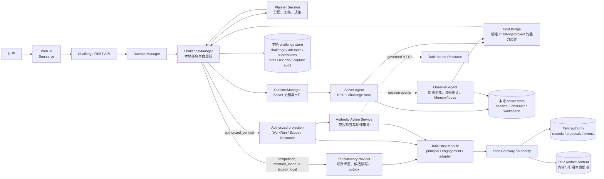
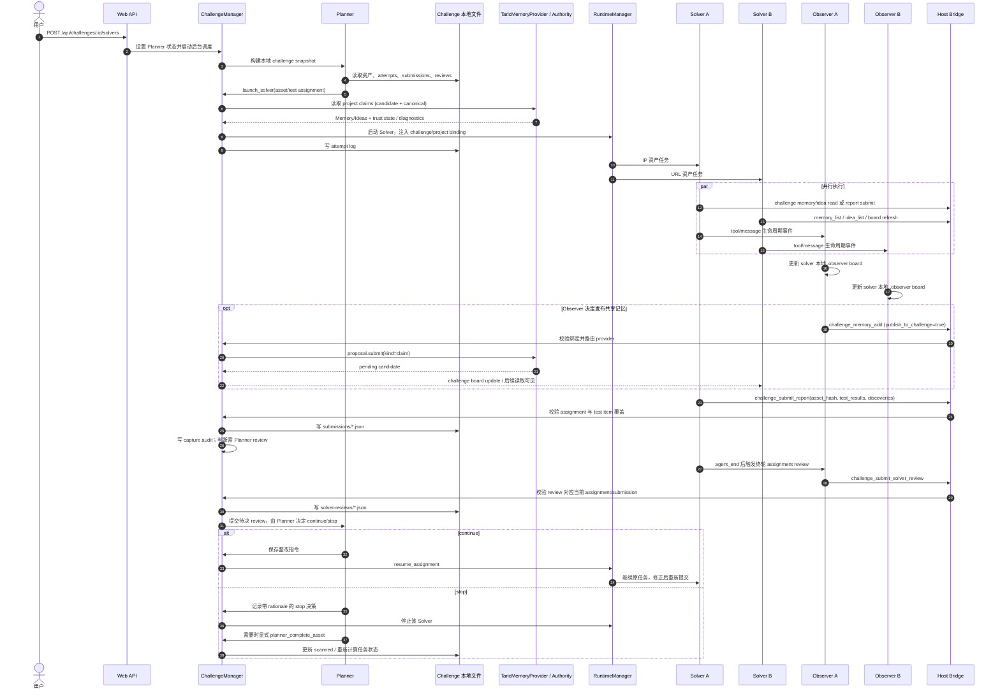
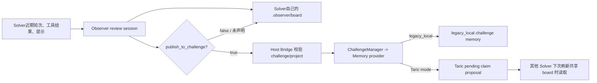
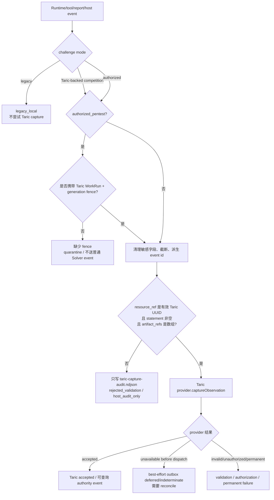
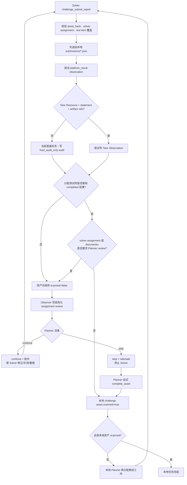
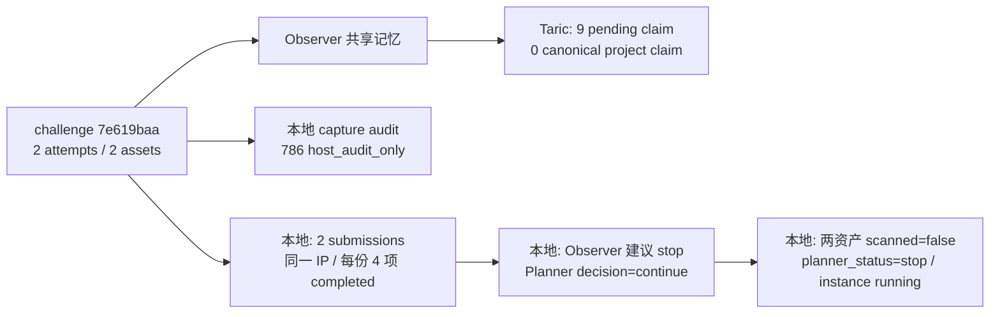
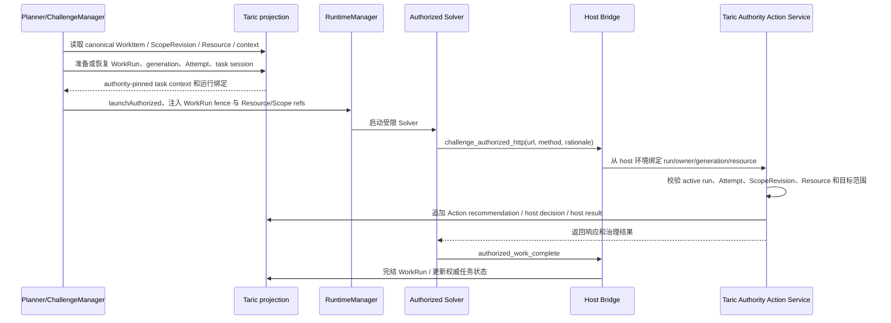

# BreachWeave 执行数据流与 Taric 集成实况

本文按当前工作区源码和本机任务 `7e619baa` 的运行记录，说明 BreachWeave 调度、执行、复核、记忆和 Taric authority 之间的真实边界。它区分普通 `competition` 任务的 Taric 共享记忆路径与 `authorized_pentest` 的 authority-governed 路径；两者接入深度和完成语义不同。

## 证据范围

- 源码结论针对当前工作区，包括尚未提交的实现变更；不要把它等同于某个 Git commit 或历史部署包。
- 本机 Web 首页 `http://127.0.0.1:3000/` 可访问。任务详情、attack-timeline、memory-health API 对无认证请求返回 `401`；本次没有读取认证材料，因此任务运行事实来自 `~/.tch-agent` 文件和 Taric SQLite 的只读统计查询。
- `7e619baa` 的文件和 Taric proposal 在任务运行中仍持续变化。下文数字是 2026-11-04 13:21:07 UTC 左右的采样，不是最终结果。文档刻意不包含报告正文、proposal 正文、目标凭据或认证数据。

## 结论

Taric 在 BreachWeave 中承担两种不同职责：

1. **普通 CTF/competition：跨 Solver 的共享记忆与治理候选层。** 启动 Solver 时把 Taric Memory/Ideas 摘要放入任务；Observer 选择发布时，将共享 Memory/Idea 写成 Taric `claim` proposal。项目可以读取 pending candidate 和 canonical/admitted claim，并通过 `trustState` 区分二者。它增加了跨 Solver、跨会话的可查询共享状态，但不会自动成为已验证事实。
2. **授权渗透测试：任务和动作的 authority control plane。** 当前代码可从 Taric 投影 WorkItem、ScopeRevision、Resource、Evidence、Coverage 和 Report 上下文，以 WorkRun/generation fence 绑定 Solver，通过受治理 HTTP 动作写入 Taric Action 决策及结果。这条路径比普通 CTF 深，但仍有证据产物、观测和最终覆盖关闭方面的缺口。

对任务 `7e619baa`，第一种职责实际产生了可见结果：项目下有 9 条 pending claim proposal、0 条对应 canonical claim。Solver/Observer 确实读写过共享记忆。自动执行事件捕获则没有进入 Taric：本地 audit 在 13:21:07 UTC 有 786 条记录，全部为 `rejected_validation / host_audit_only`。报告、attempt、统计、资产扫描状态及 Planner 调度仍由 BreachWeave 本地任务数据决定。

## 系统架构



图里的两组数据平面不要混为一谈：

- `ChallengeManager -> Local` 是普通任务的调度和结果事实路径。即使它同时调用 Taric，本地 attempt、submission、stats 和 challenge 状态仍是 competition 任务生命周期的依据。
- `ChallengeManager -> TaricMemoryProvider -> Taric` 是 Memory/Idea 共享路径，不是 challenge 文件系统的镜像。
- 授权项目读取 Taric projection 并通过 Action service 执行受限 HTTP。普通 `challenge_submit_report` 不能代替授权路径的 Evidence、Coverage 或 close/report 治理。

### 角色与权威边界

| 角色/组件 | 负责什么 | 不负责什么 |
| --- | --- | --- |
| Planner | 从 challenge snapshot 和复核记录做 Solver 分配、`continue/stop` 决策、必要时完成资产 | 不直接把普通报告写成 Taric canonical Evidence |
| Solver | 在分配的资产和 test item 范围内执行、报告、读取共享 Memory/Ideas | 不持有 Taric authority principal/token，不自行批准自己的结束 |
| Observer | 整理 Solver board；周期性观察；终轮审计已提交分配和报告 | 不等于 Taric reviewer/admission，不单独批准任务完成 |
| Host Bridge | 校验 challenge/project 绑定并代调用 Manager；屏蔽模型自带 authority 身份 | 不让模型伪造可信 Resource 或 WorkRun provenance |
| TaricMemoryProvider | 按项目读 candidate/canonical claims；提交 Memory/Idea claim proposal；不可用时按模式处理 | 不管理普通任务的 attempt、submission、统计或扫描完成状态 |
| Taric Gateway/Authority | principal/engagement 授权、proposal、canonical record、治理事件和 Artifact 管理 | 不会自动接收没有满足 observation contract 的 Solver 日志 |
| 本地 challenge store | 普通任务定义、资产、attempt、submission、stats、solver review 和 capture audit | 不代表 Taric canonical record 或授权审计链 |

## 一次执行的时序



普通 Runtime 事件也会触发 `captureSolverEvent()`，但这不表示它们进入 Taric：Manager 先进行敏感字段清理，再经过 Resource/statement/artifact_refs 校验；失败就只追加本地 audit。图中的 `proposal.submit` 和 observation capture 是两条不同写入路径。

## 核心数据流分支

### Memory/Idea 模式分支

```mermaid
flowchart TD
    Challenge[读取 challenge/project binding]
    Mode{memory_mode}
    Local[legacy_local File provider]
    Bound{trusted composite project binding 有效?}
    Provider[创建/复用 TaricMemoryProvider]
    Health{Taric health / 可用性}
    Required[taric_required\n不可用则阻断读写/启动]
    Best[taric_best_effort]
    Read[读取 proposal.list + resource.query(claim)\n以同一 read_seq 固定分页快照]
    Candidates[按项目 binding 过滤并标 trustState=candidate]
    Canonical[按项目 binding 过滤并标 trustState=admitted]
    Degraded[读取结果降级为空并标 degraded\n不回退到 local provider]
    Write[Observer/Manager 提交 Memory 或 Idea]
    Proposal[Taric proposal.submit\nsubject_type=claim / status=pending]
    Outbox[不可用时写加密 outbox\n仅适用于可安全重放的 proposal]

    Challenge --> Mode
    Mode -->|legacy_local| Local
    Mode -->|taric_best_effort 或 taric_required| Bound
    Bound -->|否| Reject[拒绝未绑定或不可信项目]
    Bound -->|是| Provider --> Health
    Health -->|不可用| Required
    Health -->|不可用| Best
    Health -->|可用，读取| Read
    Read --> Candidates
    Read --> Canonical
    Best --> Degraded
    Provider --> Write --> Health
    Health -->|可提交| Proposal
    Health -->|best_effort + 暂时不可用| Outbox
```

实现要点：

- 本机新建普通 challenge 在默认本地 Gateway healthy 且 Taric enabled 时，会合成 trusted `competition/local_practice` project，默认 `taric_best_effort`；显式 `legacy_local` 可退出 Taric 路径。参见 [manager.ts:1731](/Users/liuhongtao/development/BreachWeave/packages/core/src/challenge/manager.ts:1731)。
- 非 legacy 的 provider 必须有可信 composite project binding。`project_id` 用来约束 BreachWeave 内的项目读写；它与共享 Engagement 不是同一个概念，也不能把共享 Engagement 描述为天然的租户隔离。
- Memory/Idea 被转成 `kind=claim`、`status=proposed`、带“尚未 admitted”限制的 proposal。写入成功只说明 candidate 已提交，不代表 reviewer 已接受。
- provider 读取 `proposal.list` 与 `resource.query(kind=claim)`，用一致 `read_seq` 和有界分页读取，再按项目 binding 过滤。canonical 结果标 admitted，pending proposal 标 candidate。
- `taric_best_effort` 不等于本地文件 fallback：读取不可用时当前任务 prompt 会标记 degraded、不给 memory/ideas；写 proposal 可进入加密 outbox。`capture.observation` 不具备安全自动重放条件时会进入 indeterminate/operator reconciliation，而不是盲目重发。
- Taric Memory/Idea 的 update/delete 不等同于编辑本地 JSON；当前 provider 要求提交 correction proposal，删除留给 operator retention workflow。

### Observer 本地记忆与共享记忆分支



Observer 写入本 Solver board 是本地行为；只有 `publish_to_challenge=true` 才向 challenge 级 provider 发布。若 provider 是 Taric，发布对象进入 proposal 队列。Observer 的模型 review 不等于 Taric proposal admission。

### Host observation 捕获分支



注意 `authorized_pentest` 的 Runtime event 当前没有 WorkRun provenance 时会被隔离；不能用 Manager 本地递增计数替代 Taric Attempt generation。普通 competition event 即使被 sanitize，如果没有真实 Resource 引用、statement 和 Artifact 引用，也只形成本地 `host_audit_only`。因此“每条 Solver 事件都有 audit 行”不等于“Taric 已有 Observation”。

### 报告、复核与完成分支



对普通 competition，报告的校验和本地存储不依赖 Taric admission。当前源码中“有 Solver assignment 或有 discoveries”会让报告进入 Planner review 分支；即使 test_results 全部 `completed`，也不代表资产立刻 `scanned=true`。Planner 的 stop decision 与 `planner_complete_asset` 才推动本地完成状态。`Taric proposal` 或 `Taric capture audit` 不会替代这条状态机。

## 任务 `7e619baa`：运行截面

### 任务实际状态

| 项 | 采样观察 |
| --- | --- |
| 模式 | `competition`，`memory_mode=taric_best_effort`，本地合成 trusted project binding |
| 调度 | Planner enabled，challenge 的 `planner_status=stop`；challenge instance 仍为 running |
| 资产 | 1 个 URL + 1 个 IP；采样时两者均 `scanned=false` |
| 执行 | 2 个 attempt：`59b1d606` 分配 IP，`3c8a0b0f` 分配 URL；同一 Solver prompt/model |
| 报告 | 2 个本地 submission，均由 `59b1d606` 对同一个 IP 资产提交；两次各有 4 个 test_results 且均为 `completed`，discoveries 数分别为 5 和 6 |
| Assignment review | 有 1 条本地 Observer review：4 项 checklist 均 `verified`，同时有 3 项 concerns、2 项 remaining work；Observer 的 `suggested_decision=stop`，Planner 后续在 13:12:37 UTC 记录了 `continue` |
| Planner 状态结果 | 采样时 URL 和 IP 均未 scanned，challenge 的 `planner_status=stop`、instance 仍 running。此快照没有给出后续停止原因；不要把它等同于任务完成或 Taric close |

这里的 `suggested_decision=stop` 只是 Observer 建议。当前 Manager 明确拒绝带有 concerns、`missing` 或 `unsupported` 项目的 stop 决策；这条 review 有 3 项 concerns，因此 Planner 选择 `continue`，并且本地出现了第二份同资产报告。其后 challenge 文件显示 `planner_status=stop`，但 URL 仍未提交、两个资产仍 `scanned=false`；仅凭这些状态字段无法判断 Planner 为什么停止，也不能推断任务已完成。

具体存储位置：`~/.tch-agent/challenge/7e619baa/{challenge.json,attempts/,submissions/,solver-reviews/,stats.json,taric-capture-audit.ndjson}`；Solver 原始 session 和 Observer session 在 `~/.tch-agent/solvers/<solverId>/session/`。统计和 observer round 数都随着运行变化，应以文件内时间为准。

### Taric 在此任务真正做了什么

在 Taric `authority.sqlite` 中按该 composite project key 的标题前缀统计：**9 个 pending `claim` proposal，0 个对应 canonical claim record**。标题可识别出它们由两个 Solver 的 Observer 生成，类别包含 fact、evidence 和 hint。会话记录显示 Solver 使用过 `memory_list`、`idea_list`、`idea_search`、`board_refresh` 一类工具，且第二个 Solver 在本地运行 session 中读过共享 Memory。

因此可以确认两项实际价值：

- Observer 从执行过程提取的记忆可以跨 Solver 汇总到同一 Taric 项目命名空间；另一个 Solver 可读取它们，而不依赖前一个 Solver 的进程内存。
- 每条共享信息都有 candidate/admitted 状态边界。当前 9 条仍全部 pending，consumer 可以把它们作为线索，而不能当作已核实漏洞或 Taric Evidence。

同时也有重要限制：本次看到的是“写进 Taric proposal 并被查询到”，不是“经过 admission 后成为 canonical record”。该任务的共享 Engagement 是本机开发边界；复合 project key 参与 provider 过滤，但不能据此推断隔离级别等同独立 Engagement。

### Taric 没有接住的执行数据

`taric-capture-audit.ndjson` 在 2026-11-04 13:21:07 UTC 采样有 786 条：782 个 `tool_result`、2 个 `host_event`、2 个 `platform_result`。全部为 `rejected_validation`，code 均是 `host_audit_only`。这说明本次有大量事件到达 BreachWeave capture gate，但没有一个进入 `provider.captureObservation()`。

失败原因不是 Gateway 不可用，而是普通 competition 事件没有满足 Taric Observation 的实体关联契约：真实 Taric `resource_ref` UUID、非空 `statement`、`artifact_refs` 数组。代码选择把有限 audit 元数据保存在本地，不伪造 Resource，也不把未经结构化的工具输出当成 Taric Observation。故本次报告正文、完整工具日志、尝试过程和统计并未因此成为 Taric canonical records 或 Artifact。

### 任务证据的双轨结论



这次运行表明 Taric 在“共享 Memory 的持久化、跨 Solver 读取、候选状态表达”上发挥了作用；它在“端到端渗透事件留证、Artifact/Evidence 关联、任务进度和关闭判定”上没有发挥权威作用。两份报告都在 BreachWeave 本地落盘，但都属于同一个 IP 资产；URL 资产没有报告，两个资产仍未 scanned。Taric 的 proposal 数量和状态未决定本地任务完成。

## 两种 Taric 集成模式的差别

| 项目类型 | 数据/执行由谁主导 | Taric 实际参与 | 关键限制 |
| --- | --- | --- | --- |
| `competition` + `taric_best_effort` | BreachWeave 本地 challenge store、Planner、Runtime | Memory/Idea candidate 与 admitted claim 的读写；符合 DTO 时可尝试 capture | 普通日志大多没有 Taric Resource/Artifact 引用；capture 失败不阻断任务；本地状态才决定扫描与完成 |
| `competition` + `taric_required` | BreachWeave 管生命周期，Taric 为受保护操作提供 authority 前置条件 | Provider health、proposal/read 和受约束写入 | provider 不可用时应 fail closed；这仍不自动把普通报告变成 canonical Taric report |
| `legacy_local` | BreachWeave 本地 memory provider | 无 Taric Memory/Idea 路径 | 共享数据留在本地 challenge 文件 |
| `authorized_pentest` | Taric canonical projection + BreachWeave Runtime/host adapter | WorkItem、ScopeRevision、Resource、Evidence/Coverage/Report 上下文；WorkRun fence；受治理 HTTP Action recommendation/decision/result | 不读取普通本地 challenge 作权威 fallback；Runtime event 缺 WorkRun provenance 会 quarantine；动作闭环不等于完整 Evidence/Artifact/coverage close |

### 授权项目的独立执行链

当前源码中的授权执行比旧版“只有治理 helper”的描述更深入。其大致路径是：



这条链中，旧的普通 `challenge_submit_report` 被授权 Solver 禁用；Solver HTTP 通过 `challenge_authorized_http`，调用方身份和 WorkRun fence 由 host bridge 从受控环境取值。即便如此，当前代码仍把几个概念分开：

- Action recommendation/decision/result 可成为 authority 审计事件，但它们不自动生成 Evidence Artifact 或 coverage-cell 更新。
- 授权 Solver event 若没有 Taric WorkRun provenance 会 quarantine；本地 event counter 不是 Taric Attempt generation。
- Action response body 可返回给 Solver，但当前 projection 创建 Action service 时没有注入 ArtifactService；普通运行结果不能因此被描述成已经保存为受治理 Artifact。
- WorkRun 完成、Engagement coverage gate 可关闭、最终 canonical report/close 是不同状态。不能由某一 WorkRun completed 推导整项 Engagement 已关闭。

## 数据归属矩阵

| 数据 | 写入方与事实源 | Taric 关系 |
| --- | --- | --- |
| 普通 challenge 定义、资产、`scanned` | ChallengeManager；`challenge/<id>/challenge.json` | Taric 不判定普通任务是否完成 |
| Planner round/snapshot | ChallengeManager/Planner；`planner-last-round-<id>.json` 等 | 可以包含 Taric Memory 摘要，但不是 Taric record |
| Solver attempt | ChallengeManager；`attempts/*.json` | 普通模式本地索引；授权模式从 Taric work lifecycle 投影，不以本地 log 代替 authority |
| Solver 原始 session/tool log | Runtime/Solver；`solvers/<id>/session/*.jsonl` | 不自动复制到 Taric |
| Observer round、review queue、个人 board | Observer；`session/.observer/` | 本地状态；共享发布是另一条显式分支 |
| Solver assignment review / Planner decision | Manager；`solver-reviews/*.json` | 普通 competition 的本地 Planner 流程，不是 Taric admission |
| challenge Memory/Ideas | legacy provider 本地写；Taric 模式写 proposals/读 records+proposals | Taric 的主要 CTF 集成价值；candidate 和 admitted 必须分开解释 |
| 普通报告 submission | ChallengeManager；`submissions/*.json` | 只尝试 capture；提交本身不是 Taric report |
| 普通任务统计 | `refreshChallengeStats()`；`stats.json`、`solver-stats/*.json` | 不由 Taric 汇总或决定 |
| capture audit | ChallengeManager；`taric-capture-audit.ndjson` | 这是本地诊断记录，不是 authority event |
| 授权 Work/Scope/Action/coverage/report | Taric projection 与治理服务 | canonical authority 数据；不同于普通 competition 文件状态 |
| Artifact payload | Taric Artifact 服务/content lifecycle | 需显式 Artifact upload/binding；普通报告或 action response 不会自动变成 Artifact |

## 价值和未发挥价值

### 已体现的价值

- **共享上下文跨进程存在。** Observer 发布的候选记忆可以被另一 Solver 查询，不依赖单个 Solver session 生命周期。
- **可信度状态可见。** candidate 与 admitted 分开映射，避免把模型提案伪装成权威事实；authority read 使用 read watermark 和受限分页。
- **权限与项目绑定收敛在 host 侧。** Solver 通过 Host Bridge 请求 Manager 操作，不能携带自选 Taric principal/token 或 project binding。
- **授权执行具备 authority fence。** WorkRun/generation、ScopeRevision 和 Resource 用于约束请求与动作结果；相比直接将普通 Solver 工具输出称作审计数据更可核查。

### 当前没有实现或本次没有体现的价值

- **普通执行过程没有沉淀成 Taric Observation。** `host_audit_only` 数量再多也只是本地 capture audit；本次没有一个 task event 进入 Taric observation capture。
- **普通报告没有成为 Taric canonical report/Evidence。** `submissions/*.json` 是可靠的本地交付物，不是 Taric Evidence/Artifact 引用。
- **Memory proposal admission 尚未闭环。** 本次采样的 9 条候选均 pending，零条项目 canonical claim；它们提供线索，不提供事实确认。
- **普通任务完成不是 Taric authority decision。** `scanned`、Planner 状态和 task completion 都由本地 challenge 记录及复核工作流决定。
- **Best-effort 不是透明双写或自动 fallback。** Provider 异常时读取可能 degraded 且无本地 fallback；proposal 可入 outbox，但 observation 的不确定结果需要 reconciliation。
- **本机共享 Engagement 不是项目隔离边界。** 项目过滤依赖复合 project key 和标题/绑定规则；若需要严格跨项目授权隔离，应以 Taric Engagement/Scope 权限模型验证，不能仅依据 UI 的 project 列表。
- **授权动作结果还不等于完整证据包。** Action 审计、response body、Evidence Artifact、Coverage 更新和最终 close 要分别建立并验证链路。

## 复核数据的建议顺序

1. 读 `challenge/<id>/challenge.json`：确认 mode、memory_mode、project binding、资产及 `scanned`。
2. 读 `attempts/` 与 `submissions/`：按 solver id、asset hash 和 test item 还原分工及报告。
3. 读 `solver-reviews/`、Planner round 和 `.observer/`：区分 Observer 观察、Observer review、Planner 决策和 Taric admission。
4. 汇总 `taric-capture-audit.ndjson`：按 outcome/sourceKind/code 统计本地尝试捕获结果；不要把 audit 行当成 authority record。
5. 再查询 Taric `proposals` 与 `records`：按 project/engagement binding 分开 candidate 和 canonical；仅看标题或总行数不足以判断 admission。
6. 对授权项目检查 WorkRun、ScopeRevision、Action audit、Evidence Artifact、Coverage gate 和 report/close，各自都要有 authority 证据。

只读统计示例（不要查询或输出 proposition 正文）：

```sh
sqlite3 -readonly -header -column ~/.tch-agent/taric-gateway/authority.sqlite \
  "SELECT subject_type, status, COUNT(*) AS count
   FROM proposals GROUP BY subject_type, status ORDER BY subject_type, status;"

sqlite3 -readonly -header -column ~/.tch-agent/taric-gateway/authority.sqlite \
  "SELECT kind, trust_level, COUNT(*) AS count
   FROM records GROUP BY kind, trust_level ORDER BY kind, trust_level;"

jq -s 'group_by(.outcome, .sourceKind, .code) |
  map({outcome: .[0].outcome, sourceKind: .[0].sourceKind,
       code: .[0].code, count: length})' \
  ~/.tch-agent/challenge/<challengeId>/taric-capture-audit.ndjson
```

## 关键源码

- Daemon 初始化、Gateway、provider factory 和 Runtime event hook：[index.ts](/Users/liuhongtao/development/BreachWeave/packages/core/src/index.ts:29)
- 默认 competition project binding、provider 路由和健康状态：[manager.ts](/Users/liuhongtao/development/BreachWeave/packages/core/src/challenge/manager.ts:964)
- Taric claim proposal、candidate/canonical board 读取、read watermark：[taric-memory-provider.ts](/Users/liuhongtao/development/BreachWeave/packages/core/src/challenge/taric-memory-provider.ts:215)
- 普通 capture contract、audit-only 分支与 event bridge：[manager.ts](/Users/liuhongtao/development/BreachWeave/packages/core/src/challenge/manager.ts:1030)
- 报告提交、本地 submission、review gate 与扫描状态：[manager.ts](/Users/liuhongtao/development/BreachWeave/packages/core/src/challenge/manager.ts:1954)
- Observer review record、Planner continue/stop 和 Runtime resume/stop：[manager.ts](/Users/liuhongtao/development/BreachWeave/packages/core/src/challenge/manager.ts:2118)
- Solver 任务里 Memory/Ideas 和授权 Taric context 的注入：[manager.ts](/Users/liuhongtao/development/BreachWeave/packages/core/src/challenge/manager.ts:3319)
- Host Bridge Memory/report/authorized action 路由：[host-bridge-handler.ts](/Users/liuhongtao/development/BreachWeave/packages/core/src/challenge/host-bridge-handler.ts:220)
- Observer 的本地 board 与显式 challenge publish：[tools.ts](/Users/liuhongtao/development/BreachWeave/packages/core/src/solver/extension/challenge-observer/tools.ts:285)
- Observer 周期触发和 agent_end review：[observer-loop.ts](/Users/liuhongtao/development/BreachWeave/packages/core/src/solver/extension/challenge-observer/observer-loop.ts:407)
- Solver 等待 Observer/Planner 决策的完成门：[rpc-server.ts](/Users/liuhongtao/development/BreachWeave/packages/core/src/solver/rpc/rpc-server.ts:92)
- 授权项目 projection 与 WorkRun 上下文：[authorized-projection.ts](/Users/liuhongtao/development/BreachWeave/packages/core/src/challenge/authorized-projection.ts:130)
- Taric Action scope/fence、网络执行与 authority event：[authority-action-service.ts](/Users/liuhongtao/development/BreachWeave/packages/core/src/taric/authority-action-service.ts:98)
