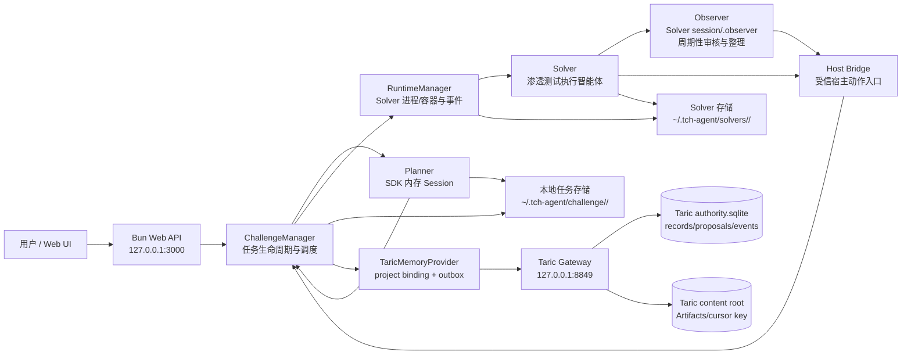
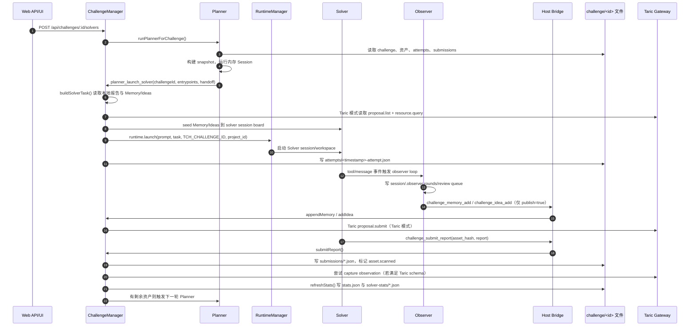
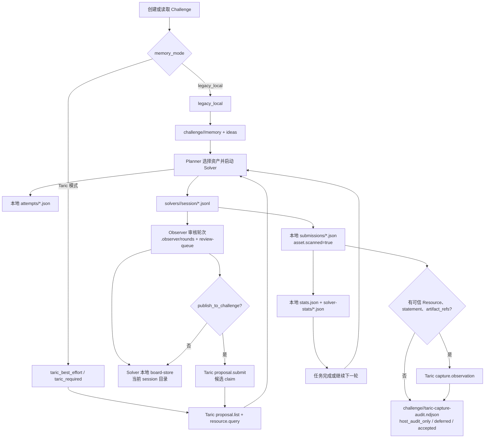

# BreachWeave 渗透测试执行、任务数据与 Taric 关系

本文结合当前源码和本机 2026-10-29 的只读运行数据，说明 Planner、Solver、Observer 与 Taric 的调用关系，以及 `~/.tch-agent/challenge/<challengeId>/` 和 Taric authority 的数据边界。

## 结论先行

`~/.tch-agent/challenge/<challengeId>/` 是 BreachWeave 的任务生命周期事实源：任务定义、资产扫描状态、Planner 状态、Solver attempt、报告 submission、统计和本地审计都由这里驱动。Planner 的调度快照也读取这些本地文件，因此任务是否完成、是否继续调度，不由 Taric 的记录数量直接决定。

Taric 是共享 Engagement 下的受信协作与审计面。当前本机使用 `authenticated_proxy`，Gateway 监听 `127.0.0.1:8849`，实际 authority 是 `~/.tch-agent/taric-gateway/authority.sqlite`，Artifact 内容根为 `~/.tch-agent/taric-gateway/content/`。Taric 负责候选 Memory/Idea claim、受信 Host observation、查询水位和权限边界；它不自动镜像 `challenge.json`、`attempts/*.json`、`submissions/*.json` 或 `stats.json`。

两者的关系可以概括为：

```text
challenge/<id>/challenge.json
        │ 任务、资产、project_id、memory_mode
        ├──> Planner snapshot / 完成判断 / 本地统计
        ├──> Solver 启动参数与 attempt/submission 文件
        └──> Host bridge 按 project binding 选择 Taric provider

Taric provider
        ├── memory/idea 读取：proposal.list + resource.query
        ├── memory/idea 发布：proposal.submit（通常是 candidate claim）
        └── 受信观察：capture.observation（必须满足 Resource/statement/artifact_refs）
```

## 系统架构图



图中最容易误解的边界是：`Manager -> Local` 和 `TaricProvider -> Taric` 是两条不同的数据路径。Taric provider 由 Manager 选择，但本地任务文件仍然由 Manager 的任务 API 写入和读取。

## 一次任务的时序图



这条时序显示一个重要事实：报告提交先落本地 `submissions/*.json`，再尝试向 Taric 捕获 Host observation。即使 Taric observation 因缺少受信 Resource 而只记录为本地 audit，报告仍然可以作为 BreachWeave 任务报告存在；`taric_required` 项目则会在不可用时阻断相应操作。

## 任务数据流与分支



## 源码调用链

### 1. Daemon 初始化与 Provider 选择

`DaemonManager.getInstance()` 先确保本地 Taric Gateway，再创建带 Taric provider factory 的 `ChallengeManager`，最后把 Runtime 事件接到 `challenge.captureSolverEvent()`：[packages/core/src/index.ts:28](/Users/liuhongtao/development/BreachWeave/packages/core/src/index.ts:28)。

Provider factory 按可信 project 的 `memory_mode` 创建 `TaricMemoryProvider`；`legacy_local` 明确使用本地 provider，Taric 模式使用 host module、共享 Engagement binding 和加密 outbox：[packages/core/src/taric/provider-factory.ts:139](/Users/liuhongtao/development/BreachWeave/packages/core/src/taric/provider-factory.ts:139)。

`ChallengeManager.getMemoryContext()` 根据 challenge 的 project binding 选择 provider。默认本地创建的任务通常是 `taric_best_effort`，显式 `legacy_local` 才退出 Taric 路径。[packages/core/src/challenge/manager.ts:714](/Users/liuhongtao/development/BreachWeave/packages/core/src/challenge/manager.ts:714)

### 2. Planner 只调度，不直接沉淀漏洞事实

Web 入口 `POST /api/challenges/:id/solvers` 设置 Planner 状态，然后后台调用 `runPlannerForChallenge()`：[packages/ui-web/src/server.ts:1204](/Users/liuhongtao/development/BreachWeave/packages/ui-web/src/server.ts:1204)。

`runPlannerOnce()`：

1. 从本地 challenge、资产、attempts、submissions 和运行中的 Solver 构建 snapshot。
2. 创建 Planner 的内存 SDK Session。
3. 注册 `planner_launch_solver` 等工具。
4. 将 Planner 的摘要、动作和 snapshot digest 写入 `planner-last-round-<challengeId>.json`。

实现见 [packages/core/src/challenge/manager.ts:1889](/Users/liuhongtao/development/BreachWeave/packages/core/src/challenge/manager.ts:1889)。Planner 工具最终调用 `launchSolver()`，不直接调用 Taric 的 `proposal.submit`，也不直接写漏洞报告。

因此 Planner 的持久化重点是调度状态和下一轮输入，而不是漏洞证据。

### 3. Solver 启动同时建立三条本地关联

`launchSolver()` 会：

1. 检查 challenge 和 memory authority 是否可用。
2. 启动 challenge instance（必要时）。
3. 生成 `solverId`，构造任务 prompt。
4. 将当前 Memory/Ideas 摘要 seed 到 Solver session。
5. 通过 Runtime 启动 Solver，并注入 `TCH_CHALLENGE_ID` 和可信 `project_id`。
6. 写入 `attempts/*.json`。

实现见 [packages/core/src/challenge/manager.ts:1783](/Users/liuhongtao/development/BreachWeave/packages/core/src/challenge/manager.ts:1783)。attempt 文件保存了 `challenge_id`、`project_id`、`solver_id`、prompt 和完整任务文本，是连接 challenge 与 solver session 的索引。

Solver 的原始会话在 `~/.tch-agent/solvers/<solverId>/session/*.jsonl`，启动信息在 `startup.json`，工作文件在 `workspace/`。`stats.json` 通过 attempt 中的 solver id 再读取 startup/session 聚合，不是从 Taric 查询统计。[packages/core/src/challenge/stats.ts:204](/Users/liuhongtao/development/BreachWeave/packages/core/src/challenge/stats.ts:204)

### 4. Observer 是旁路审核与整理，不是第二个 Solver

Observer loop 监听 Solver 的 tool execution、assistant round 和 agent end，每 6 轮以及 hint/agent end 等触发条件下，把压缩后的上下文放入 observer review queue；Observer session 位于同一 Solver 的 `session/.observer/`，包括 rounds、runtime state 和 review queue。[packages/core/src/solver/extension/challenge-observer/observer-loop.ts:9](/Users/liuhongtao/development/BreachWeave/packages/core/src/solver/extension/challenge-observer/observer-loop.ts:9)、[packages/core/src/solver/extension/challenge-observer/observer-loop.ts:244](/Users/liuhongtao/development/BreachWeave/packages/core/src/solver/extension/challenge-observer/observer-loop.ts:244)

Observer 的 `memory_add` 和 `idea_add` 总是先写当前 Solver 的本地 board。只有明确传 `publish_to_challenge: true`，才通过 Host Bridge 调用 `challenge_memory_add` 或 `challenge_idea_add`：[packages/core/src/solver/extension/challenge-observer/tools.ts:312](/Users/liuhongtao/development/BreachWeave/packages/core/src/solver/extension/challenge-observer/tools.ts:312)、[packages/core/src/solver/extension/challenge-observer/tools.ts:411](/Users/liuhongtao/development/BreachWeave/packages/core/src/solver/extension/challenge-observer/tools.ts:411)。

Host Bridge 再调用 ChallengeManager；它不允许 Solver 直接携带 authority principal 或 token：[packages/core/src/challenge/host-bridge-handler.ts:167](/Users/liuhongtao/development/BreachWeave/packages/core/src/challenge/host-bridge-handler.ts:167)。

这里的 Observer “审核”是对 Solver 近期行为和策略看板的旁路复核。它不等于 Taric 的 reviewer 身份、proposal review 或 admission，也不会替 Solver 实测漏洞；候选 Memory/Idea 仍需后续 evidence/admission 流程才能成为 canonical admitted 数据。

### 5. Taric Memory/Idea 的实际语义

Taric provider 的 `appendMemory()` 和 `addIdea()` 会构造 Taric schema 的 `claim`，调用 `proposal.submit`。这通常产生 `candidate`，不是已经被审核的 canonical fact。读取 board 时，provider 同时读取：

- `proposal.list`：candidate claims。
- `resource.query(kind=claim)`：已进入 authority projection 的记录。

然后按 `engagement_id` 和 `BreachWeave [<project_id>]` 标题前缀过滤，再映射成 `trustState=candidate` 或 `trustState=admitted`。实现见 [packages/core/src/challenge/taric-memory-provider.ts:281](/Users/liuhongtao/development/BreachWeave/packages/core/src/challenge/taric-memory-provider.ts:281) 和 [packages/core/src/challenge/taric-memory-provider.ts:366](/Users/liuhongtao/development/BreachWeave/packages/core/src/challenge/taric-memory-provider.ts:366)。

这意味着：

- challenge API 返回的 Memory 可能来自 Taric 的 pending proposal，并不等于已审核事实。
- Taric `records` 中没有对应 canonical record 时，不能把 candidate 当成 admitted evidence。
- 更新/删除 Taric Memory/Idea 仍然通过 proposal 语义处理，不是简单修改本地 JSON 文件。

### 6. Solver 事件和报告为什么经常只落本地 audit

Runtime 每收到 Solver 事件，就通过 `runtime.onEvent()` 转交 `captureSolverEvent()`：[packages/core/src/index.ts:34](/Users/liuhongtao/development/BreachWeave/packages/core/src/index.ts:34)、[packages/core/src/challenge/manager.ts:819](/Users/liuhongtao/development/BreachWeave/packages/core/src/challenge/manager.ts:819)。

`captureHostObservation()` 要求 observation 具有可信 Taric Resource UUID、非空 `statement` 和 `artifact_refs`。普通 competition challenge 的 Solver tool result、attempt_started、report_submitted 通常没有已授权的 Taric Resource，因此不会伪造 Resource；它们会写入：

```text
~/.tch-agent/challenge/<challengeId>/taric-capture-audit.ndjson
```

结果通常是 `rejected_validation / host_audit_only`。`taric_best_effort` 对不可用或校验失败不阻断任务；`taric_required` 则会对需要 authority 的操作 fail closed。[packages/core/src/challenge/manager.ts:779](/Users/liuhongtao/development/BreachWeave/packages/core/src/challenge/manager.ts:779)

这解释了为什么本地 attempt/report 已存在，但 Taric `records` 里不一定出现对应渗透过程记录。只有预先绑定可信 Resource、满足 observation schema 的治理流程，才会通过 `capture.observation` 进入 Taric authority；不可达时 best-effort 还可能进入加密 outbox。

### 7. 报告提交和任务完成仍以本地任务状态为准

Solver 通过 Host Bridge 的 `challenge_submit_report` 进入 `submitReport()`：[packages/core/src/challenge/host-bridge-handler.ts:147](/Users/liuhongtao/development/BreachWeave/packages/core/src/challenge/host-bridge-handler.ts:147)。

`submitReport()` 的顺序是：

1. 验证 asset hash 和报告内容。
2. 写 `submissions/*.json`。
3. 尝试捕获 `platform_result` observation。
4. 将对应 asset 标记为 `scanned=true`。
5. 若仍有待测资产，触发下一轮 Planner；全部扫描后结束 challenge。

实现见 [packages/core/src/challenge/manager.ts:1481](/Users/liuhongtao/development/BreachWeave/packages/core/src/challenge/manager.ts:1481)。所以任务完成条件是本地 challenge 的全部资产 `scanned=true`，不是 Taric proposal 被 admit。

## 本机实际任务执行证据

本机当前有 6 个活动 challenge 目录，其中 5 个是 `taric_best_effort`，1 个是 `legacy_local`。Taric 模式任务共享同一个 Engagement：

```text
01a17b51-61a2-730f-8b49-b9c4cc46bac1
```

这说明当前实现使用的是 shared development boundary；不同任务的 `project_id` 是 BreachWeave 的本地复合项目键和 Taric claim 标题命名空间，不是独立 Taric Engagement。它不能被当成多租户授权边界。

### 脱敏后的任务样本

| challenge | memory_mode | attempts | submissions | Solver | Taric 关联现象 |
| --- | --- | ---: | ---: | --- | --- |
| `98496a92` | `taric_best_effort` | 2 | 2 | `32c22339`, `71ae4a87` | 6 条本项目 pending claim；429 条本地 capture audit 全部为 `host_audit_only` |
| `0ba45f3e` | `taric_best_effort` | 1 | 2 | `0b213362` | 4 条本项目 pending claim；attempt/report 仍以本地 JSON 为任务事实 |
| `ea087308` | `taric_best_effort` | 2 | 2 | `39f18d4d`, `fb98e55e` | 3 条本项目 pending claim；自动事件仍主要是本地 audit |
| `f41e775a` | `taric_best_effort` | 1 | 2 | `5dfbeb73` | 3 条本项目 pending claim；报告仍以本地 submissions 为任务事实 |
| `4a0914b9` | `legacy_local` | 1 | 2 | `769a39d5` | Memory/Ideas 直接写 challenge 目录，不走 Taric provider |

当前 shared Engagement 的 authority 汇总为：`records` 中有 engagement/scope/resource 等 canonical 记录；渗透任务相关的大量 claim 主要是 `proposals` 中的 pending candidate；另有单独的 Taric integration smoke observations。后者使用 operator-provisioned Resource，不应误认为普通 challenge 自动捕获已经全部进入 Taric。

以 `98496a92` 为例，磁盘上能看到 2 个 attempts、2 个 submissions、2 个 solver-stats，以及 429 行 `taric-capture-audit.ndjson`。audit 的大量 `host_audit_only` 不是 Taric authority 记录，而是 BreachWeave 明确保留的“未满足 Taric observation 合约”的本地审计结果。

## 数据归属矩阵

| 数据 | 主要写入方 | 主要位置 | 是否由 Taric 决定任务完成 |
| --- | --- | --- | --- |
| Challenge 定义、资产、扫描状态 | ChallengeManager | `challenge/<id>/challenge.json` | 否 |
| Planner snapshot / round | ChallengeManager / Planner | `planner-last-round*.json` | 否 |
| Solver attempt | ChallengeManager | `challenge/<id>/attempts/*.json` | 否 |
| Solver 原始会话、工具输出 | Runtime / Solver | `solvers/<solverId>/session/*.jsonl` | 否 |
| Observer 审核轮次 | Observer loop | `solvers/<solverId>/session/.observer/` | 否 |
| Solver 本地 Memory/Ideas | Observer tools / board-store | Solver session board | 否 |
| Challenge 共享 Memory/Ideas，legacy_local | File provider | `challenge/<id>/memory/`, `ideas/` | 否 |
| Challenge 共享 Memory/Ideas，Taric 模式 | TaricMemoryProvider | Taric `proposals` / `records` | 否，需区分 candidate/admitted |
| 报告 submission | ChallengeManager | `challenge/<id>/submissions/*.json` | 否 |
| 任务统计 | `refreshChallengeStats()` | `stats.json`, `solver-stats/*.json` | 否 |
| Host observation | Taric host module | Taric `proposals` / `records`；失败或不适用时本地 audit | 不是普通任务完成条件 |
| Taric Artifact payload | Taric authority/gateway | `taric-gateway/content/` | 由 Taric Artifact 生命周期管理 |

## 如何正确解读两套数据

1. 先读 `challenge.json`，确定 `challengeId`、`project_id`、`memory_mode`、资产和扫描状态。
2. 再读 `attempts/`、`submissions/`、`stats.json`，还原任务是否执行、哪个 Solver 执行、报告是否提交。
3. 通过 attempt 的 `solver_id` 去读 `~/.tch-agent/solvers/<solverId>/session/` 和 `.observer/`，还原 Solver/Observer 的细节。
4. 只有在需要审计共享 Memory、candidate/admitted 状态、Host observation、scope/resource 或 Taric watermark 时，才查询 `authority.sqlite` 或走 Taric API。
5. 将 Taric `pending proposal` 视为候选事实，将 `records` 中的 admitted/canonical 记录视为权威投影；两者不能混称为“已确认漏洞”。

## 直接查看命令

查看本地任务：

```sh
jq . ~/.tch-agent/challenge/<challengeId>/challenge.json
find ~/.tch-agent/challenge/<challengeId> -maxdepth 3 -type f -print
```

只读查看 Taric claim 状态：

```sh
sqlite3 -readonly -header -column \
  ~/.tch-agent/taric-gateway/authority.sqlite \
  "SELECT kind, trust_level, COUNT(*) AS count
   FROM records
   GROUP BY kind, trust_level
   ORDER BY kind, trust_level;"

sqlite3 -readonly -header -column \
  ~/.tch-agent/taric-gateway/authority.sqlite \
  "SELECT subject_type, status, COUNT(*) AS count
   FROM proposals
   GROUP BY subject_type, status
   ORDER BY subject_type, status;"
```

查看 Web 聚合结果：

```text
GET /api/challenges
GET /api/challenges/<challengeId>
GET /api/challenges/<challengeId>/memory-health
GET /api/challenges/<challengeId>/attack-timeline
GET /api/challenges/<challengeId>/solver-sessions.zip
```

这些 Web API 需要登录后的 JWT。`GET /api/challenges/<id>` 会将本地 challenge、attempts、submissions、stats、solvers 与通过 provider 读取的 Memory/Ideas 聚合在一起，因此它是查看单个任务全貌的最方便入口；但要判断某条 Memory 是否已经进入 Taric 权威层，仍需看返回的 `trustState`/diagnostics 或查询 Taric proposal/record。

## 当前实现的边界

- 共享 Engagement 适合本机开发和练习，不等于项目级或租户级 Taric 授权隔离。
- 自动 Solver 事件没有可信 Resource 时只写 `taric-capture-audit.ndjson`，不会为了“看起来接入成功”伪造 Taric Resource。
- `taric_best_effort` 的 authority 不可用时可以降级或进入加密 outbox；`taric_required` 的受保护操作应 fail closed。
- Planner、任务完成判断、报告交付和统计仍以 BreachWeave 本地文件为主；Taric 的健康状态不能替代这些本地状态。
- 当前 governance helper 的 durable WorkRun、Artifact、review、close、restart recovery 等仍不是完整生产级闭环，不能从“Taric Gateway 可查询”推导出完整授权渗透测试治理已启用。

