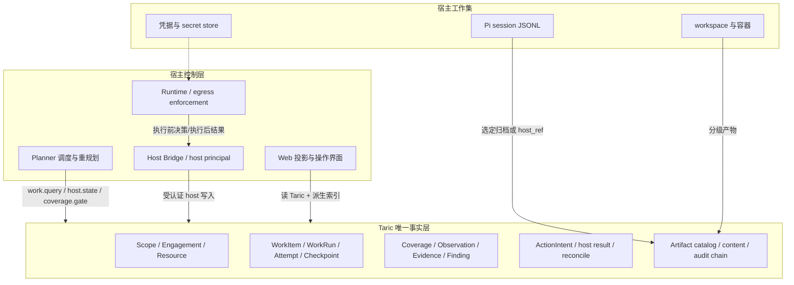

# Taric 作为 BreachWeave 智能体唯一事实支撑源：基于 Taric 1.0.3 的差距分析与实施方案

本文基于三类证据重新评审：

1. `/Users/liuhongtao/development/Taric` 当前源码、schema registry、兼容性矩阵和集成文档；
2. BreachWeave 当前工作区的 Taric adapter、`AuthorizedPentestGovernance`、ChallengeManager、Host Bridge 和 Web API；
3. 本机 `~/.tch-agent` 的只读运行数据，以及 `~/.tch-agent/taric-gateway/authority.sqlite` 的脱敏聚合统计。

时间基线为 2026-10-30。运行数据只用于判断控制流、持久化边界和成功/拒绝结果，不复制凭据、cookie、token、原始 HTTP 响应或完整模型提示词。运行数据章节明确标注为历史快照，不能替代当前源码、当前 authority 查询或最新联调证据。

Taric GitHub 当前没有正式 Release tag；本次以远端 `main` 的最新提交 `2314880`（完整提交见 [m-sec-org/Taric@2314880](https://github.com/m-sec-org/Taric/commit/2314880)）和本地同步源码为发布基线。该源码的组件版本为 `1.0.3`，API contract 为 `1.3.0`，adapter contract 为 `1.1`，schema 为 `1.0.0`，authority storage contract 为 `authority-storage/3`，SQL format 为 `authority-sql/4`。不能把 Taric 的 GitHub Release 状态、root workspace 版本、组件版本和 API contract 混为一谈。

Taric 1.0.3 的本机验证记录声称 build、typecheck、兼容矩阵、workspace 测试和独立 tarball consumer 通过；Core 360 通过、9 个未配置 live PostgreSQL 的可选测试跳过，Bun driver 12、Schemas 11、MCP 12、Hermes 5 和 CLI 测试通过。该记录验证的是 Taric 源码和组件合同，不等于 BreachWeave 的真实宿主流程已经认证。

## 1. 结论先行

**Taric 具备成为 BreachWeave 唯一事实支撑源的领域能力，但当前 BreachWeave 尚未达到这个状态。** 当前状态应准确描述为：

- 普通竞赛 ChallengeManager 已接入 Taric Memory/Idea proposal、有限的 host observation 尝试和加密 outbox；挑战定义、资产 `scanned`、Planner 快照、attempt、submission、统计和完成判定仍以 `~/.tch-agent/challenge/` 为事实源。
- BreachWeave 已实现一套独立的 `AuthorizedPentestGovernance` 和 Web governance API，封装 WorkRun、lease、checkpoint、coverage、artifact、review、admission 和 close；这些能力尚未接入普通 ChallengeManager/Solver/Observer 主循环，而且其中的 artifact 与运行态主要是 Web 进程本地状态，并没有证明已经写入 Taric Artifact catalog。
- 本机 authority 的真实内容远小于“Taric API 已实现的能力”：只有 5 条 canonical records（2 scope、2 engagement、1 resource）、40 条 proposal（27 claim、12 observation，均 pending，另有 1 条 resource proposal 已 admitted），`work_runs`、`attempts`、`checkpoints`、`action_intents`、`artifact_catalog`、`artifact_sessions`、`execution_catalog` 均为 0。当前 challenge 目标没有成为 Taric Resource，也没有 Taric Coverage 行。

因此，原文“Taric 能、当前接入面空白、按 P0-P3 接管即可”的方向大体正确，但把“已实现的治理封装”误写成“完全没有接入”，把“设计目标”误写成“当前实际落库”，并对 sidecar、Coverage gate、Artifact 和恢复语义作了过度概括。下面逐条修正。

## 2. “唯一支撑源”的精确定义

本文把“唯一支撑源”定义为 **sole authority / 唯一事实源**，而不是“所有字节都只能放在 Taric”。迁移完成后应满足：

| 层次 | Taric 应成为唯一来源的内容 | 宿主仍负责的内容 |
| --- | --- | --- |
| 治理事实 | Scope/Engagement、Resource/Revision、Observation/Evidence、Finding/Claim、Control/Access、Coverage、WorkItem/WorkRun/Attempt/Checkpoint/ActionIntent 的权威状态 | 调度算法、模型调用、工具执行、人工审批 |
| 证据索引 | Artifact metadata、content reference、evidence 关联、审计事件和版本水位 | 活跃 workspace、原始 session 文件、凭据、外部对象存储的复制和删除策略 |
| 运行前提 | 只登记 external `host_ref` 或归档副本，不把容器、进程、seek/原地覆盖文件系统伪装成 Taric 记录 | Pi session JSONL、workspace、solver 容器、端口、环境变量和 secret 生命周期 |
| 产品投影 | Web/Planner 可缓存 Taric 的派生视图 | 投影必须能从 Taric 重建，不能继续拥有与 authority 冲突的完成状态 |

这与 Taric `docs/host-integration-profiles.md` 和 `docs/agent-integration.md` 的合同一致：Taric 不运行模型、不选择或启动 agent、不调度工具、不执行目标操作、不发放凭据，也不替宿主管理 redaction、retention 或人工 review。

“唯一事实源”不是当前系统的描述，而是迁移完成后的验收目标。当前 `challenge.json` 的 `scanned` 和 Planner 的“已完成”判断仍优先于 Taric，因此当前系统不是 sole authority。

## 3. Taric 源码核验后的真实能力

### 3.0 1.0.3 新增的接入合同

最新源码没有新增 BreachWeave 专属业务对象，而是把宿主接入边界补成了可组合、可恢复的合同。对 BreachWeave 影响最大的变化如下：

| Taric 1.0.3 能力 | 对 BreachWeave 的直接要求 |
| --- | --- |
| WorkItem 受治理初始化 | 先以稳定 proposal/idempotency key 创建并 admission WorkItem，再 `work.query`、`work.claim`；不能由 Planner 直接凭本地数组启动 Solver，也不能把 Coverage cell 当作 WorkItem。 |
| 固定读取水位和分页 | `work.query`、Context 等支持固定读取点的查询要消费 cursor、`read_seq`、遗漏/截断诊断；通知断开后必须补查，空页不能解释成“没有记录”。 |
| active Attempt 与重启恢复 | 保存 `work_run_id`、`attempt_id`、generation、session locator；重启先 `work.resume` 检查租约和 premise，再决定 reclaim/replan。旧 generation 的迟到写入必须被拒。 |
| 四种 profile 权限一致性 | in-process Bun、Unix socket、loopback TLS TCP、HTTPS 的 operation registry、principal、Engagement 隔离和拒绝语义必须一致；不能从 network adapter 的测试推导 embedded 已认证。 |
| 有界重试和 `indeterminate` | 已知未 dispatch 的传输失败最多重试一次；可能已 dispatch 的请求只对 registry 标记幂等且带同一 key 的操作重试一次；最终未知时查询 authority 或进入 reconcile，不能盲目重放。 |
| Coverage/Action/Artifact/Evidence 验收合同 | expected-version、引用归属、Evidence 缺失、Action unknown、run binding、外部 host_ref 未验证等必须在 BreachWeave 接口层显式处理。 |
| 版本精确配对 | 宿主锁定 API `1.3.0`、adapter `1.1`、schema `1.0.0`、storage `authority-storage/3` 和 SQL `authority-sql/4`；旧合同按精确匹配拒绝，不做兼容猜测。 |

这些能力使 Taric 更适合承载唯一事实层，但不会替宿主完成外部业务 ID 映射、Planner 调度、工具执行、报告关闭、workspace/outbox 或凭据生命周期管理。Taric 仍是治理 authority，不是 BreachWeave 的 agent runtime。

### 3.1 两种写入轨道和严格角色边界

Taric 的 schema registry 和 `service.ts` 将写入分成两类：

| 轨道 | 典型操作 | 允许角色 | 语义 |
| --- | --- | --- | --- |
| host/operator/writer 直写 | `resource.revise/patch/relation`、`coverage.record`、`control.observe`、`access.observe`、`work.claim/renew/reclaim/transition`、`checkpoint.commit`、`action.host-*`、`artifact.*` | 按 operation 检查，不能互换 | 同步写 canonical state，带 owner、generation、version、idempotency 和引用校验 |
| model/host/operator 提案 | `proposal.submit`、`checkpoint.propose`、`action.recommend`、`capture.observation`（host/operator） | model 只能在受限面提案/读取 | proposal 进入 admission/review 后才可能成为更高信任层的事实 |

模型 MCP 不是全部 API，而是固定的六工具面；它没有 host state、raw Artifact content、Tasks 或通用远程 HTTP 写入口。BreachWeave 的 Host Bridge 必须持有 host principal 和对应能力，不能只把 Manager 当作无权限转发器。

Taric 的 canonical record 不是简单 append-only：current projection 可按 CAS 更新，但每次提交会追加 `record_versions` 和哈希链 events；revision 类对象和已提交 Artifact payload 不可覆写，catalog 状态仍可能被 reconcile 为 unavailable/integrity_failed。WorkRun、Attempt、Checkpoint、ActionIntent 则分别位于 workflow tables，由状态 SQL 和 audit event 更新，不应称作普通 records 的 CAS 行。

### 3.2 WorkItem、WorkRun、Attempt、Checkpoint 不是同一个对象

`work.claim` 只能 claim 一个已存在且 `kind=work_item` 的 record。Taric 的最小调度链是：

```text
WorkItem（可调度计划项）
  -> WorkRun（一次租约拥有的运行）
      -> Attempt（该运行的尝试）
          -> Checkpoint / ActionIntent / Artifact / Evidence refs
```

公开 registry 没有普通的 `work_item.create` 直写操作；WorkItem 通常需要先通过 `proposal.submit(subject_type="work_item")` 和 admission，或由 Taric 支持的受审计初始化路径创建。1.0.3 已对这条 `proposal.submit -> admission -> work.query -> work.claim` 链做合同验收，但没有把 BreachWeave 的业务 ID 自动映射成 WorkItem。Coverage cell 不能替代 WorkItem。

WorkRun 状态迁移包括 `queued -> claimed -> running/checkpointed/blocked -> completed/failed/cancelled/lost`；终态无出边。默认 lease TTL 为 60 秒，renew 要求 owner、generation 和未过期租约仍匹配；reclaim 会把旧 Attempt 标为 `lost`、generation 加一并隔离迟到结果。`work.resume` 只返回恢复包和 premise checks；若前提失败，返回 `blocked/replan_required`，不会替宿主自动重新 claim 或执行动作。

因此“Solver 启动就 `work.claim`”只有在 BreachWeave 先完成 WorkItem seed/provision 后才成立。P0 必须同时设计 WorkItem 与 Coverage cell 的映射，例如一个 `(resource, category, operation)` WorkItem 关联多个 cell，或每个 cell 生成一个 WorkItem，并明确 owner、resource_refs、验收条件和幂等键。

### 3.3 Coverage 是受版本保护的矩阵，不是一个完成布尔值

`coverage.record` 是 host/operator 直写 L1，Coverage cell 的逻辑维度不可随状态更新改变，并要求 expected version。`coverage.gate` 的公开请求以 Engagement 为作用域；它会考虑未测试、排队、进行中、blocked、无观察、无理由的 not-applicable、缺证据的 positive、冲突维度，以及 recalled record 的 impact/revalidation 等条件。

所以“challenge 资产子集 coverage 全终态即可完成”需要限定：

- per-project Engagement 时，可以把一个 challenge 作为该 Engagement 的完整 gate；
- 多个 challenge 共享 Engagement 时，Taric 原生 gate 没有 `challenge_id` 子集参数，BreachWeave 必须分页查询 Coverage 并按本地映射过滤，或向 Taric 增加 scoped gate；
- “终态”不能只看 status，必须同时满足 evidence、justification、revision、scope 和冲突门槛。

### 3.4 Observation、Evidence、proposal 和 admission 的边界

`capture.observation` 要有同 Engagement 的可信 Resource、非空 statement，以及可验证的 Artifact/evidence references；普通 `tool_result` 事件没有这些字段时必须拒绝，不能为了“接管全部事件”伪造 Resource。Artifact 只提供内容和 metadata，不会自动生成 canonical Evidence/Observation；Evidence schema 仍要求 artifact reference、observed_at 和 limitations，Finding 还需要 claim/evidence refs。

候选 claim/observation proposal 也不等于 canonical admitted fact：模型可看到的 candidate 与 authority 的 L1/L2 projection 要分开显示。

### 3.5 Artifact 与 execution sidecar 的真实范围

Taric 提供 `artifact.session.bind`、`artifact.store.begin/append/commit`、`artifact.ingest_file`、metadata/content read 和 `artifact.session.output`。external Artifact 也不是无条件登记一个 `host_ref`：仍要求 Engagement/session 绑定，`base_content_ref`、child/derived ref 必须存在且属于同一 session；run-bound session 要求活跃 WorkRun、Attempt、generation 和 owner。分块追加期间的 staged bytes 在 commit 前不可通过普通 content/output 查询，提交后才可读。Taric 的默认耐久承诺是 `local_process_crash`，不是断电 fsync 保证。

external 模式会先登记 `content_status=external`、`integrity_status=unverified` 的 metadata；Taric 不抓取或验证 `host_ref` 指向的字节。若报告需要可恢复、可验证的 payload，应使用 Taric-managed stored Artifact 并在 commit 后引用，或由宿主提供 expected size/hash 和独立完整性证明。

Taric 的 `execution_catalog` 没有公开的通用 `execution_catalog.append` 或“任意 tool_result 流写入”操作。内部 sidecar 只由 checkpoint、action 状态、host error 和迟到结果隔离等路径产生，`artifact.session.output` 负责组合读取。因此 G4 的正确建议是：

- 关键工具输出作为 Artifact 或受控 external reference；
- 状态迁移、action result、checkpoint 和 error 让 Taric 自己产生 sidecar；
- 若确实要保存 Pi 的 callback 事件，需增加受认证的 execution-event writer，或把它们作为分级 Artifact/宿主审计，而不是假设已有 sidecar 能直接接管。

### 3.6 部署、恢复和性能边界

`single_host_sqlite` 支持单宿主、多 worker 经 gateway 访问同一 SQLite；不支持共享 SQLite/NFS/独立副本充当多主 authority。`multi_host_authority` 必须使用一个共享 PostgreSQL 服务、server-fenced lease 和 fail-closed health check，Taric 1.0.3 的已保存验证覆盖同一工作站的容器/PG bridge，不覆盖跨物理机协调和网络中断恢复。PG 共享 metadata，不自动集中每个 host 的 Artifact 字节。BreachWeave 当前默认应先采用单机 SQLite + Unix socket 或 embedded Bun（修正 role routing 后），只有多主机需求和最新 conformance evidence 同时满足才启用 PostgreSQL。

公开 `snapshot.export` 不是完整备份；它不包含全部 proposal/review/event history、lease 和 spool payload。`snapshot.import`、`storage.backup/restore`（以及 `backup.restore`）不是公开可调用的恢复 API。SQLite 备份必须和 content root、cursor key 一起保存，并在恢复后运行 doctor/verify。1.0.3 的 adapter 恢复入口也不是持久 host outbox；BreachWeave 仍需独立维护 outbox/reconcile。

查询不是无界全表扫描：`work.query`/`coverage.query` 有 keyset cursor 和 scan budget，但部分维度/status 仍在 JS 层过滤；`coverage.gate` 和 impact 类操作仍可能物化较大 Engagement。50k Context 首屏 3.08s 是特定 fixture/机器的测量，不是通用 SLA。

还要区分 transport profile 的权限路由。当前 `network-adapter.ts` 将除 model operation 之外的调用路由到 host token，但 `embedded-adapter.ts` 的 `HOST_OPERATIONS` 只包含 `capture.observation` 和 `proposal.list`，其余调用会以 model principal dispatch。这样在 `embedded_bun` profile 下，`work.claim`、`coverage.record`、`artifact.*`、`checkpoint.commit` 等 host-only 操作可能被 Taric 以模型角色拒绝。不能因为 host module 的 operation 白名单完整，就声称 embedded 与 authenticated proxy 已经等价；两种 profile 必须分别做 role-routing conformance。

## 4. BreachWeave 当前实现和运行事实

### 4.1 普通 ChallengeManager 主流程

普通挑战的事实链仍是：

```text
challenge.json -> Planner snapshot/完成判定 -> attempts/*.json
             -> Solver session/workspace -> submissions/*.json -> stats.json
             -> TaricMemoryProvider（Memory/Idea + host observation 尝试）
```

`submitReport()` 先写本地 submission，再调用 `captureHostEventBestEffort()`；`runtime.onEvent()` 异步把 solver 事件转成 host observation 尝试。没有 trusted Resource、statement 和 artifact refs 时，事件写入 `taric-capture-audit.ndjson` 并保持本地任务继续运行。这里的 `taric_required` 主要在启动/提交前检查 Memory authority；普通 capture schema 拒绝仍记录为 `host_audit_only`，不能笼统写成“每个 capture 都会阻断”。授权 governance API 的 `assertReady()` 才是逐调用 fail-closed 的治理边界。

TaricMemoryProvider 比“单页读写”更完整：它有分页、cursor/read_seq 一致性、去重和有界诊断（24 页、1000 条、4 MiB 等限制）；Memory/Idea 写的是 candidate claim proposal。更新/删除不是普通本地 JSON 修改；best-effort 的 proposal outbox 可按顺序重放，但 capture observation 是非幂等操作，dispatch 不确定时标记 indeterminate，不会自动重放。Provider 查询的是 claims/proposals，不是当前已接入的 `context.query`；“从 Taric context seed”仍是 P3 目标。

### 4.2 已实现但尚未接入主循环的授权治理 API

`packages/core/src/taric/governance.ts` 的 `AuthorizedPentestGovernance` 已封装：

- `claimWork`、renew、recover、transition；
- 本地加密 artifact metadata/payload、observation capture；
- coverage record/gate、report snapshot；
- review、admission、checkpoint 和 close。

`packages/ui-web/src/taric-governance-api.ts` 和 `server.ts` 已提供相应 REST 路由。它们说明 BreachWeave 已有可复用的授权渗透测试控制面，但不等于普通 Solver 已经通过 Host Bridge 使用这些能力。当前治理实例的 `runs`、reservations、coverage、reviews 和 `readSeq` 是 Web 进程内状态；重启后不能仅凭这些 Map 自动恢复，必须另有 authority locator、`work.resume` 和持久会话恢复流程。

治理 setup 要求调用方提供已存在的 Taric Resource manifest；构造器只是本地初始化 coverage Map，不会自动执行 `engagement.init`、`resource.revise` 或 authority 级 coverage 预配。

更关键的是，`AuthorizedPentestGovernance.commitArtifact()` 当前把 payload 写入宿主 `artifactRoot` 的加密 `payload.enc` 和 `metadata.json`，没有调用 Taric `artifact.store.*`。后续 `captureObservation()` 可以把本地 artifact metadata 映射成 Taric reference，但这不是 Taric Artifact catalog 已接管字节。原文“报告可从 Taric spool 完整还原”只能作为 P2 验收目标，不能作为当前能力。

Pi adapter 也不能被概括为“只能观察”：认证 Pi 版本在有效 run binding 下可通过 hooks 映射 checkpoint、action、host result 和 error；但 Pi SDK 仍是 session JSONL 的唯一写者，adapter 不接管 transcript、workspace 原地文件，也不会自动把每条 tool result 变成 canonical Observation。未认证版本才收敛为只读安全子集。

### 4.3 本机运行数据：能力存在不等于数据已经进入 authority

本机 2026-10-29 的聚合观察如下：

| 数据源 | 观察结果 | 解释 |
| --- | --- | --- |
| challenge 数量 | 6 个：5 个 `taric_best_effort`，1 个 `legacy_local` | 本地挑战配置已启用 Taric best-effort，但不是 Taric lifecycle 接管 |
| Engagement | 5 个 Taric challenge 共享同一 Engagement；`legacy_local` 不使用 Taric | 当前是共享开发边界，不是 challenge 租户隔离 |
| `authority.sqlite` canonical records | 5 条：2 scope、2 engagement、1 resource | resource 是 localhost smoke 资源，不是 98496a92 的目标 |
| `authority.sqlite` proposals | 40 条：27 claim、12 observation pending；1 resource proposal admitted | observation 来自独立 host smoke，不能当作生产 solver 事件已成功捕获 |
| lifecycle/evidence 表 | `work_runs=0`、`attempts=0`、`checkpoints=0`、`action_intents=0`、`artifact_catalog=0`、`artifact_sessions=0`、`execution_catalog=0` | 没有实际 challenge 被 Taric Work/Coverage/Artifact/Execution 驱动 |
| 98496a92 audit | 429 行：425 `tool_result`、2 `host_event`、2 `platform_result`；全部 `rejected_validation/host_audit_only` | 429 是 capture callback/event 记录数，不是工具调用数 |
| 98496a92 本地状态 | 两个 attempts、两个 submissions、两项资产均 `scanned:true` | 完成和报告仍由本地 ChallengeManager 决定 |

98496a92 的 audit 时间范围为 2026-10-28T10:17:26.479Z 至 10:23:04.723Z；同一 solver 的 session JSONL 只有 71 条顶层记录，其中包含 33 次 bash、2 次 report tool 和 1 次 write tool，进一步证明 audit 行数不能直接当作 tool invocation 数。该 challenge 的 Planner 快照把后续启动拒绝归因于本地 challenge 已完成，而不是 Taric `coverage.gate`。

本机 authority 最新的 real-smoke proposal 不应与 98496a92 的 solver capture 混为一谈：两者时间和 provenance 不同，authority 中没有包含 `98496a92` 目标的 canonical Resource 或 lifecycle rows。

## 5. 校正后的差距分析

### G1：主流程接入面仍然缺失，但不是“代码完全没有”

**现状：** Memory/Idea 已接入；host observation 有校验、audit 和 outbox；授权治理 API 另有 Work/Coverage/Artifact 等封装；普通 ChallengeManager/Host Bridge 没有把 challenge 任务映射为 Taric WorkItem、Coverage、Artifact session 和 ActionIntent。

**实现建议：** 选定一个唯一入口。普通 Solver 应通过 Host Bridge 新增 `taric_work_*`、`taric_coverage_*`、`taric_checkpoint_*`、`taric_action_*`、`taric_artifact_*`，或由 Manager 在受信 host principal 下调用同一 governance service；不要让 Solver 容器携带 Taric token。授权 Web API 与普通 bridge 的入口和生命周期必须分开记录。

**额外前置：** 先实现 WorkItem seed/provision。因为公开 API 没有普通 `work_item.create`，需明确 proposal/admission 或受支持的 host provisioning 路径、幂等键、resource_refs 和 owner。

### G2：Engagement 边界与 challenge 映射不完整

**现状：** local gateway 明确复用一个共享 Engagement，且 provider factory 尚未实现 `project_bound` 的独立 Engagement。标题前缀和 project binding 只是逻辑过滤，不是 Taric 授权边界。授权 governance project 则要求自己的 `taric_engagement_id`，不能把两种模式混写。

**建议：** 默认选择 per-project Engagement，把“可信授权项目”映射为 Engagement，把 challenge 映射为 WorkItem 集和 Coverage 子集；只有确实需要 challenge 间完全隔离时才选 per-challenge。若保留共享 Engagement，必须增加 challenge-to-resource/cell 索引，并自行实现 scoped completion gate；同时做 token 生成、撤销、清理和跨项目拒绝测试。

### G3：任务生命周期与完成判定仍是双权威

**现状：** 本地 `challenge.json`、attempt/submission 和 Planner 快照决定调度与完成；Taric 没有 WorkRun、Attempt、Checkpoint 或 Coverage rows。授权 governance 的 WorkRun/Coverage 仅在进程内 Map 中维护，尚未完成重启恢复。

**建议：** 创建 challenge 时同时预配 Resource、Coverage cells 和可调度 WorkItems；Solver/Runtime 通过 host bridge claim/renew/transition；Planner 快照降级为可重建投影。完成判定必须绑定 Taric read_seq、scope/resource revision、evidence 和 gate，不得继续以 `scanned` 单字段为最终答案。

### G4：证据和过程事件落点被高估

**现状：** submission 和 session/workspace 仍在本地；普通 98496a92 的 429 callback 全部被拒绝为 host audit only；治理 helper 的 artifact 也是宿主本地加密目录；Taric execution sidecar 不能直接接管任意 tool_result 流。

**建议：** 先分级：报告和可复核关键输出进入 Taric Artifact session；然后创建满足 schema 的 Evidence/Observation，再提交 Finding proposal；Observation/Finding 只引用同 Engagement 的 committed Artifact。普通噪音留在本地或宿主 audit；若需完整事件审计，新增明确的受认证 execution-event contract。对于非幂等 capture 的 indeterminate 结果，必须提供 operator reconcile，而不是静默 retry。

### G5：会话、workspace 与恢复索引缺失

**现状：** Pi session JSONL、`.observer` 和 workspace 由 SDK/Runtime 写入；Taric adapter 可挂 lifecycle hooks，但没有替代 Pi 的 session store。治理实例的进程内 Map 重启即丢。

**建议：** 活文件继续由 Pi/Runtime 管理；任务结束或 checkpoint 时把 session/archive 和选定 workspace 产物作为受 retention 的 Artifact 或 external host_ref 注册；保存 `(challenge, project, work_item, work_run, attempt, generation, session_id)` recovery locator，并让 restart 流程先 `work.resume`、再决定 reclaim/replan。

### G6：授权动作仍是“记录决策”，不是 Taric 执行

**现状：** Taric `action.recommend`、`action.host-decision`、`action.host-result`、`action.reconcile` 已存在；Taric 不执行目标动作。BreachWeave 的 egress `evaluateEgress` 尚未在每次真实连接路径上强制调用。

**建议：** 连接时由 host-controlled proxy/firewall/DNS policy 执行 scope、redirect、IPv4/IPv6、端口和时间窗；执行前写 host decision，执行后写 result，unknown 必须 reconcile。不能用 prompt、容器网络模式或事后日志证明 egress 已被强制治理。

### G7：查询性能和 gate 作用域需要实测

**现状：** Taric 有 cursor/scan budget，但 Coverage 状态/维度过滤和 gate 仍可能在应用层物化；当前 challenge 规模很小，不能从 50k synthetic benchmark 推导生产 SLA。

**建议：** 热路径用 `work.query`/`host.state` 点查，gate 只在完成或报告 close 时执行；为共享 Engagement 的 challenge 子集建立本地索引和 read_seq 对账；达到规模阈值后再向 Taric 增加结构化索引或 scoped gate。

### G8：备份、恢复与契约耦合

**现状：** `compatibility.ts` 已锁定 API 1.3.0、adapter 1.1、组件 1.0.3 和提交 2314880；`docs/taric-verification.json` 已于 2026-10-30 按当前工作区重生成，typecheck、focused/core tests 和 build 通过，但它只证明当前源码/profile 的构建验证，不等于真实 gateway、目标执行或多主机认证。既有 smoke/report 仍有旧的 1.0.1 历史材料。最新 schema 1.0.0、authority-storage/3 和 authority-sql/4 仍要严格配对；没有 compatibility shim。公开 export 不是完整 backup；SQLite content root/cursor key 与 authority DB 必须一起保存。

**建议：** 锁定 Taric `1.0.3` tarball/digest、提交 `2314880` 和 compatibility matrix；CI 运行 clean-consumer/conformance；重新生成与当前 BreachWeave source digest 绑定的 verification report；备份 runbook 同时保存 DB、content root、cursor key 并定期 doctor/verify；不要把 `snapshot.export` 当灾备恢复接口。

### G9：多主机和 Artifact 分发未达到生产承诺

**现状：** PostgreSQL/server-fenced profile 和 remote gateway 已有代码及同工作站验证；跨物理机、网络恢复和多 host 共享可写 spool 未认证。PG 不自动集中 Artifact bytes。

**建议：** P4 以双物理机 conformance、断网恢复、token revocation、Artifact 路由和 host-local spool retention 为硬门；跨机使用对象存储/受控 host_ref，不把共享 SQLite 或共享 Git 当 authority。

### G10：Memory/Idea 投影和人工 review 仍不是完整领域模型

**现状：** TaricMemoryProvider 为兼容既有 board，把 Memory/Idea 映射为 claim；Idea 的投影状态固定为 pending，不能表达 Observation/Finding/Hypothesis 的完整 canonical 语义。proposal/admission/review/close API 存在，但普通 challenge 没有报告 snapshot、Coverage gate、review verdict 与 close 的完整权威链。

**建议：** 将 Memory/Idea 明确定位为兼容性 board projection，不把它当作漏洞事实模型；发现、证据、假设和报告使用显式 Taric subject/evidence schema。把“模型提出、host 采集、reviewer 审核、operator close”作为不同 principal 和状态；Taric `review.submit` 是 reviewer-only，当前治理 helper 以 host 作为默认 review actor 的单元测试不能证明真实 reviewer 合同；报告绑定 scope/resource revision、gate read_seq、evidence snapshot hash；对质量、完整性、人工复核和恢复分别建立证据。

### G11：profile 路由修复后的四 profile 仍需 conformance

**现状：** 旧实现曾按 operation 猜测角色，导致 embedded Bun 只有两个 host operation，且 network 的 `work.query` host 查询可能走 model principal。当前 Host Bridge 已将 `model`/`host` role 显式传入 adapter，embedded/network 也按显式角色分流；这修复了代码路径，但尚未完成 Bun in-process、Unix socket、loopback TLS TCP、HTTPS 四 profile 的真实一致性验收。

**建议：** 把 profile 选择纳入 P0/P1 的硬门：为每个 operation 生成 role-routing 矩阵，特别验证 host `work.query(include_active_runs=true)` 能看到 active Attempt，而 model projection 不泄露 owner/generation；运行 embedded、Unix、TLS/HTTPS 四套 conformance，覆盖成功、拒绝和 token/principal 绑定；在证据完成前不要把任何 transport 声明为已认证生产 profile。

## 6. 目标架构和数据归属



| BreachWeave 数据 | 目标归属 | 迁移前事实源 | 迁移验收 |
| --- | --- | --- | --- |
| challenge scope/assets | Taric Resource/Revision + Engagement | `challenge.json` | Resource 可按 revision 查询，原文件只能是可重建投影 |
| asset × category plan | Taric Coverage cells + WorkItems | Planner/本地资产数组 | WorkItem 可 claim，Coverage gate 可解释每个 gap |
| attempts/runtime lease | WorkRun/Attempt | `attempts/*.json` 和进程状态 | claim/renew/reclaim/resume 全部有 generation fence |
| report | committed Artifact + Evidence/Observation + Finding proposal/review | `submissions/*.json` | 从 authority metadata 和 Artifact 可恢复报告及 evidence refs |
| tool output | 分级 Artifact 或宿主 audit | session/workspace/NDJSON | 关键输出有 digest、session/work binding 和 retention |
| Planner/stats | 可重建 projection | `planner-last-round-*.json`、`stats.json` | 删除投影后可由 Taric state 重建，不改变 gate |
| credentials/containers/active files | 宿主 runtime | env、容器、Pi SDK | 只注册 host_ref/metadata，不假装为 Taric canonical |

## 7. 分阶段实施与验收

### P0：建立唯一映射和数据合同

选定 Engagement 粒度；定义 challenge/project/resource/work-item/cell/artifact 的稳定 ID；创建 challenge 时预配 Resource、Coverage 和 WorkItem；为每个操作声明 principal、idempotency、retry 和 indeterminate 处理；建立 authority-to-local 对账报告；同时冻结 network/embedded 两种 profile 的 role-routing 矩阵。Resource 预配必须满足 Taric 的 trusted identity、scope 和 revision 合同；WorkItem 必须通过 Taric 支持的 proposal/admission 或明确的 host provisioning 路径创建，不能把 Coverage cell 当作 WorkItem。若当前 Taric 没有满足该流程的创建入口，应先增加受审计的 provision operation，而不是在 BreachWeave 里绕过 authority 直接写表。

验收：新 challenge 的目标不再只是标题前缀；Taric 能列出完整 Resource/WorkItem/Coverage；共享 Engagement 的 challenge 子集 gate 有明确算法；任何未授权 Resource/Artifact 引用都会 fail closed；两个 transport profile 的相同 operation 具有相同 principal 结果。

### P1：接管 Work 生命周期

将 Solver 启动、Runtime 存活、退出、崩溃和重启接到 host bridge/Manager；实现 lease renew、reclaim、generation fencing 和 `work.resume` 后的 replan；先双写本地和 Taric，按 stable idempotency key 对账，再切读路径。

验收：并发 claim 只成功一个；`kill -9` 后旧 generation 的 transition/checkpoint/action/artifact 全部被拒；重启后能恢复或明确 `blocked/replan_required`；进程内 governance Map 不再是唯一恢复来源。

### P2：接管 Artifact、观察和动作结果

为 session bind、begin/append/commit 或 external host_ref 选择一种 Taric profile；报告、关键工具输出和 observation 使用同一 Engagement/session/run binding；将 egress decision/result/reconcile 接到实际连接路径；为 capture indeterminate 增加 reconcile queue。

验收：报告 bytes 可从 Taric Artifact profile 完整恢复；Evidence/Observation 的 Resource、statement、Artifact refs 可验证；敏感字段在 dispatch 前被拒；动作 unknown 可被重新对账；普通 429 类事件不再被错误地声称已进入 execution sidecar。

### P3：切换上下文和完成判定

Planner/Solver seed board 改由 bounded `context.build/query` 和 authority read_seq 驱动；stats、Planner snapshot 变为投影；完成判定绑定 Coverage gate、evidence、revision 和报告 snapshot；保留本地文件只作为缓存/归档。

验收：删除本地投影仍可重建任务状态；报告 close 的 gate 与 authority read_seq 一致；旧 revision、recall、conflict 和无证据 positive 都能阻止错误 close。

### P4：多主机和灾备

只在 embedded/network role-routing conformance、双物理机 PostgreSQL conformance、网络中断恢复、token revocation、host-local spool 和对象存储路由验证后启用；明确 PG metadata 与 Artifact bytes 的复制边界，演练完整 backup/restore，而不是只做 snapshot export。

## 8. 风险和待决问题

| 风险/问题 | 当前判断 | 决策门 |
| --- | --- | --- |
| 共享 Engagement 是否保留 | 能共享记忆，但不是隔离边界 | 产品确认跨 challenge 共享权重后决定 per-project/per-challenge |
| WorkItem 如何映射 Coverage | Taric 不会替 BreachWeave 自动生成调度计划 | P0 固定一对多或一对一映射，并写 conformance |
| 完整 tool event 是否保存 | Taric 原生 sidecar 不能接任意 tool_result | 关键 Artifact、采样 audit 或新增 execution-event contract 三选一 |
| governance helper 重启 | 当前 Map 不持久 | P1 必须提供 recovery locator 和 authority-backed discovery |
| 报告/Artifact 灾备 | export 不含 payload | P2/P4 选对象存储或受控 content root，并演练恢复 |
| 契约升级 | 无 shim，严格匹配 | 成对升级、锁 tarball digest、CI conformance |
| 质量和人工 review | smoke 只能证明路径，不证明质量 | 需要 paired trials、reviewer role 和 close evidence |

## 9. 证据索引

- Taric API/角色/operation：`/Users/liuhongtao/development/Taric/compatibility-matrix.json`、`packages/schemas/src/registry.ts`、`packages/core/src/service.ts`（dispatch 角色门和 operation aliases）。
- Taric Work/lease/resume/checkpoint：`packages/core/src/store.ts:2516-2776,3236-3507`；Coverage gate：`packages/core/src/coverage.ts:172-275`。
- Taric Artifact/sidecar：`packages/core/src/artifact-content-store.ts`、`packages/core/src/store.ts` 的 `writeExecutionSidecar` 与 `executionCatalogPage`。
- Taric 宿主合同、备份和验证边界：`docs/host-integration-profiles.md`、`docs/agent-integration.md`、`docs/authority-storage-runbook.md`、`docs/taric-design.md`。
- BreachWeave host adapter：`packages/core/src/taric/host-module.ts:15-79,160-445`、`network-adapter.ts:45-83`、`embedded-adapter.ts:41-113`、`provider-factory.ts`、`outbox.ts`。
- BreachWeave 授权治理：`packages/core/src/taric/governance.ts:606-620,725-924,997-1142`、`packages/ui-web/src/taric-governance-api.ts`、`packages/ui-web/src/server.ts`。
- BreachWeave 普通任务：`packages/core/src/challenge/manager.ts:779-844,1481-1523,1698-1708`、`host-bridge-handler.ts`、`taric-memory-provider.ts:420-610`、`runtime/runtime.ts`。
- 运行过程说明：`docs/breachweave-taric-execution-dataflow.md`、`docs/taric-integration-review-2026-10-28.md`、`docs/taric-real-integration-smoke-2026-10-28.md`、`docs/dvwa-taric-real-2026-10-28.md`。
- 本机事实：`~/.tch-agent/challenge/98496a92/`、`~/.tch-agent/solvers/32c22339/`、`~/.tch-agent/taric-gateway/authority.sqlite`（仅脱敏聚合，不把 secrets 纳入文档）。

## 10. 最终评定

Taric 可以承担 BreachWeave 的唯一事实层：它有受角色约束的 host/model 写入、Work lease/generation、Coverage/CAS、proposal/admission/review、Artifact/session contract、审计链和单机到 PostgreSQL 的部署路径。Taric 不能也不应承担模型调度、目标执行、凭据、活跃 workspace 或 Pi transcript 的所有权。

当前 BreachWeave 的真实状态是 **Taric best-effort Memory/Idea + 有限 host observation/audit + 独立但未持久化接入主循环的授权治理 API**。本机 authority 尚未承载任何 challenge WorkRun、Coverage、Artifact 或 execution sidecar；本地 challenge 文件仍然是任务完成和报告事实源。因此现阶段结论不是“已经是唯一支撑源”，而是“Taric 能作为目标 authority，首要工作是把普通任务的映射、持久化、恢复和 evidence 链真正接通，并用本机 authority 的可查询数据作为验收证据”。
