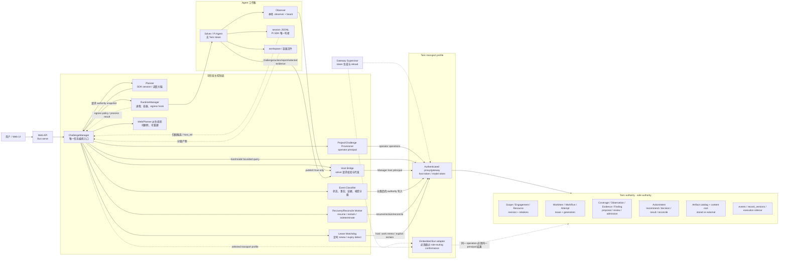
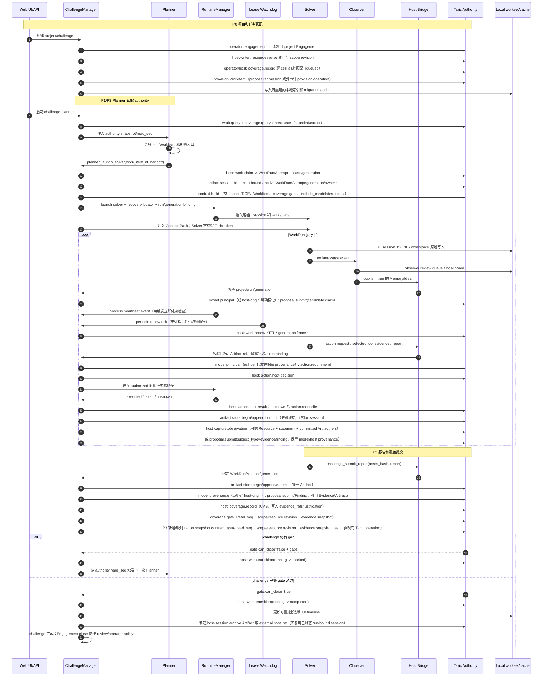
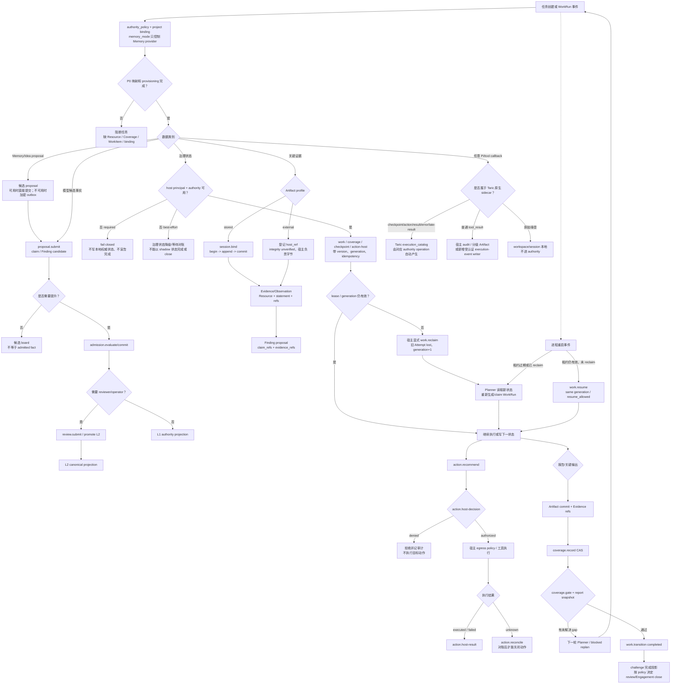

# BreachWeave 改造后的 Taric 目标架构、任务时序与数据流

本文推演 [breachweave-taric-sole-authority-gap-analysis.md](breachweave-taric-sole-authority-gap-analysis.md) 中 P0-P3 完成后的目标态，重点说明：

- 改造后 Planner、Solver、Observer、Manager/Runtime 与 Taric 的调用边界；
- 任务创建、调度、执行、证据提交、租约失效和收尾的时序；
- 状态、提案、证据、过程事件、活跃工作集和故障的分支；
- 哪些边是 Taric 当前已有 operation，哪些需要 BreachWeave 的 provisioning、bridge 或恢复工程。

本文是目标设计和验收模型，不把当前运行结果描述成已完成改造。当前真实状态见 [breachweave-taric-execution-dataflow.md](breachweave-taric-execution-dataflow.md)；差距、角色合同和本机 authority 证据见 [breachweave-taric-sole-authority-gap-analysis.md](breachweave-taric-sole-authority-gap-analysis.md)。P4 多主机只标出边界，不作为 P0-P3 已交付内容。

## 1. 目标态的判断边界

目标态成立的必要条件不是“每个文件都搬进 Taric”，而是：任务治理事实只能从 Taric authority 恢复，BreachWeave 本地文件只能是活跃工作集、归档副本或可重建投影。

| 领域 | P0-P3 目标事实源 | 仍由宿主维护的内容 |
| --- | --- | --- |
| Scope/Engagement/Resource | Taric canonical records 和 revisions | 用户输入的 API 表单、派生 UI 缓存 |
| WorkItem/WorkRun/Attempt/Checkpoint/ActionIntent | Taric workflow tables 和审计事件 | Planner 的调度算法、Runtime 的进程控制 |
| Coverage/Observation/Evidence/Finding | Taric records/proposals/review/admission | 模型生成、人工 review 界面 |
| Artifact | Taric-managed stored Artifact，或明确标为 `external` 的 host_ref | 外部对象存储、复制、删除和 retention 执行 |
| Pi session/workspace | 活跃文件仍在本地；选定内容归档或引用到 Taric | SDK transcript、容器、seek/原地覆盖文件系统 |
| Secret/egress/instance | 宿主 runtime 和 secret store | Taric 只记录必要的决策和实例元数据 |

### 1.1 目标态的三个前置决策

1. **Engagement 映射：** 推荐 per-project Engagement；challenge 是该 Engagement 下的 WorkItem 集和 Coverage 子集。若继续共享 Engagement，BreachWeave 必须维护 challenge-to-resource/cell 映射，并自行计算子集 gate。
2. **WorkItem provisioning：** Coverage cell 不能代替 WorkItem。Taric 公共 registry 没有普通 `work_item.create`，因此 P0 必须选择 `proposal.submit(subject_type="work_item")` 加 admission，或新增受审计的 host provisioning operation。
3. **Artifact profile：** 报告和关键证据使用 Taric-managed stored Artifact 的 begin/append/commit；external Artifact 只登记 `host_ref`，默认不验证或抓取字节，不可直接当作可恢复证据。

生命周期接管不能继续复用 `memory_mode` 这个只面向 Memory provider 的开关；P0 应增加独立的 `authority_policy`，分别定义 Work/Coverage/Artifact/Action/Checkpoint 和 event capture 在 `required`、迁移影子或 legacy 模式下的行为。

### 1.2 目标态仍然不由 Taric 负责的事情

Taric 不运行模型、不选择或启动 agent、不调度工具、不执行目标操作、不管理凭据，也不替宿主执行 egress proxy、DNS pinning、redaction 和 retention。Taric 的 `action.*` 只记录建议、宿主决策、执行结果和 reconcile；目标动作始终由 BreachWeave Runtime/工具链执行。

## 2. 改造后的系统架构图



图中的关键约束如下：

- **Solver 和 Observer 都没有 Taric 直连。** Solver 通过 Host Bridge 请求 Memory/Idea、报告、动作和选定证据；Observer 的本地 board 只有明确 `publish_to_challenge=true` 才进入 bridge。
- **Manager 是受信宿主调用的收敛点，但不是 Taric 的调度替代品。** Planner 仍决定下一项工作，Manager 负责用 host/operator principal 执行 authority mutation。
- **Planner 自身没有 Taric principal。** Planner 的读取由 Manager 代查；写入 WorkRun、Coverage、ActionIntent 和 Artifact 也由 Manager/Runtime 执行。
- **Provisioner 与运行态 principal 分离。** `engagement.init` 和资源/WorkItem provisioning 使用 operator 或受支持的 writer 路径；`work.*`、`coverage.record`、`checkpoint.commit`、`action.host-*` 和 `artifact.*` 使用 host principal。
- **续租由 Watchdog 驱动。** Runtime 的进程事件可以触发立即检查，但不能替代定时 renew；Taric 不会自动 reclaim，宿主检测租约过期后必须显式调用 `work.reclaim`。
- **Network 和 Embedded 不是天然等价。** network adapter 按 operation 路由 host/model token；embedded adapter 必须修复并验证 host-only operation 的 principal 路由后才能承载完整治理闭环。
- **Authority 与工作集分层。** session JSONL、workspace 和容器仍在本地；只有归档副本、选定证据或 external host_ref 进入 Artifact 层。

## 3. 三角色与 Taric 的调用关系

### 3.1 角色调用矩阵

| 角色 | 直接 principal | 目标态调用 | 调用入口 | 不允许做的事 |
| --- | --- | --- | --- | --- |
| **Planner** | 无 | 读取 `work.query`、`coverage.query`、`host.state`；P3 请求 bounded `context.build/query` 投影 | Manager 代查并提供固定 read sequence；context 投影按 adapter role-routing 使用受限 query principal | 不直接写 Taric，不直接 claim，不决定 authority 的事实状态 |
| **Solver** | 无 | 通过 bridge 请求 Memory/Idea/Finding proposal、`action.recommend`、报告提交、关键输出上传 | Solver RPC/Host Bridge；Manager 校验 project/run/generation 后代发 | 不携带 Taric token；不调用 `coverage.record`、`work.*`、`action.host-*`、`artifact.content.read` |
| **Observer** | 无 | 本地整理 board；显式 publish 时请求 `proposal.submit` | `.observer` 本地 session -> bridge -> Manager；proposal 按 model provenance 提交，或明确标注 host-origin | 不是 Taric reviewer，不执行 admission、L2 promotion 或目标动作 |
| **Manager/Runtime** | host；Provisioner 另有 operator/writer | `work.claim/renew/reclaim/transition`、`coverage.record`、`checkpoint.commit`、`action.host-*`、`artifact.*`、`capture.observation` | Host Bridge、Watchdog、治理 service、Taric adapter | 不把本地 shadow 当 authority；不替 Taric执行目标动作 |
| **Provisioner** | operator/writer | `engagement.init`、`resource.revise`、WorkItem provisioning、逐 cell Coverage 初始化 | 项目创建/迁移流程 | 不处理 Solver 的运行时租约和目标动作 |
| **Reviewer（后续治理面）** | reviewer | `review.submit` | 独立 Web/API workflow | 不由 Observer、Solver 或 Manager 冒充 |
| **Operator（治理面）** | operator/writer | `admission.evaluate/commit`、`admission.promote_l2`、Engagement close | 独立 Web/API workflow | 不由 Observer 或 Solver 冒充 |

### 3.2 Memory/Idea 与领域事实的关系

Memory/Idea 继续兼容现有 challenge board，但它们是 candidate claim 的投影，不是完整漏洞领域模型。目标态将不同数据分开：

```text
Memory / Idea       -> proposal.submit(subject_type=claim) -> candidate board
Tool evidence       -> Artifact commit -> Evidence/Observation -> Finding proposal
Action request      -> action.recommend -> host-decision -> host-result -> reconcile
Coverage status     -> coverage.record (CAS) -> coverage.gate
Task execution      -> WorkItem -> WorkRun/Attempt -> checkpoint / transition
```

Artifact commit 本身不会自动生成 Evidence/Observation；Evidence/Observation 必须有可信 Resource、statement、时间、limitations 和同 Engagement 的 Artifact refs。Finding 还需要 claim/evidence refs，并按产品要求经过 admission/review。

### 3.3 读取水位和恢复

所有 Planner/Manager 读取都应携带可追踪的 `read_seq` 或 cursor：

- Manager 以 host principal 使用 bounded `work.query`、`coverage.query` 和 `host.state`，避免把大 Engagement 的 gate 作为高频调度轮询；
- `context.build/query` 是受限的上下文投影读取，不授予 Planner 或 Solver 写权限；candidate memory 必须显式标记 `include_candidates` 和 trust state；其 model/host transport role 由 adapter conformance 固定，不能因 embedded/network profile 不同而改变；
- checkpoint 必须记录与 context manifest 对应的 `source_read_seq`；
- `work.resume` 只返回恢复包和 premise checks，不自动执行或自动重新 claim；
- 若 lease 已过期并完成 reclaim，旧 generation 的 checkpoint、action 和结果必须被隔离，Manager 按 `replan_required` 生成新 WorkRun。

## 4. 一次任务的目标时序

下面的时序把“WorkRun 终态”和“报告/Engagement close”分开：目标主路径在 Coverage gate 通过后才把本次 WorkRun 标为 completed；即使某个 WorkRun 已进入终态，也只有 Coverage gate、证据和 review/close 规则满足时，challenge 或 Engagement 才能关闭。



### 4.1 时序中的重要约束

1. **WorkItem 必须先存在。** `coverage.record` 预配 cell 不会自动产生可 claim 的 WorkItem；任务创建流程必须单独完成 WorkItem seed/provision。
2. **报告不是单一写入。** 报告 bytes、Evidence/Observation、Finding proposal、Coverage CAS 和 WorkRun transition 是不同操作；Artifact commit 不等于 Finding 已 admitted。P3 的 report snapshot 需要新增或映射到受审计的 authority-bound contract，不能把当前治理 helper 的进程内 snapshot 当作 Taric operation。
3. **动作先决策后执行。** Taric 只记录 ActionIntent；实际连接必须经过宿主 egress policy，执行后才写 result。未知结果只能通过 reconcile 收敛。
4. **租约失效不等于自动恢复。** Watchdog 定时 renew；发现过期后由宿主显式 `reclaim`。`reclaim` 后新 generation 才能继续；`work.resume` 返回 `replan_required` 时，Manager 必须重规划并创建/claim 新尝试。
5. **本地文件是迁移期投影。** P1 影子双写期可以保留 `attempts/*.json` 和 `submissions/*.json` 对账；P3 后它们不能再独立决定完成状态。

## 5. 目标任务数据流分支图



### 5.1 分支语义

1. **Provisioning 分支：** 任何 Resource、Coverage cell、WorkItem、Engagement 或 host binding 缺失，都在任务开始前阻断。不能以标题前缀、challenge ID 或本地 asset 数组替代 authority identity。
2. **Authority 可用性分支：** host-only 状态操作不可用时，`taric_required` 必须 fail closed。`taric_best_effort` 只允许候选 proposal 进入加密 outbox；不能把本地 shadow 的 `scanned`、submission 或 stats 当成新的权威事实。capture observation 在 dispatch 不确定时进入 indeterminate/reconcile，不自动重放。
3. **Candidate/Admission 分支：** proposal pending、L1 admission 和 L2 promotion 是不同状态。Memory/Idea candidate 可以供后续工作参考，但不能直接成为 Finding、Evidence 或 close 的依据。
4. **Artifact/Evidence 分支：** stored Artifact 在 commit 前不可作为已提交内容读取；external Artifact 只登记引用且默认未验证。两者都必须在同 Engagement 下建立 Evidence/Observation，Artifact alone 不能满足证据门。
5. **过程事件分支：** Taric 原生 execution sidecar 只由 checkpoint、action、error 和迟到结果等 authority path 产生，不能直接接收全量 Pi `tool_result`。普通工具事件应进入宿主 audit、分级 Artifact，或通过新增的受认证 execution-event contract。
6. **租约分支：** 旧 generation 的迟到 result、checkpoint、action 和 Artifact 写入必须拒绝或隔离。`work.resume` 不负责自动恢复执行；`replan_required` 后由 Planner 生成新 WorkRun/Attempt。
7. **动作分支：** `action.recommend` 是请求，`action.host-decision` 是宿主授权，`action.host-result` 是执行回报；Taric 不执行目标动作，unknown 结果必须 reconcile。
8. **完成分支：** WorkRun terminal、challenge coverage gate、报告 snapshot、Finding review 和 Engagement close 是不同层次。Coverage gate 必须按 evidence、justification、revision、冲突和 recall 条件判断，不等价于所有本地资产 `scanned=true`。

## 6. 目标数据归属和迁移阶段

| 数据 | 当前事实源 | P0-P3 目标归属 | 迁移验收 |
| --- | --- | --- | --- |
| project/scope/assets | `challenge.json` | Taric Engagement/Scope/Resource/Revision | 删除本地缓存仍能查询完整资源与 scope 版本 |
| WorkItem 计划 | Planner 快照/本地 challenge | Taric WorkItem；BreachWeave 保存 challenge-to-work 索引 | `work.claim` 可以按稳定 WorkItem ID 竞争 |
| attempts/runtime lease | `attempts/*.json`、进程状态 | Taric WorkRun/Attempt/lease/generation | reclaim、resume 和 stale_version 可复现 |
| coverage cells | `scanned` 和 Planner 判断 | Taric Coverage CAS + gate | status、evidence、justification、revision 一致 |
| report | `submissions/*.json` | stored Artifact + Evidence/Observation + Finding proposal | bytes、digest、refs 可从 authority 恢复 |
| Memory/Idea | Taric claim proposal/record | 兼容性 candidate/admitted board projection | candidate 不被误显示为 canonical Finding |
| action | Solver/Runtime 事件 | ActionIntent state machine | decision/result/unknown/reconcile 完整可审计 |
| 普通 tool_result | `taric-capture-audit.ndjson` 或 session | 宿主 audit、分级 Artifact 或新 execution-event contract | 明确保留策略和 sourceKind，不冒充 execution_catalog |
| Pi session | `solvers/<id>/session/*.jsonl` | 本地活文件 + 归档 Artifact/host_ref | session_id 与 run/generation recovery locator 可追踪 |
| workspace | `solvers/<id>/workspace/` | 本地活工作集；关键输出升级为 Artifact | 不把原地文件系统当作 Taric canonical |
| Planner/stats/UI timeline | 本地快照 | 可重建 projection | 清空投影后可由 authority 重建 |
| credentials/containers | 宿主 env/runtime | 宿主独占；只登记必要元数据 | Taric 不接收 secret 或执行容器操作 |

### 6.1 以 98496a92 为例的目标态投影

这是一种改造后应能得到的 authority 投影，不是对当前数据库的回溯。当前样例有两次本地 attempt、两份本地 submission、两项 `scanned=true` 资产和 429 条被拒的 capture audit；P0-P3 完成后，预期关系如下：

```text
project / 98496a92
  -> per-project Engagement
      -> Scope revision + Resource revision（目标资产）
          -> WorkItem(asset/category/operation) × Coverage cells(queued)
              -> claim asset A -> WorkRun/Attempt generation=1
              -> claim asset B -> 另一个 WorkRun/Attempt generation=1
              -> 若某一 WorkRun lease 失效：reclaim -> 同一 WorkItem 新 generation + 新 Attempt
                  -> run-bound Artifact session
                      -> report Artifact + Evidence/Observation refs
                      -> Finding proposal（candidate -> admission/review）
                      -> coverage.record(CAS) -> coverage.gate(read_seq)
                      -> gate pass -> WorkRun completed -> challenge close policy
```

429 类普通 `tool_result` 仍不会被伪造成 Observation，也不会因为“有 sidecar 开关”自动进入 Taric `execution_catalog`：它们按 sourceKind 分级为宿主 audit、选定 Artifact 或未来的受认证 execution-event writer。Pi session/workspace 仍是本地活文件；终态 transcript 使用独立 host-session 归档 session，不复用已终态的 run-bound Artifact session。

## 7. 回滚、可用性和 P4 边界

### 7.1 迁移期回滚

- P0 只新增 authority provisioning 和对账，不改变旧完成判定。
- P1 使用本地 attempts 与 Taric WorkRun 双写；稳定 idempotency key 对账一致后，才切换 Manager 的读路径。
- P2 先让报告/关键证据双写和恢复校验通过，再停止 submission 作为事实源。
- P3 切换完成判定前，必须证明 coverage 子集、report snapshot 和本地 `scanned` 对账一致；切换后本地文件只能作为投影。
- `tch.taric.enabled=false` 或 challenge 级 `legacy_local` 仍可作为回滚开关，但不能把回滚产生的本地状态伪装成 Taric 已提交事实。

### 7.2 Taric 不可用时的行为

| 操作 | `taric_required` | `taric_best_effort` 迁移期行为 |
| --- | --- | --- |
| Work/lease/coverage/checkpoint/action-host | fail closed，任务阻断或进入待恢复 | 不把本地写入升级成 authority；保持影子对账或等待重试 |
| Memory/Idea proposal | 阻断或显式失败 | 加密 outbox，恢复后按幂等键顺序 replay；查询只读 authority |
| `capture.observation` | 校验/dispatch 失败则显式记录治理失败 | dispatch 不确定标记 indeterminate，人工 reconcile，不自动重放 |
| session/workspace 活文件 | 继续由 Pi/Runtime 写入 | 继续由 Pi/Runtime 写入；是否归档由 retention policy 决定 |

### 7.3 P4 多主机预留

P4 需要双物理机 PostgreSQL conformance、网络中断恢复、token revocation、host-local spool 和对象存储路由验证。PG 共享 metadata，不自动复制 Artifact bytes；不能使用共享 SQLite、NFS、独立 SQLite 副本或 Git 作为 authority。P4 不改变本文的三角色调用面，但会把每个宿主的 host principal、gateway token 和 Artifact 路由显式化。

## 8. 目标态验收清单

1. 新 challenge 能创建/绑定 Engagement、Scope、Resource、Coverage 和可 claim 的 WorkItem；所有 ID、revision、owner 和 token binding 可追踪。
2. Planner 只通过 Manager 获取 bounded authority snapshot；Solver/Observer 无 Taric token；Manager/Runtime 使用正确 host/operator principal。
3. network 和 embedded adapter 对每个 operation 的 role-routing 结果一致；host-only operation 不会以 model principal 执行。
4. `work.claim/renew/reclaim/transition/resume` 的同 generation、过期 generation、并发 claim 和迟到结果测试通过。
5. 报告 Artifact commit、Evidence/Observation 引用、Finding proposal、Coverage CAS 和 report snapshot 能从 authority 查询和恢复。
6. 普通 `tool_result` 不再被错误地统计为 Taric execution sidecar；过程事件分级、sourceKind、retention 和 indeterminate reconcile 可审计。
7. challenge gate 与 local `scanned` 对账通过后，删除本地 Planner/stats 投影仍可重建完成状态。
8. Web/治理进程重启后，能够从 authority locator 恢复 WorkRun/Checkpoint/Artifact session，或明确返回 `blocked/replan_required`，不会把新的空 Map 当作全新任务。
