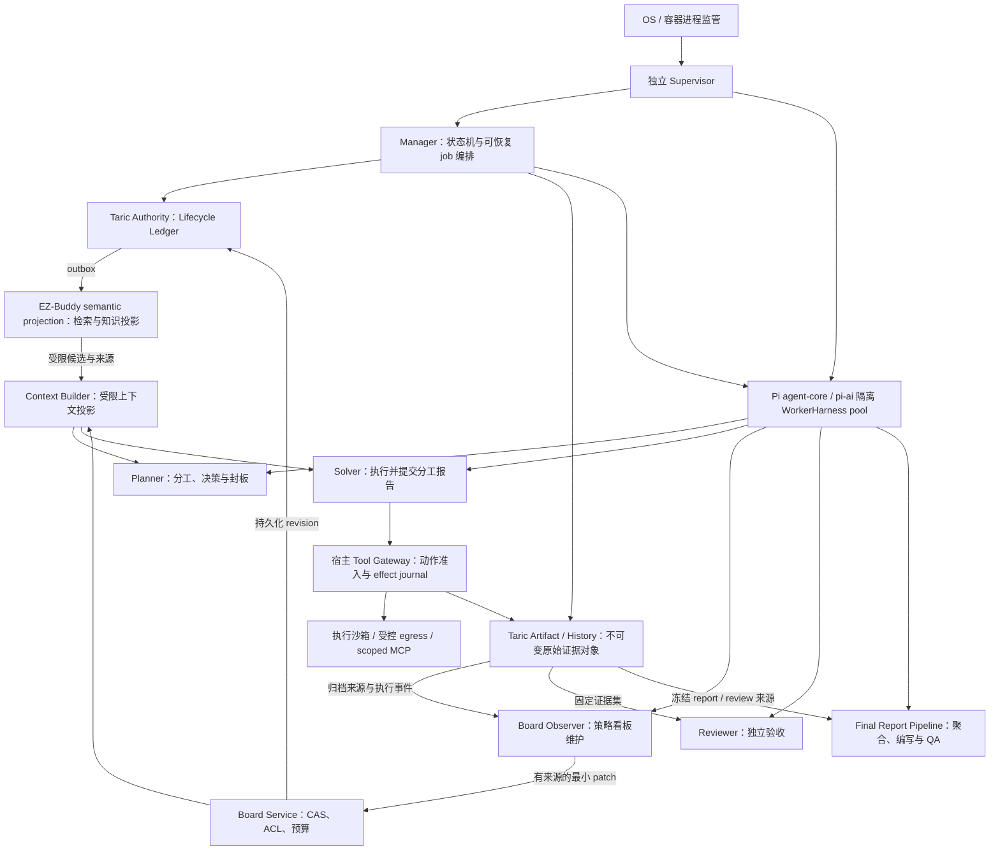

# EZ-Buddy 报告即停止、独立审核并生成最终渗透测试报告的最优智能体任务生命周期重构与实现方案

**作者**：EZ-Buddy 工程组
**最后更新**：2026-11-06
**状态**：Final Design / Implementation Plan
**范围**：EZ-Buddy Manager、Planner、Solver、Board Observer、独立 Reviewer、Final Report Pipeline、进程 Supervisor 与 Taric 外置记忆
**技术基线**：Taric `b2542a080d9690521bcf5dc59c3c9efcf1675efb`（workspace/core `1.1.0`、Core API `1.5.0`、adapter `1.1`、record schema `1.0.0`、authority storage `authority-storage/5`、SQL `authority-sql/5`）；Pi v1.5.0，commit `f9a26365568127461c47a07a37dcb42c140a3ac5`；生产 Worker 使用 pi-agent-core / pi-ai，宿主持有 canonical history 与控制权

> **版本与能力边界声明**：本版以 Taric 上游精确提交 `b2542a080d9690521bcf5dc59c3c9efcf1675efb` 为实现基线。EZ-Buddy 实现必须锁定 `packages/core/src/taric/compatibility.ts`、operation registry、真实 gateway/SQLite/PostgreSQL conformance 和运行时 smoke，完成后才可宣称满足本版合同。Taric 提供 authority、治理、WorkRun 恢复、Artifact 和受限历史检索；它不执行目标动作、不调度 worker、不代表人工审批、不管理凭据，也不替宿主完成脱敏、保留和删除策略。

## 摘要

我们将智能体任务从“solver 自报完成后等待内部 Observer 审核”重构为由 Manager 控制的持久化生命周期。Solver 只负责执行和提交报告；报告被 Manager 接受后，当前 solver run 立即结束并释放资源。Manager 冻结任务证据包，创建独立的 Reviewer job；Reviewer 在 solver 进程之外只读审核任务清单、报告和证据。Planner 根据审核结果决定继续或停止。

Board Observer 是必备的逻辑角色，保留原有使命：“维护当前的策略看板，使其保持紧凑、耐压缩、高信号；任务不是多做一点，而是让看板更准、更稳、更少噪音。”我们重构它的执行位置、输入输出和写入协议，移除每个 solver 内部的常驻 sidecar 以及附加给它的最终验收职责，不移除策略看板维护。Taric 保存来源和版本，Board Observer 负责语义整理，Runtime 负责安全压缩，Reviewer 负责验收，Planner 负责决策。

当 Planner 明确确认当前授权范围内不再创建新的 solver assignment，且所有已有 assignment 和 run 均已处理到合法终态时，Manager 执行 challenge 级封板，冻结 scope、任务清单和证据水位，启动独立的 Final Report Pipeline。流水线先确定性汇总和规范化 finding，再对候选重复项进行受控判定，生成结构化报告 IR，渲染最终报告，最后由独立 QA Reviewer 校验证据、去重、冲突和覆盖范围。最终报告是有版本和 provenance 的不可变交付物，不是 Planner 的附带总结。

“全部 Solver 完成”由 assignment ledger 和 Planner 的显式 seal 决定，不能靠当前 Solver 数量、某一条报告里的 completed 数字或模型总结推断。增量 submission 只有在对应 assignment 明确 finalization 后才冻结；最后一次 report submission 不自动意味着 challenge 进入最终报告阶段。

Manager 由独立的进程级 Supervisor 监管。生命周期写入逻辑上经过事务型 Lifecycle Ledger，最终由具备事务、CAS、幂等和恢复合同的 Taric structured Authority 持久化；Taric-managed Artifact/History 是 canonical raw-evidence object store，Evidence record/admission 才是 canonical evidence/fact。Taric 的语义记忆/检索是独立的数据平面，不可代替生命周期账本。Authority 以稳定引用和 hash 管理证据对象。任何模型调用失败、Manager 重启、Reviewer 超时或记忆检索不可用，都不能让 solver 无限保持 `running`，也不能把缺少审核结果解释为“没有待审核事项”。Taric Authority 不可用时，Manager 停止接受新分工；已运行 solver 提交的报告先写入有界、可恢复的本地 delivery spool，再由 Supervisor 停止进程，报告在 Authority 确认前显示 `pending_commit`，不能伪装为已提交。

Pi 1.5.0 源码复核后，我们进一步移除生产角色对 `AgentSession` 的依赖。WorkerHarness 复用 `pi-agent-core` 的原生 agent loop 与 `pi-ai` provider runtime；EZ-Buddy History Ingestor/Authority extension 保存 canonical events、ContextRevision、工具 effect 和报告事务，Taric b2542a0 的窄 execution catalog/history index 只作为受控派生读取面。宿主唯一决定重试、压缩、续跑与停止。`AgentSession`、CLI RPC 或 `pi-durable` 不作为第二套生产调度器或可写会话权威。逐项源码依据、取舍和现有实现核对见 [Pi 1.5.0 技术复核](pi-1.5-agent-lifecycle-architecture-review.md)。这是最终选型，不是保留旧路径的过渡适配。

### 最终架构以正确性和可证明的收益为目标，不以组件数量为目标

本方案只定义一套最终运行语义，不保留 parked solver、旧 sidecar 最终审核、本地 JSON 与 Taric 双写、旧进程 resume 等过渡运行路径。后文实施步骤是工程依赖和一次性切换顺序，不是允许这些旧路径成为长期折中方案。

逻辑角色、可恢复 job 和 OS 进程是不同概念。Supervisor 与 Manager 必须有独立故障域，Solver 必须有执行隔离；Board Observer、Reviewer、Report Writer、Final QA 使用受 Supervisor 管理的短生命周期隔离 session/job，可共用有界 worker pool。独立审查要求输入、权限和批准主体分离，不要求每个阶段都部署一个常驻服务、一个新模型或一台机器。聚合、CAS、coverage 统计和模板渲染默认由确定性代码执行，只有语义整理、争议判断和叙述需要模型。没有验证收益的额外智能体、多重自审或无限重试不属于“最优”。

### 技术先进性以可验证的合同衡量，不以启用全部框架功能衡量

Pi v1.5.0 是 EZ-Buddy WorkerHarness 的固定基线。Taric b2542a0 认证 `@earendil-works/pi-coding-agent` 1.5.0、commit `f9a26365568127461c47a07a37dcb42c140a3ac5` 的 adapter hook 合同；WorkerHarness、目标工具和调度仍须由 EZ-Buddy 自己完成认证。1.5.0 的直接影响包括 pi-schema 参数校验切换、执行输出上限与取消修复、session 写失败回滚、摘要认证和 context-edit 处理修复。`finishTurn`、`prepareRequest`、并行工具和 `terminate` 是已有能力，不能包装成这次升级才获得的生命周期保证。未认证的同 major 版本只能进入安全的只读 session/context 子集，更远版本只保留最小诊断能力，不能静默视为兼容。

我们采用 Pi 擅长的模型访问、流解析、工具循环、schema 和传输；EZ-Buddy 保留领域控制面、权限、外部副作用和物理资源管理。Taric 的 Node Core 也不能被假定为 EZ-Buddy Bun 原生 runtime：EZ-Buddy 要么使用经过验证的 `@taric/driver-bun-sqlite`，要么经 proxy/gateway/MCP 接入，并对 Bun、content root、TLS、cursor key 和恢复做本项目 conformance。`pi-durable` 的原子 admission、checkpoint、任务 ownership 和 replay 策略有参考价值，但其自动恢复、afterRun busy、单 owner storage 及独立 task graph 不直接替代本方案的 Taric Authority。最终只部署一套领域调度与恢复语义，不通过再增加 durable Harness 消除另一套 Harness 的问题。该取舍基于事务和执行语义，不以兼容旧代码或 API 是否 experimental 为决定因素。

“最优”在本方案中有明确判据：正确停止、无越权副作用、证据可追溯、覆盖不漏项、故障可恢复，并在这些约束下控制延迟、费用和资源占用。生产级正确性由合同测试、状态机属性和故障注入验收证明；源码审查不能替代运行证明，也不宣称已得到所有负载下的最优性能。

### Taric b2542a0 能力基线与本方案的使用方式

Taric 本次更新带来的能力必须进入生命周期主路径，而不能只作为“可选记忆插件”。上游 workspace 是 private workspace，版本号不等于 npm 发布或 EZ-Buddy package integrity 证据；package integrity、registry digest、运行时 conformance 和 gateway TLS/身份锁定是 EZ-Buddy deployment gate 的新增校验。下表区分 Taric 已提供的强合同、Taric 提供但仍需宿主编排的能力，以及需要扩展 Taric Authority 或由 EZ-Buddy 自己实现的能力：

| Taric b2542a0 能力 | 在生命周期中的正确用法 | 仍由 EZ-Buddy 负责的部分 |
| --- | --- | --- |
| `ScopeRevision`、ROE policy、Resource/ResourceRevision | 创建/claim WorkRun 前固定范围；每次 renew、checkpoint、action、result、run-bound Artifact 写入前重验当前 scope、policy digest、有效时间和资源 revision | Manager 的 assignment、目标工具准入、Host egress、凭据注入和物理执行 |
| `WorkItem`、`WorkRun`、`Attempt`、lease、generation、`work.resume` | 作为 solver/Reviewer/Writer 可恢复执行的 fencing 根；旧 owner、旧 attempt、旧 generation 的写入必须拒绝；恢复先 query active runs，再 resume/reconcile/replan | Manager 的 job queue、worker 启停、停止树、资源 slot 和 continuation 决策 |
| `action.recommend` / `action.host-decision` / `action.host-result` / `action.reconcile` | 模型建议、Host 授权、实际执行、未知结果对账四步分离；unknown 永不自动重放 | Tool Gateway 的 dispatch permit、目标授权和远端副作用收敛 |
| Artifact session、Taric-stored Artifact、哈希/长度/分块/manifest 完整性 | 报告、关键工具输出、证据和执行历史以不可变 Artifact 保存；external ref 只作为 locator，不能充当可恢复原文 | Artifact ACL、加密、脱敏、保留/删除、secret 扫描和外部字节的可用性 |
| `history_content_class: execution_history`、`history.query`、`artifact.search`、`artifact.history.read` | 将已提交的执行原文作为有水位、有游标、可精确回读的受限上下文源；`incomplete` 必须阻断“无记录”推断 | History Ingestor 的采集、segment/branch manifest、压缩 CAS、ContextRevision 和上下文选择 |
| Proposal → Evidence → Review → Admission | 模型只产生 candidate/proposal；高信任事实必须有 pinned evidence snapshot、独立 review 和版本化 policy | Assignment Reviewer、Board 语义整理、最终报告 QA 以及 assignment/finalization 状态机 |
| Coverage manifest/gate、`report.snapshot.commit`、`engagement.close/reopen` | 用完整 coverage、authority/evidence watermarks、Artifact integrity 和未完成 WorkRun/action 检查约束最终关闭 | challenge 级 seal、SourceManifest、Final Report IR、发布权限和报告流水线 |
| Core operation registry、固定 principal、动态 MCP tool list | MCP 目录按 registry、role、grant、Engagement 动态生成；宿主不能复制或硬编码工具权限 | MCP client 的副作用门、角色资源清单、模型预算和宿主安全边界 |
| event/outbox、read sequence、best-effort host event signals、`audit.verify/doctor/reconcile` | 用 read sequence/cursor 做恢复与审计水位；事件信号只作唤醒提示，查询和水位才是事实；派生索引可重建 | Manager ledger 的 assignment/review/finalization 事务、Supervisor 和跨系统 reconciliation |

Taric b2542a0 未提供本方案所需的 Assignment、SolverRun 终态、ReviewJob、PlannerDecision、BoardRevision、Finalization、StopEffect 或 FinalReportRevision 作为一组现成领域 API。它的 WorkRun/Attempt、Action、Artifact、Coverage 和 CloseDecision 是可复用的底层合同，但不能把相近名称直接当成完整生命周期实现。实现路径应优先在 Taric Authority 上增加带 operation registry、schema、CAS、幂等、lease 和 outbox 的 EZ-Buddy lifecycle 扩展；在扩展未通过真实 conformance 前，不得用 Taric semantic query、UI Map 或本地 JSON 伪装成同等权威。

推荐的最小可恢复主线固定为：

```text
operator 初始化 Engagement / ScopeRevision / Resource / Coverage
  -> Manager 创建 assignment 与 WorkItem
  -> host claim WorkRun + Attempt，逐次 renew / fence / revalidate ROE
  -> Solver 产生 proposal、checkpoint 和 action recommendation
  -> Host 授权并执行 action，回写 result 或 unknown 后 reconcile
  -> Artifact commit + execution_history index/watermark
  -> assignment report intake -> solver stop -> independent review/admission
  -> Planner continuation/stop -> coverage gate -> report snapshot
  -> challenge seal -> Final Report IR/QA -> operator close/publish
```

任何一步“查询为空”“MCP 没列出工具”“Artifact search 未命中”都必须结合 principal、Engagement、cursor/read sequence、index watermark 和 policy 状态解释；不能把 transport 成功、空页或模型总结当作领域事实。

## 目标和非目标

### 目标

- 报告被接受后，solver 在有界时间内停止并释放资源。
- 审核与 solver 进程完全解耦，审核失败不会让 solver 持续运行。
- Planner 始终能看到待审核、审核中、审核失败和审核完成的任务。
- 审核结果绑定到精确的 assignment、run、report version 和 evidence snapshot。
- Manager、Reviewer、Planner 或 Taric 任一组件重启后，任务可以恢复且不会重复执行。
- 通过证据逐项审查遗漏、虚报、偷懒、证据不足和真实阻塞。
- Supervisor 可以在 Manager 崩溃或失去心跳时重新拉起并清理孤儿进程。
- Taric 可以扩大跨 solver、跨任务的记忆复用，但未经审核的记忆不能直接授权停止任务。
- 保留专门的策略看板维护职责：有界上下文、证据与候选分离、失败边界、去重、陈旧条目退役、可追溯压缩和 continuation handoff。

### 非目标

- 让 Reviewer 负责策略规划或直接操作 challenge。
- 让 Supervisor 判断漏洞是否真实、替 Planner 选择测试策略。
- 让 Taric 的语义记忆/搜索接口承担生命周期事务权威。
- 用检索存储、Planner 的一次性总结或最终报告生成替代执行期间的策略看板维护。
- 通过 UI 文本、tmux pane 内容或自然语言总结判断任务是否完成。

## 最终架构



Taric structured Authority 是 Lifecycle Ledger 的目标 canonical backend；Taric-managed Artifact/History 是不可变的原始证据对象和执行历史载体，Evidence record、admission 和 Finding 才能表达 canonical evidence/fact，hash/integrity 不等于漏洞成立。EZ-Buddy semantic projection 接收已提交 outbox 并提供受限知识检索。Taric b2542a0 本身提供 authority、Artifact history index 和 best-effort host signals，不自动提供向量 Memory Plane，也不会把 outbox 自动投影成 EZ-Buddy 的 Board/semantic store。最终报告正文、状态和证据引用以 Ledger/Evidence admission 与 `FinalReportRevision` 为准；三者可以共用部署，但必须有不同 operation、权限和一致性合同。若 Authority/Artifact 尚未满足本方案合同，最终架构不能宣称完成，也不能让本地 JSON 形成并行可写事实源。

执行期间的信息通路是 `执行事件/证据 → Board Observer → 版本化 StrategyBoard → 受限上下文投影 → 活跃 Solver/Planner`。Board Observer 由 Manager 从宿主调度，不嵌在 Solver 的事件回调或最终提交栈中；其失败不会阻止 report accepted、stop 或独立审核。

### WorkerHarness 复用 Pi 循环，由宿主掌握每个执行边界

生产角色不调用 `createAgentSession()`，不加载默认用户目录、祖先目录资源或任意可执行 extension。WorkerHarness 创建原生 `Agent`，不复制 Pi agent loop；只增加不可绕过的 Journal、Tool Gateway、Context Builder、模型 transport wrapper 和 StopCoordinator。人工 CLI 可以作为独立产品入口存在，但其会话、插件和队列没有 assignment 权威，也不成为生产恢复路径。

| 执行边界 | 使用的 Pi 接入点 | 宿主强制合同 |
| --- | --- | --- |
| 完整消息到工具批次 | 先注册的 awaited `message_end` listener | 先识别并校验 singleton final，交 Terminal Intake；普通批次归档确认后放行 |
| 参数校验到工具意图 | `beforeToolCall` + 受控 execute wrapper | host 绑定身份、strict 领域校验、保存 intent；真实 dispatch 前再次验证 fence |
| 工具流到模型可见结果 | Tool Gateway 的流采集与投影 | 截断前原文归档、receipt/结果确认，再返回有来源的精简结果 |
| 每个模型轮次开始 | `prepareRequest` | 已提交 ContextRevision + 固定 input watermark 内连续归档尾段；检查 lease、latch、预算和屏障 |
| 真正发送 provider 请求 | `streamFn` wrapper | 保存最终 normalized transcript 的 request manifest 后才发送；统一 credential 路径 |
| 当前轮次结束 | `finishTurn` | terminal/fatal 时返回 `{ action: "end" }`；正常续跑仍受宿主门禁 |
| 进程结算与资源回收 | 独立 StopCoordinator / Supervisor | 有界 abort、退出确认、强制回收；不在工具或 awaited listener 内等待自身 idle |

Pi 会把部分 hook 异常转成普通错误结果，`Agent.prompt()` resolve 也不能证明任务成功。因此持久化失败、权限丢失或上下文提交未知时，宿主先锁定 FatalLatch 并同步触发 abort，再返回失败；所有 execute、模型请求和输入入口都检查该 latch。最终提交有独立 Terminal Intake：完整消息先纯校验 singleton final、身份和参数，将 report envelope 连同该消息冻结、锁 gate 并有界交付/spool，再做普通 Journal。即使随后 Journal 失败令 loop abort，最终交付和停止也不依赖 tool execute 得以运行；final execute 只是同一幂等 Intake 的结果适配，不再次产生终态副作用。UI、telemetry exporter 和语义索引消费异步投影，不进入必须成功的提交链。关键 listener 的远端等待有 deadline，失败进入安全停止，不能无限阻塞 `agent_end` settlement。

### 所有角色使用不可变资源清单、严格输出和统一预算

每次 job 固定 RoleResourceManifest：prompt/skill 内容 hash 与优先级、工具 input/output schema、MCP server 与工具绑定、模型/provider 策略、thinking level、scope/授权、artifact/recall 权限及预算版本。prompt、skill、schema 与批准资源正文均引用已持久化的不可变 Artifact，工具实现绑定可恢复构建产物/执行镜像 digest，不能只保存 hash 后依赖可变本地文件。provider 配置只存批准版本与 credential 引用，不存 secret 正文。资源来源路径仅用于展示，不能代替内容 hash 或授权。运行中资源更新创建新 revision 并重新授权，不以 `/reload` 或全局配置变化静默扩大旧 run 能力。

生命周期、Reviewer verdict、Planner decision、Board patch 和 Report IR 使用 pi-schema 的标准 JSON Schema 构建，并在 Authority 入口再次进行不 coercion 的严格校验、跨字段和来源检查。Pi 对模型工具参数的 coercion 仅用于调用便利，不能用于授权；同时保存 raw 与 normalized args 的来源映射。run/epoch/token、有效 scope、当前 report revision 由宿主绑定，模型不能自报。工具的 `outputSchema/structuredContent` 是协议声明，不等于 Pi 已验证输出正确；所有领域输出仍须显式校验。

模型、工具、MCP、嵌套调用、压缩与审核共用可追溯的预算树，分别限制 tokens、时间、费用、并发、输出字节和重试；子任务不能获得超过父任务的能力或预算。只有有风险和收益依据的任务才选择更强模型/更高 thinking level，记录请求模型、实际响应模型及 provider-reported/估算成本差异。任何模型选择不改变验收门槛或停止权限。

每个模型 request manifest 固定 base ContextRevision、已归档 tail frontier、资源版本和最终 normalized transcript，包含压缩之后的新用户消息/工具结果。`Agent.state.messages` 只是运行缓存，prepareRequest 的替换也不能被假定已回写 canonical history。transport wrapper 对应用可控制的 Pi/provider 客户端重试显式配置 `maxRetries=0` 和 deadline，由宿主记录、授权每个新 attempt；不能遗漏 classifier、摘要或 codemode 内部模型调用。供应商内部处理不在此可控范围，不声称端到端模型 exactly-once。

### Tool Gateway 统一副作用、MCP 和沙箱能力

普通工具可以有界并行；真实 dispatch 前必须重验 manager epoch、run generation、ScopeRevision、policy digest、动作 gate 和当前 lease，防止并行 preflight 后撤权的 TOCTOU。每个外部 effect 有稳定 ID、参数 digest、物理执行身份、dispatch disposition 和 result/unknown receipt。`tool_execution_start` 是 SDK 展示事件，不是外部动作已发生的证明。

同一 run 的 gate 关闭与 dispatch permit 授予由唯一宿主 Gateway 原子排序，receipt 记录 `gate_revision/admitted_at`。关闭后不能发出新 permit；关闭前已获发送许可的 effect 属于 in-flight，即使网络字节在关闭后到达目标也不能谎称未发生。排队但尚未获许可的动作须重验 gate。跨进程断连由本地拒绝新请求、Gateway 的有界 lease、取消及物理回收共同处理，不能承诺跨机器瞬时撤销；stop 确认前必须对账这些边界。

恢复按照工具语义区分纯读取、可凭幂等键重放和不可盲重放的副作用。即使是读取也可能产生目标日志或会话变化，策略必须按实际操作声明；未知的 HTTP、浏览器、scanner、shell 或远端任务先 reconcile，不能因网络超时或稳定 ref 就自动重发。模型请求重试也记录 attempt 和可能重复计费，不把 token 流重试解释为工具可重放。

保留 EZ-Buddy 已有的无直连网络执行隔离、host egress、DNS pinning 和 socket/握手边界复核，扩展为浏览器、脚本、扫描器和受控子任务的能力注册；不把旧 HTTP-only 工具集固化为最终功能边界。Provider、Taric 与目标网络使用分离出口及凭据，目标 secret 不进入模型上下文。Pi tool allowlist、project trust 和 MCP roots 不能代替 OS/容器与出口权限。

Taric b2542a0 的 MCP 是由 Core operation registry、固定 principal、role/grant/Engagement 动态裁剪出的 stdio 工具目录；它支持 `initialize`、`tools/list`、`tools/call`，不提供 MCP resources、subscriptions、Tasks 或 HTTP listener。EZ-Buddy 的 MCP client 必须在启动时读取 `tools/list`，在每次调用前保留完整 schema，并把 Taric `data.ok=false` 与 transport `ok=true` 的业务拒绝分开处理。动态目录只发现已批准能力，不能授予新权限；工具名称使用稳定 operation ID，不能在宿主复制一套权限表。MCP 进程一个 principal 一条身份边界，model、host、reviewer、writer、operator 必须分进程或可信 transport 配置，模型不能在参数中切换角色、Engagement、grant 或 attestation。

MCP tool call 仍须经过 EZ-Buddy Gateway 的 run/attempt/generation、scope、budget、terminal gate 和 effect journal；Taric `packages/mcp` 是 authority/model-context 的 stdio server，永不替代 Pi `@earendil-works/pi-mcp` 或 EZ-Buddy `pi-mcp-adapter` 作为目标工具 MCP client。后者才负责与目标工具 server 建立连接，且必须经过 Tool Gateway、effect journal、scope 和 egress；Taric MCP 不能承载 target execution。`codemode` 仅用于获准的数据整理或调用已注册工具，禁止任意 host I/O、隐藏模型请求和 terminal 工具嵌套；不能绕过归档、预算或停止 gate。MCP annotations、TCP notification 或远端 cancel 回执都不构成副作用安全或物理退出证明。Taric 的 host/operator in-process `subscribe` 只提供 best-effort `delta`、`l1_backlog`、`impact_pending`、`lease_expiry` 和 `artifact_integrity` 提示；EZ-Buddy 必须以带 read sequence/cursor 的 query/poll 为事实源，gateway HTTPS 与 MCP 不得被假定支持订阅。

### 复用已有最佳控制面合同，删除旧耦合执行路径

保留并推广 Taric b2542a0 已提供的 WorkRun/Attempt 联合 fencing、完整 Coverage manifest 查询、ReportSnapshot 的 scope/resource/coverage 绑定、unknown dispatch 不盲重放、lease 与物理 slot 分离、operator close/reopen 和 Artifact/Evidence 分层。`work.claim` 生成 owner、lease、Attempt、generation、Scope binding 和 read sequence；`renew`、checkpoint、action、result、proposal、run-bound Artifact 每次都重验这些字段。`work.resume` 返回 premise checks；任一 scope、checkpoint、context manifest、source sequence、host authorization 或 action result 前提失败，必须 `blocked/replan_required`，不能只凭 checkpoint 继续。文件和接口可以替换，这些已验证的正确性合同不能丢弃。

`Artifact 原文 → Evidence candidate → 独立 review/admission → canonical Evidence` 的信任链与 AssignmentReview 分开。hash 正确证明对象完整，不证明漏洞成立；assignment 验收、证据准入和最终报告 QA 分别保存记录并绑定精确来源，避免把一个 `verified` 布尔值用于所有层级。Reviewer 使用独立 principal/Gateway：来源只读，仅允许追加自身审查结果；Planner 不持有 operator credential，close/reopen 由受授权的 Manager 服务核验 scope、Coverage、QA 和 CAS 后执行。

### Manager 是唯一的生命周期权威

Manager 是 assignment 状态机的唯一写入者。Planner、Reviewer、Solver 和 Supervisor 都不能直接修改 assignment 的最终状态。

Manager 负责：

- 创建 assignment 和 run；
- 接受并幂等处理最终报告；
- 冻结证据包并创建 review job；
- 请求停止、确认停止或强制清理 solver；
- 启动 Reviewer 和 Planner；
- 校验 Planner 决策是否仍然对应当前 report version；
- 在重启后回放账本并恢复队列；
- 维护 manager epoch 和 fencing token。

### Solver 只负责执行

Solver 不再负责最终验收，也不再等待 Observer 审核。宿主收到有效的最终提交 envelope 后立即关闭该 run 的动作准入；`REPORT_ACCEPTED` 证明报告事务已持久提交，不能成为开始停止的唯一前提。停止由独立宿主执行，不依赖模型继续配合。

如果 Manager/Authority 暂时不可用，solver 只在有限窗口内使用同一个 `report_id` 重试提交；host 接受到最终 report payload 后即拒绝普通写作同步并停止 run，不能因为等待审核或 Authority 恢复继续执行。Solver 不得在报告提交后继续接收普通写作同步消息。

### Reviewer 是独立的只读审查者

Reviewer 运行在独立进程和独立 session 中，不能访问 solver 的实时控制通道，不能调用 shell、网络、challenge 写入、memory 写入或停止 solver 的工具。

Reviewer 只读取：

- assignment 的不可变任务清单；
- 当前 report version；
- Manager 为该 `evidence_snapshot_hash` 生成的 FrozenReviewPack（包括已脱敏的 solver 主会话/工具调用摘录、原始 Artifact 引用、完整性 manifest 和 history watermarks）；
- 请求、响应、脚本、附件和挑战提交记录；
- FrozenReviewPack 中由 Manager 授权、脱敏并固定水位的 assignment 记忆投影/引用；Reviewer 不直接调用 Taric Memory。

当前 Taric b2542a0 的权限注册表不能直接满足“reviewer 读取原始历史”：`history.query`、`artifact.search`、`artifact.history.read` 需要 model + `history_read`，`content_read` 只给 host/operator；`review.pack` 由 host/operator 构建，`review.submit` 才给 reviewer。并且 Taric 的 `review.pack` 面向已 admitted Proposal 及其 immutable evidence snapshot，不是本方案的 assignment final review pack。因此 Reviewer 不得复用 solver/model principal，也不能获得 operator 或 `content_read`。生产实现必须由 Manager/host 使用可信 host 身份构建、冻结并交付 EZ-Buddy FrozenReviewPack，Reviewer 只读取该 pack；若要让 Reviewer 按引用回读，需新增 reviewer-scoped、只读、固定 snapshot 的 Taric operation 和独立 attestation，并完成 registry/ACL/conformance。FrozenReviewPack 的创建、完整性和脱敏失败会阻止正式 review，但不会重新拉起 solver。

Reviewer 输出结构化结果，而不是只输出自然语言总结。

### Planner 只负责 assignment 和 finalization 决策

Planner 处理 Reviewer 生成的结构化结果：

- `continue`：继续原 assignment，但创建新的 solver run；
- `stop`：确认分工真实完成或已被证据支持的真实阻塞；
- `retry_review`：Reviewer 失败、超时或证据读取失败；
- `manual_review`：多次审核仍无法判定。

Manager 会拒绝与当前 assignment version、report version 或 review id 不匹配的 Planner 决策。

### Board Observer 专门维护策略看板，不承担最终验收

Board Observer 是执行期间的语义整理者。它以已有主线、已归档执行证据和当前任务约束为输入，维护供 Solver、Planner 和后继 run 使用的紧凑 StrategyBoard。它不负责推进测试、不生成新的分工、不执行目标动作，也不审定 assignment 是否真正完成。

默认维护次序保留为：`NO_CHANGE > update existing > retire superseded > add new`。只有更强证据或明确过期条件才允许收缩和改写结论；单次 payload 失败不能被概括成整条路线失败，最近没有提及也不能被概括成已失效。看板删除或退役只影响上下文投影，原始证据、claim、旧版看板和 supersession 来源永久遵循保留策略，不被摘要重写覆盖。

Observer 的“监督按分工推进”是运行期间的提示：指出遗漏迹象、低信息重复、边界变化和范围偏离，并向 Planner 提交来源明确的 advisory。最终清单验收、证据裁决和作弊疑点由独立 Reviewer 负责；真实权限和目标范围由 Manager/Runtime 强制执行。Observer advisory 不授予新任务、不强制重启 Solver、不决定停止。

Taric 不替代这项语义工作。Taric 保存、检索、隔离和版本化数据；Board Observer 决定哪些已有结论应更新、哪些仅是失败边界、哪些候选值得保留。Planner 使用看板做任务选择，不能成为自己长期记忆的唯一整理者；Reviewer 读取原始证据，不把看板摘要当作完成证明。

| 原 Observer 职责 | 最终责任主体 | 保留的行为和边界 |
| --- | --- | --- |
| 看板收缩、去重、主线闭环和高信号筛选 | Board Observer | 专职语义维护；默认 NO_CHANGE，不制造动作流水 |
| durable facts、失败边界、hint 和约束整理 | Board Observer + 来源服务 | 每条有 evidence/source refs；不可将猜测升格为已验收事实 |
| 私有/assignment/challenge 可见性与持久化 | Taric Authority/Memory + Manager 权限服务 | 外置不等于共享；提升可见性不提升可信度 |
| token/条目预算和上下文投影 | Board Service/Context Builder 确定性代码 | 宿主校验预算、固定约束和版本；不依赖模型自觉控制长度 |
| 原文归档、上下文压缩和恢复 | History Ingestor/Runtime | 先确认原文水位，再提交新投影；看板摘要不是完整 session |
| 执行期间的偏离和低效提示 | Board Observer advisory + Planner | 来源、去重、冷却；只面向有效活跃 run，不扩大授权 |
| 当前分工完成性、遗漏与不实声明审查 | 独立 Assignment Reviewer | 对照固定 manifest 和原始证据正式验收 |
| 继续、停止、分工及封板 | Planner 提议 + Manager 校验执行 | Observer 没有生命周期写权 |
| 最终报告跨 Solver 去重和总结 | Final Report Pipeline | 使用冻结、已审核来源；不把运行看板直接当报告事实库 |

### Final Report Pipeline 是独立于 Planner 的交付阶段

Final Report Pipeline 在 challenge 级终结屏障之后启动，由 Manager 编排，包含五个职责独立的阶段：

1. **确定性聚合器**：读取固定水位的已审核报告和证据引用，归一化资产、endpoint、漏洞类型、受影响参数、权限/安全级别条件、严重性、影响和复现步骤；形成 finding candidates 和 source claims。聚合器不推断漏洞成立，也不丢弃来源。
2. **重复关系判定**：规则先生成候选重复簇；专用模型可提出 `duplicate / related / distinct / uncertain` 关系和理由。确定性服务只接受符合规则且有审查记录的关系，最终 Finding ID 和合并由服务提交。相似标题或 embedding 距离不能单独成为合并依据。
3. **结构化 Report IR**：按固定 schema 生成 scope、资产、方法、测试覆盖、confirmed findings、blocked/not-tested/unsupported 项、冲突、限制、修复建议和证据引用。跨资产同根因可以归为 root-cause group，但每个资产保留独立 finding instance。
4. **报告编写 Agent / Renderer**：独立编写 Agent 将 canonical Report IR 编排为清晰文本；模板 renderer 生成 Markdown/HTML/PDF 等产物。Agent 没有目标访问能力，不能修改 finding 状态或补造证据；渲染产物可以从同一 Report IR 重建。
5. **Final QA Reviewer**：独立检查覆盖完整性、去重、严重性一致性、证据引用可解析、结论有来源、冲突和条件差异已披露、敏感数据已脱敏、阻塞和未测边界已披露、没有无依据断言。QA 失败时只生成报告修订任务，不重新拉起已完成 solver。

只有 QA 通过且 FinalReportRevision、Report IR、source manifest 和产物 hash 一并持久化后，最终报告才可标为 `ready_to_publish`；是否正式发布或关闭 challenge 仍由用户/平台权限策略决定。最终报告生成不直接等价于 challenge close。

最终报告必须表述范围内的实测事实，不能从未发现问题推导“资产安全”。无发现时应使用“在本次测试范围和条件下未发现”，并同步展示 scope、tested/not-tested/blocked coverage、测试条件、时间水位和限制。

## 策略看板是有来源、有预算的工作视图，不是原文仓库或任务账本

### Board Observer 维护主线、事实与失败边界

StrategyBoard 区分以下内容，而不是把所有文本混成一份 summary：

- **ideas**：具体、可验证的候选路线和正在验证的主线；含适用 asset、条件、状态和来源。候选不构成分工授权。
- **observed facts / evidence summaries**：当前执行观察和证据摘要，标明来源、条件、时间及是否已被 Reviewer 审定；“有观察”不等于“完成验收”。
- **failure boundaries**：哪种 payload、参数、角色、安全级别、环境条件失败；不把局部失败夸大为路线整体不成立。
- **constraints / hints**：范围、不可违反的任务约束、关键环境限制及用户提示；明确其来源和优先级。
- **blockers / pending decisions**：有来源的阻塞、未解决冲突、分工外新发现和待 Planner 决定事项。

Observer 优先更新和闭环现有条目，合并近义路线，移出已被替代的弱摘要，并保留 `supersedes` 关系。证据不充分时使用 `unknown/uncertain`，不靠摘要语言补足确信程度。Idea 的 `verified/failed` 仅表示当前假设的证据状态，不写入 assignment 验收状态，不触发 stop。

Board 的 assignment/solver-private 与 challenge 共享视图按 Taric ACL 分离；外置不意味着把私有上下文广播给全项目。把本地观察发布到共享看板需要满足共享策略和来源要求，候选仍保留候选身份。提升可见性、提高置信度和通过正式事实准入是三个独立操作。

### 确定性 Board Service 提交最小 patch，Observer 不能直接改事实

每个 job 固定 `board_scope_id`、base board revision、assignment revision、输入 event range、水位、可见来源及 token budget，输出 `NO_CHANGE` 或结构化 patch：`update/merge/retire/add`。每项变化须给出 source refs 和理由。

Board Service 验证权限、引用、预算、revision、当前 generation/seal gate 和 worker lease fence 后以 CAS 提交。相同作用域只有一个有效的语义写者；不同 scope 的 jobs 可并行。CAS 冲突时重读并 rebase，不能让旧任务覆盖新证据。相同输入和请求 ID 的重试幂等；patch/NO_CHANGE 结果与 processed watermark 在同一 Authority 事务中提交，不能先推进水位再保存看板。正文重写不能改变 task manifest、report、review、Coverage、Scope 或 canonical fact。

Taric b2542a0 model principal 只能提交 proposal/candidate，不能直接执行 StrategyBoard 的权威 CAS patch；因此 Board Observer 的模型输出必须先成为带 source refs 的 patch proposal，再由 Manager/host/writer 执行新增的 `board.patch`（或等价 lifecycle operation）。如果直接使用通用 `proposal.submit`，它仍是候选，不能被 Context Builder 当作当前 BoardRevision；Board Service 的正式写入必须保留独立 operation、ACL、幂等键和 patch CAS。

Board revision 的退役只移除模型当前看到的条目；原文、artifact、旧版条目、合并映射和证据 hash 保留。只删除投影中的重复摘要，不能把“看板变短”实现为“证据消失”。

### 按事件调度短 job，避免再造常驻 sidecar

Manager 在新增有效工具证据、已有主线状态变化、用户约束/hint 变更、看板预算压力、continuation handoff 等事件发生时合并触发一个有 lease、deadline 和重试预算的 BoardJob。不会每个 tool result 启动一轮模型，也不为每个 solver 常驻一个 Observer 进程。

BoardJob 与 AssignmentReviewJob 是不同的队列、输入合同和提交接口；可以共用受限 worker pool，但有独立配额，不能用 BoardJob 的积压耗尽 Reviewer/停止通道资源。观察任务失败只标记 board stale、保留最近有效 revision 和事件缺口，不阻止报告接受、停止 Solver、创建审核 job 或重启恢复。

### 耐压缩由语义整理和 Runtime 共同保证

总看板和每个消费者的 context pack 都有明确的 token budget、条目上限和单条长度限制；仅限制 memory 为 12 条、ideas 为 8 条无法保证实际上下文有界，这些旧数字不作为新合同。

Task manifest、授权边界、用户启动约束和当前 Planner 整改清单由 Context Builder 固定注入，不能由 Observer 为满足预算而删除或改写。剩余预算优先保留主线、决定性证据、明确失败边界和阻塞，将过程流水留在原文。必要约束自身超预算时返回可见错误并重新分工，不能静默截断。

Runtime 在上下文压缩前先确认 Taric Artifact/History 的原文归档水位，执行下文“会话压缩的原文归档与恢复协议”，提交 summary 的来源范围、branch 和版本，再以 ContextRevision 注入最近有效 board revision。Observer 不负责压缩事务，也不需要在每次压缩前成功运行一次；Observer 失败时使用最近有效看板、固定任务约束和有界的未处理事件投影，并明确 stale/gap，不能空等一个新模型总结。摘要缺失不表示事实不存在，恢复时可通过来源引用回读原文。

Continuation run 在宿主校验新 assignment/run fence 后，读取当前有效 Planner 整改清单、精简看板和必要 evidence refs，按需查询旧历史。它既不依赖旧 SolverRun 常驻，也不把旧 run 的整段会话无选择地塞入新上下文。

### 看板同步按相关性拉取，不广播新工作

Board 更新由 EZ-Buddy Board Service 发布为 revision/diff，由活跃 run 在合适的模型轮次边界读取；需要及时提示时，host-local signal 只携带与当前分工相关的少量变化引用。Taric `Core.subscribe` 只能作为 host/operator 的 best-effort 唤醒提示，不能承载 Board diff 或可靠订阅。Manager 按 run id、epoch、assignment phase 和 ACL 校验，执行去重、合并、冷却和背压。NO_CHANGE 不广播；普通事实更新不自动开启新的模型轮次。

运行结束后撤销旧 run 的订阅和消息能力。final report 提交、awaiting_audit、stopped 或旧 generation 均不得因看板更新收到 follow-up 或被再次唤醒。跨分工发现只进入 Planner candidate intake，不要求当前 Solver 越界“多做一点”。Observer 不是权限监控的唯一防线；实时禁止的行为由 Manager/Runtime 拦截，不能等 Observer 模型指出。

### 封板前核对未决发现，封板后不等待看板整理

Manager 对正式 report/review/discovery 输入建立持久化 candidate intake，seal intent 绑定 `discovery_intake_watermark` 和每个候选的处置：`assigned/covered/excluded/deferred`。未处置候选和未确认归档缺口必须阻止 seal，或经具备权限的显式风险接受转为报告限制；不能因 BoardJob 尚未提炼摘要就遗漏已登记的新发现。

这项对账读取原始 intake 和 Ledger，不能以“最后一轮 Observer 输出 NO_CHANGE”替代，也不要求某次 Observer 模型调用成功。seal 后禁止 Observer 写回冻结 scope 的 board；未完成 BoardJob 取消或标 stale。后续发现进入 post-seal queue，必要时由 Planner/授权用户显式 reopen。最终报告使用固定的 report/review/evidence 来源，不能仅凭 Board 内容确认发现。

### 用可检验结果评价看板，而不是看写入次数

验收指标包括：context pack token budget 合规率、约束和来源保留率、近义重复率、更新导致的广播/额外模型轮次数、原文可回读率、相同失败路径的重复尝试，以及在相同模型、任务和预算下的覆盖质量。NO_CHANGE 可以是正确结果；新增条目多、写入多或提醒多不能作为 Observer 有效的证据。token 下降同时丢失关键约束、条件或证据应判为失败。

## 会话压缩的原文归档与恢复协议

Taric 中必须保留可回读的执行原文，不能只保存压缩摘要或向量。Taric-managed Artifact 保存已提交的内容，`history.query`/`artifact.search`/`artifact.history.read` 提供带 cursor 和 index watermark 的受限读取；但 Taric b2542a0 的 history index 是派生投影，不是 EZ-Buddy 所需的完整 session ledger、连续 durable watermark、分支 manifest 或 ContextRevision。EZ-Buddy 必须在 host 层维护这些对象，并把 Taric Artifact commit、content hash、source manifest 和连续水位绑定起来；EZ-Buddy semantic/index projection 只承担派生检索。此合同适用于所有产生会话的角色，包括 Planner、Solver、Board Observer、Reviewer、Writer、QA 和子智能体，不只适用于 Solver。

这里分别保证两件事：原文在约定的持久化、权限和保留策略内可以恢复；模型压缩后的工作上下文保留必要约束并能按需回读。摘要仍然有损，原文已归档也不表示模型一定会主动检索到被省略的细节。生产压缩由宿主提交新的 ContextRevision，原文不随投影删除；Pi coding-agent 的 compaction 也只是追加摘要并改变可见上下文，但本地 session 不能替代 Taric 归档，亦不作为新生产路径的权威。

### 持续归档真实输入输出，压缩前执行完整性屏障

History Ingestor 持续采集 host 实际可观察的 canonical events、用户/host 输入、模型输出、工具调用参数、原始工具结果、分支/配置变更及附件，在工具输出截断、展示裁剪和摘要序列化之前捕获应留原文。超长结果分块归档，图片、二进制和 spill 文件存为 Artifact；仅保存本地路径、展示文本或 `serializeConversation()` 的结果不构成原文归档。记录 SDK/provider 实际返回的数据，不要求生成未暴露的内部推理。工具只获准读取某个 offset/limit 时准确记录实际授权读取范围，不擅自归档整个目标文件。

每个 segment 具有稳定 ID、内容 hash、canonical schema 版本、event/parent ID、toolCallID、角色、scope、branch 和附件 manifest。分支历史保留树结构与 active leaf，不能按时间混拼成一条消息流。原始结果、截断/脱敏/resize 后投影和模型实际收到的 normalized transcript 分别记录 hash、变换和来源，不能把模型看到的文本当全部原文。Pi session import/export 使用显式版本 codec，SDK entry/`firstKeptEntryId` 只是映射字段，不是 canonical history 主键。恢复历史不重放工具副作用，也不承诺重现相同的模型输出。

原文字节先写受控 Artifact，再由 EZ-Buddy History Ingestor 幂等提交 History manifest 及其依赖。Taric 的 Artifact catalog/index watermark 只表示对应 session 的 catalog/index 投影，不是 Authority 全局 `read_seq`，也不是连续 session event sequence；`history.query` 的 `read_seq` 与 execution catalog sequence 另行记录，sidecar completeness 还要单独对账。SourceManifest 必须分别保存 `authority_read_seq`、`execution_read_seq`、`artifact_catalog_watermark` 和 `artifact_index_watermark`。只有 EZ-Buddy 的 manifest/segment 对账服务确认父链、附件和连续前缀后，才能推进本方案的**连续 durable watermark**。Taric b2542a0 的 `artifact.search` 返回 `incomplete=true` 或 `index_status` 非 current 时，说明索引滞后/不可用，不能解释成原文不存在；空搜索结果也不能跨越该缺口。较晚的 entry 上传成功不能越过较早缺口；本地 spool、上传请求返回、搜索可命中以及 SDK 已写 JSONL 都不是等价确认。待压缩范围所依赖的父链、完整工具结果、附件与前序摘要的递归来源必须已齐全；按策略省略的数据有显式 disposition，不能计入“无损完整”。

### 压缩先提交摘要与来源，再发布新的上下文投影

```text
持续捕获原文 → Artifact/History 持久确认 → 连续归档水位
  → prepare：冻结 branch/head、ContextRevision、待压缩来源及保留边界
  → 受控 pi-ai 请求生成摘要，持久保存结果；原投影仍有效
  → Authority commit：SummaryManifest + 来源映射 + CAS 新 ContextRevision
  → 提交确认后，WorkerHarness 构建新投影并放行依赖轮次
```

Runtime 在安全轮次边界建立 CompactionOperation，绑定 session/run、manager epoch 和 lease fence、branch/head、base ContextRevision、source manifest hash、前序 summary refs、保留 event 边界、schema/policy revision 和幂等 key。prepare 校验归档屏障并固定引用；SummaryManifest 记录摘要 Artifact/hash、来源水位、分割 turn 边界、工具调用配对、未覆盖段、摘要模型与参数、输入 manifest 和输出预算。重复压缩保留前序摘要的递归原文谱系，不能将上次摘要当唯一来源。自动、手动、分支和显式 context edits 共用一个提交入口；不提供 SDK 直接 append 或 extension 改写 canonical context 的旁路。短任务没有触发压缩时仍按结束协议归档原文。

模型生成、Artifact 写入和 Authority 提交不是一个数据库事务。操作状态为 `prepared/summary_generated/committed/aborted/stale`，另记录 `retryable/unknown` 交付结果；生成成功不发布新投影。Authority 在同一事务中校验当前 run/generation、lease fence、terminal gate、branch/base revision，再提交 SummaryManifest 与新 ContextRevision 的 CAS，与终态 gate 提交原子互斥。本地 gate 一旦关闭，即使断网期间 Authority 尚未知停止，也拒绝安装或使用迟到投影，恢复后对账标 stale。提交响应未知时保持 `summary_pending`，按稳定 operation ID 查询实际结果，不能重新生成或重复压缩来掩盖未知提交。base revision、branch 或来源边界漂移时拒绝旧 CAS；若允许追加尾段，须明确校验冻结前缀不变、保留尾段引用齐全，再创建新 revision，不能静默跨分支应用。

prepare 后崩溃时，从已提交操作和 Artifact 判断恢复生成、复用已生成结果、补交或废弃。若 Authority 已提交但 Worker 尚未安装新投影，从 Taric 重建该 revision，不必恢复旧 Worker 内存。Manager 重启或 run 被终止后，由独立 History Ingestor 完成对账，不依赖旧 Solver 继续存活；终止后迟到摘要仅可归档，不得发布到失效 run 的活跃投影。只有原文、摘要及映射确认后才能回收本地副本；prepared/有效 manifest 的引用在保留期内阻止远端 GC。格式不支持、依赖缺失或 hash 失败时显式阻断，不猜测恢复。

### 归档失败阻断压缩和依赖轮次，不能阻断停止

Taric Artifact/History/Authority 不可用或归档存在缺口时，不启动依赖这些来源的摘要生成；已生成但提交未知的保持 `summary_pending` 并对账。均不得使用未确认的新 ContextRevision；上下文达到阻塞阈值时暂停后续模型/工具轮次，不能带着错误投影继续执行。原文只能进入有界、加密、可恢复的 delivery spool；不能以“本地已保存”冒充 Taric 提交。重试有 deadline 和预算，缓冲满或预算耗尽时停止对应 run、记录 `history_ingest_gap` 诊断，并由 Manager 将无最终报告的 assignment 转为 `manual_review`；已有最终报告的按 `awaiting_evidence` 合同处理，缺口无法补齐则转 `manual_review`。诊断不是新的 assignment phase，不能无限保持 running 等待恢复。EZ-Buddy semantic/index projection 的索引延迟不阻塞已确认原文上的压缩或按引用读取。

报告提交、用户取消、全局 deadline、Supervisor 强制回收拥有独立的停止通道，不等待新的摘要、归档重试或语义索引。停止时宿主尽力在停止 deadline 内封存尾段；尚未确认的尾段由 Ingestor 重试或明确记录 gap。需要这些来源的 Reviewer 裁决、任务完成声明和最终封板遵守各自的证据屏障；不能因进程已停止就把历史缺口视为已补齐。

### 原文回忆有精确引用和受限检索两条路径

摘要、board 条目、report 和 review 均携带可解析的 source refs。host recall 服务首先支持按 session/branch/entry/segment 精确定位和有界分页，再支持范围内的关键词/语义候选检索。语义检索未命中不表示原文不存在；索引不可用时，已授权的按引用读取仍可工作。Context Builder 按 token budget 注入相关片段及来源，并维持任务约束、当前整改清单、未决事项和必要最近上下文；不能无选择地重新塞回整段历史。

每次回读执行当前 ACL、脱敏、retention 和撤权规则，原文按不可信任务数据处理，不能改变角色权限或指令优先级。Taric 只提供 scoped Artifact/history authorization；Artifact redaction、secret scanning、credential lifecycle、content retention 和删除策略仍是宿主责任，不能把 Taric 的 `content_read` 或 `history_read` 当作这些策略已经执行。明确区分 `omitted/redacted/not_archived/deleted/unavailable/corrupt`；存在 gap 或 `incomplete` 时不能用摘要补造原文。配置 secret 禁止进入 `execution_history`；目标凭据只能作为受限 opaque Artifact，经 host 授权后注入 egress runner。若策略要求脱敏或删除，保留变换/删除声明，不再声称对应部分可以逐字节恢复；无法满足任务前提时显式重新规划。

原文读取和审查发现摘要有遗漏、过度概括或矛盾时，生成有来源的新 summary/board revision，保留旧版与修正关系，不能改写既有原文。终止的 SolverRun 仍保持终止，需要继续执行时由 Planner 授权新 run。Artifact、归档、ACL、retention、recall 基础合同可复用；SDK apply/entry 型摘要 payload 不用于新生产路径，必须扩展并验证本方案的 SummaryManifest + ContextRevision 原子提交合同。

## 生命周期状态机

我们将 runtime 状态和 assignment 状态拆开，避免把“进程停止”和“任务验收完成”混成一个字段。

### Solver run 状态

```text
starting -> running -> finalizing -> stopping -> stopped
                                  └──────────> force_stopped
running -------------------------------> crashed
```

`stopped` 只表示进程已结束，不表示任务已经通过审核。

### Assignment 状态

```text
assigned
  -> executing
  -> report_submitted
       ├-> authority_commit_pending -> awaiting_audit
       ├-> report_ingest_gap -> manual_review
       ├-> awaiting_evidence -> awaiting_audit
       └-> awaiting_audit
             -> audit_running
             -> awaiting_planner
                  ├-> continuing -> executing (新 run)
                  ├-> verified_complete
                  ├-> verified_blocked
                  ├-> blocked_handoff
                  ├-> deadline_expired
                  ├-> cancelled
                  └-> manual_review
```

审核失败可以进入 `audit_retryable` 或 `manual_review`，但不能回退成 `None`。

### Review job 状态

```text
queued -> leased -> running -> ready
                         ├-> retryable
                         ├-> failed
                         └-> manual_review

ready -> stale       (出现新 report version)
```

每一个最终报告必须对应一个 review job。重复提交同一个 `report_id` 只能返回原 job，不能创建第二个审核任务。

Review job 使用有期限的 lease。Reviewer 崩溃或 lease 过期后，job 回到 `retryable`，而不是永远停留在 `running`。

### 四类“完成”必须完全分离

以下四个事实不能互相推导：

1. **报告覆盖完成**：solver 为任务清单提交了报告项；这是报告输入事实。
2. **Solver run 已停止**：final report 被接受后，执行进程已经退出或被 Supervisor 回收；这是 runtime 事实。
3. **Assignment 已验收**：Reviewer 逐项确认完成或有证据支持的真实阻塞，Planner 已作出有效决策；这是分工事实。
4. **Asset 或 challenge 已关闭**：所有相关 assignment 都已进入合法终态，所有停止副作用都已确认，没有活动 review、lease 或未知 runtime effect；这是更高层的业务事实。

`report coverage` 不能直接推出 `assignment verified`，`run stopped` 不能直接推出 `assignment complete`，单个 assignment 也不能直接推出 asset 或 challenge 可以关闭。

## 最终报告必须由显式封板触发，不能由“当前没有运行中的 Solver”推断

`active_solver_count = 0` 可能只是两个分工之间的空档，不表示 Planner 已经没有后续任务。只有 Planner 对固定 scope/task-manifest revision 提交 `finalization_intent`，明确本轮授权范围已穷尽且不再分配新 Solver，Manager 才能启动封板。

```text
open
  -> sealing_requested
  -> execution_sealed
  -> source_set_frozen
  -> aggregating
  -> draft_ready
  -> qa_running
  -> ready_to_publish
  -> published

任何非终态阶段 -> retryable | blocked | manual_review
draft/QA 阶段 -> stale（来源或 revision 变化）
execution_sealed -> reopened（显式新 generation）
```

`retryable`、`blocked` 和 `manual_review` 是各阶段的结果状态，不覆盖原始 `finalization_generation`、source manifest 或失败上下文；重试创建新的 job attempt，不能重写历史事件。

`execution_sealed` 是调度硬屏障：Manager 拒绝新建 assignment、launch Solver、恢复旧 generation 或应用迟到的 Planner continue。所有 assignment 必须已验收、明确 blocked/handed off、取消或进入人工处理；所有 solver run 必须有 stopped/crashed 的权威终态并完成执行树对账，所有 RuntimeEffect 不能处于 `unknown`。ToolEffect 的未决外部结果必须已对账，或有明确授权的 residual-risk disposition 并进入报告限制；仍活动或退出未知的执行资源不能以风险接受跳过停止。如果仍有未处置任务，Manager 拒绝 seal 并返回阻塞清单。

seal intent 还必须绑定 `discovery_intake_watermark`、候选处置清单和未归档 gap。Manager 根据正式 report/review/discovery intake 对账；Observer 看板可辅助 Planner 阅读，但空看板或 NO_CHANGE 不是没有候选的证据。冻结后未完成的 BoardJob 取消或标 stale，不得因等待它整理摘要而保留 Solver 或无限延迟最终报告。

允许 assignment 以 `verified_blocked` 或 `manual_review` 进入最终交付报告的前提是 Planner/授权用户明确接受当前范围的不完整状态。seal intent 必须列出这些 residual task，并记录是否需要人工接受；Manager 不能把“尚未完成但被忽略”解释为范围穷尽。

seal 采用本 challenge/Engagement 的控制面 revision CAS：在一个原子状态转换中关闭 launch gate、绑定 `scope_revision`、`task_manifest_revision` 和 `expected_engagement_revision`，并纳入所有并发 launch effect 检查。Taric 的全局 `source_read_seq` 只固定证据读取水位，不作为 seal、report.snapshot.commit 或 engagement.close 的全局竞争锁；跨 Engagement 写入和无关 History/telemetry 不使本任务控制面 CAS 失效。该细粒度 revision 合同必须扩展到 Taric，不保留旧全局 sequence CAS 的兼容路径。已发出的 launch effect 若结果未知，seal 不能成功；Manager 必须先查明并 stop/reconcile。封板后新发现进入 post-seal queue，不能改变已冻结来源集。

封板后若发现必须追加测试，只允许显式 `reopen`：增加 `finalization_generation`，创建新的 task-manifest revision，旧的 source snapshot、Report IR、draft 和 QA 结果全部标记 stale，然后重新执行、审核和封板。不能静默解封或让报告流水线自行拉起 Solver。

### 最终报告只纳入固定水位下最新且已审核的数据

source manifest 由固定的 scope revision、assignment manifest、每项最新有效 report version、review record、Planner decision、evidence snapshot hash、canonical Evidence/admission decision revision 和 history watermark 组成。纳入“confirmed findings”的结论必须通过 assignment review，并满足独立 Evidence admission 策略，且对应当前最新来源版本。原文 Artifact 完整或 assignment review 通过不能绕过 admission；无 positive finding 的分工仍可正常完成，不要求把每条执行记录都升格成 canonical Evidence。旧 run 的报告保留 lineage，但不和 continuation run 的最终版本重复计数。

未审核、`unsupported`、存在未解决矛盾或报告版本过期的结论不得进入 confirmed findings。它们应进入 `unverified / disputed / not tested / blocked` 章节，并显示来源和限制。最终报告源数据来自 Report IR 和 source manifest，而不是直接拼接 Solver 自由文本。

## 分工报告提交和 Solver 停止协议

Solver 的接口只提交当前 assignment 的报告，不能把它命名或解释成 challenge 的最终渗透测试报告。`submission_kind: incremental` 表示增量进展，只归档 report revision，不结束仍在执行的 run；`submission_kind: final` 表示 SolverRun/assignment 最终提交，Manager 校验任务清单、冻结证据并停止当前 run。只有全局 finalization pipeline 能创建 challenge 级最终渗透测试报告。逻辑协议如下：

模型侧拆分为 `record_assignment_progress` 与 `submit_assignment_final` 两个不同工具，避免可选参数混淆终态；下面是宿主内部 domain command，不把 authority 身份字段交给模型填写。宿主绑定 assignment/run、generation、task revision、有效 scope 和稳定 report/request ID，Authority 分配或 CAS report version。

```text
SubmitAssignmentReport {
  assignment_id,
  run_id,
  report_id,
  report_version,
  checklist_results,
  evidence_refs,
  submission_kind: incremental | final
}

Manager -> {
  status: "REPORT_ACCEPTED" | "PENDING_COMMIT",
  phase: "executing" | "awaiting_audit" | "awaiting_evidence" | "authority_commit_pending",
  run_status: "running" | "stopping",
  receipt_id,
  report_revision_id?,
  review_job_id?,
  stop_effect_id?,
  evidence_assembly_id?,
  evidence_snapshot_hash?
}
```

`submission_kind: incremental` 返回 `phase=executing, run_status=running`；`final` 返回 `awaiting_audit/awaiting_evidence` 和 `run_status=stopping`。runtime 的最终 `stopped` 仍只在进程退出确认后投影。

回执中的 `evidence_snapshot_hash` 仅在快照已冻结时存在；归档尚在收敛时返回 `evidence_assembly_id` 与显式 pending 状态。Report envelope/正文一经接受不可改写；独立 EvidenceAssembly 对 host 认可的声明引用、尾段原文和 ToolEffect receipts 进行对账，形成有版本的冻结 EvidenceSnapshot 后，以 CAS 绑定 ReviewJob 并放行正式审查。未解析引用只是 pending/untrusted declaration，不能伪装成已存在 Artifact；补交证据不能静默修改已运行 Reviewer 的 snapshot。

### 最终提交是唯一工具批次，并先关闭动作准入

`submit_assignment_final` 必须独占完整 assistant 工具批次，禁止与 bash、read、其他 final 或任何 sibling 同批，也禁止通过 MCP、codemode 或子工具嵌套调用。宿主在完整 assistant `message_end` 及实际 execute 两层校验；混合批次全部返回协议错误，整批不产生外部工具副作用，并给予有预算的修正机会。工具仍标记 `executionMode=sequential`，但不能用顺序执行替代整批校验，因为排在 final 前的 sibling 仍可能执行。

最终提交通过身份、fence、schema 和有效分工校验后，宿主原子锁定 terminal admission gate：拒绝该 run 的新模型请求、工具 dispatch、steer/follow-up、看板消息和子任务；撤销订阅，清空队列，锁定提交 payload hash。该准入点发生在上传/事务之前，断网也不能重开 gate。终态报告自身的提交、归档和 stop 控制通道使用独立有限权限，不受普通工具 gate 关闭影响。相同 payload 的交付可幂等重试，不允许旧 run 借重试恢复执行或修改最终 payload。

已在途工具收到取消信号；未发出的排队/socket 动作在 dispatch 点被拒绝。已经发送到外部目标的动作不能声称被撤销，按 effect receipt 收敛或登记 `unknown`；停止 deadline 不等待远端无限响应。未决 effect 与归档水位进入 evidence manifest 的诊断，阻止虚假的证据完整声明。`terminate: true` 仅作 Pi 的提示，`finishTurn` 在 terminal 时返回 `end`；真正停止仍由下面的独立协议保证。

Manager 必须在接受 assignment 报告时完成以下动作；普通 Journal 尚未成功时，Terminal Intake 仍按上文独立接管最终 envelope：

1. 校验 assignment、run 和 report version；最终提交同时关闭 terminal admission gate；
2. 将报告原文、声明清单和当前已齐的证据对象以 content hash 幂等写入 Evidence Store，未解析引用作为带状态的声明记录；
3. 在 Ledger 的单一事务中提交 report revision、已确认对象引用及 EvidenceAssembly；若 `submission_kind=final`，同一事务还创建 ReviewJob、`RuntimeEffect(stop)` outbox 记录并推进 assignment phase。ReviewJob 在完整冻结来源就绪前不可进入正式审核；
4. 向 solver 返回 `REPORT_ACCEPTED` 和 report revision id；最终提交另外返回 review job id 和 stop effect id；
5. StopCoordinator 从有效最终提交开始独立结束 run，不等待回执被模型消费；Manager/Supervisor 消费 stop outbox 并确认进程退出，超过 grace deadline 后 force stop。增量提交继续当前 run。

对象存储和 Ledger 之间不假设分布式原子事务。Evidence Store 先写入不可变、content-addressed 对象；Ledger 事务只引用已确认存在且 hash 匹配的对象。若对象写成功但 Ledger 事务失败，对象是可回收的 orphan，不能算报告已接受；若 Ledger 已提交而 stop 尚未执行，durable outbox 和 startup reconciliation 会重放 stop effect。相同 `report_id` 和 request hash 重试必须返回原结果；相同 ID 不同内容必须拒绝。这里的业务幂等 key 不等于 Taric registry 允许 transport 自动重试：b2542a0 将 `report.snapshot.commit`、Artifact begin/append/commit、engagement close/reopen 等标为可幂等，而 `review.submit`、`work.claim`、`work.renew`、`work.reclaim` 等仍要求查询/对账后再决定下一步。对 after-dispatch 结果未知的非幂等 operation，Adapter 必须返回 `indeterminate`，Manager 先 `work.query`、`action.reconcile` 或 operation marker 查询，不能因为请求带了 correlation ID 就重发。

这里“只引用已确认对象”指可解析的正式对象绑定；声明中未就绪的 ref 带 `pending/missing/untrusted`，不能混入已确认引用集合。EvidenceAssembly 冻结出新的 snapshot revision 后才绑定审查 lease；后续补交形成新 snapshot 并使旧审查 stale，不改写旧 hash。

Assignment 报告接受是同步的强一致事实：只有 Ledger 事务提交成功才能返回 `REPORT_ACCEPTED`。若 Taric Authority 暂时不可用，host 可在有界 spool 中保存待提交 payload，但返回 `PENDING_COMMIT` 而不是 accepted；solver 停止，宿主等待对账，不能继续执行或调度 continuation。spool 不可用或满时仍停止 solver，宿主记录 `report_ingest_gap` 并在 Authority 恢复后幂等转入 `manual_review`，不能假称断网时已成功更新权威状态。

`SubmitAssignmentReport` 只表示该 SolverRun 提交当前 assignment 的增量或最终报告，不代表整个 challenge 的执行范围已经封板。增量 revision 可以重复提交并合并到 assignment report set，solver 继续执行；最终 revision 必须覆盖 assignment manifest 的所有项目。若 coverage 不完整，Manager 仍创建可见的 ReviewJob，并在该 assignment 上停止当前 run；Reviewer 列出遗漏，Planner 决定是否以整改要求创建新的 continuation run，或在有明确授权和理由时将其结转为 blocked/handoff。若事件/历史归档尚未达到声明的 evidence watermark，最终报告仍可被接受并停止 solver，但 assignment 进入 `awaiting_evidence`；history ingestor 补齐或明确记录 gap 后才能让 Reviewer 开始正式裁决。对 challenge 级 finalization 则还要等待 Planner 的独立 seal intent。

停止有明确的 grace deadline。优雅停止失败后执行 force stop。无论停止使用哪条路径，Manager 必须记录 `solver_stop_requested`、`solver_stopped` 或 `solver_force_stopped` 事件。

`stop_requested` 不等于 `stopped`。只有收到 waitpid/容器 exited 等物理退出回执，且受监管进程组/cgroup、私有子进程和归属该 run 的远端执行 job 已清理或明确处置后，Manager 才能把 runtime effect 标记为 `applied` 并投影 `run=stopped`。stdio EOF 仅是线索，不能证明进程或执行树退出。停止结果未知时进入 `unknown`，由 reconciliation 继续查询，不能盲目重复产生副作用。

### StopCoordinator 在调用栈之外回收完整执行树

工具 execute、before/after hook 和 awaited listener 只能提交 stop intent 或同步 abort signal，禁止在其中 `await waitForIdle()` 或等待自身 settle。StopCoordinator 运行在这些栈之外：锁 gate/撤销能力 → cancel 模型与工具 → 有界等待 loop settlement → 关闭执行通道 → Supervisor 回收 Worker、沙箱进程组、浏览器、scanner、MCP 私有子进程及子任务。共享客户端按 run 撤销能力和连接归属，不误杀其他 run。

参考默认策略为 `stop_grace_ms=3000`、`stop_hard_ms=10000`，自有效最终提交或外部 stop intent 起使用单调时钟计算；具体值是须在目标部署验收的 policy，而不是已测性能。force stop 独立于 Pi 内部取消期限。超出硬期限仍无物理退出确认时记录 critical `stop_unknown`、隔离并保留物理 slot，禁止谎报 stopped 或重复调度到同一占位。RuntimeEffect 绑定不可变 host/boot/container/process-start identity，不能仅凭可复用 PID 或容器名杀进程。lease 失效不证明物理资源已释放。

普通 `agent_end`、`prompt()` resolve、自然语言“完成”或 `dispose()` 均不等于 domain final submission。loop 无有效最终报告就结束时，host 记录 `ended_without_submission/error/aborted` 等 RunOutcome，停止并提交可见的 incomplete 诊断；无报告路径转 `manual_review`，Planner 依据已归档证据决定新 run 或 handoff。禁止靠自动 follow-up 重启旧 run 来补救，也不能将异常结束计为 verified_complete。

## Reviewer 的审核模型

Reviewer 采用“机械验证优先，模型判定其次”的两阶段流程。

### 机械验证

系统先检查：

- 任务清单中的每个测试项是否都有报告项；
- 报告项是否绑定正确 asset 和 test item；
- 是否存在对应工具调用、请求、响应或附件；
- 报告结论是否引用真实证据；
- 报告中的完成数量是否与提交记录一致；
- 复现脚本是否存在并位于证据包内；
- 旧报告、旧审核和当前 report version 是否匹配。

### Reviewer 模型判定

模型只处理机械验证无法决定的内容：

- 证据是否真正支持结论；
- solver 是否绕过测试清单；
- 是否存在偷懒、虚报、只总结不执行的行为；
- 失败是否是目标不可达、权限限制或环境阻塞；
- 遗留事项是否需要继续执行。

每个任务项都必须得到以下之一：

```text
verified       有充分证据，真实完成
blocked        有证据证明真实阻塞
missing        任务项未完成
unsupported    证据不足，不能采信完成声明
contradictory  报告和原始证据矛盾
```

`unsupported`、`missing` 和 `contradictory` 默认只能导向 `continue` 或 `retry_review`，不能直接导向 `stop`。

### Reviewer 失败策略

Reviewer 超时、模型服务失败、历史读取失败或 Taric Authority 暂时不可用时：

- 写入 `retryable` 或 `failed` review record；
- 记录失败原因和重试次数；
- 保持 solver 已停止；
- 让 Planner 看到明确的待处理对象；
- 达到重试上限后进入 `manual_review`；由 Planner 显式选择重试审核、创建新的 continuation run 或交人工处理，不能自动采信 report，也不能静默丢失。

## 最终报告汇总必须保留原子 claim、冲突和完整来源

Solver 报告先拆为原子 claim，再形成 finding candidate。一个 claim 表示一个可检验陈述，例如某 asset 的某 endpoint 在特定参数、认证身份和安全级别下存在某类行为。每个 claim 至少携带：

```text
claim_id
assignment_id / run_id / report_id / report_version
asset_id / normalized_endpoint
vulnerability_class / affected_parameter
auth_context / security_level / preconditions
claim_status / severity_claim / confidence_claim
evidence_refs / evidence_snapshot_hash
observed_at / source_solver_id
```

重复判断分两步完成：

1. 规范化目标、endpoint、漏洞类别、参数、角色/安全级别和复现条件，生成可能重复的候选对；
2. 规则或独立去重审查器将候选判为 `duplicate`、`related_root_cause`、`distinct` 或 `uncertain`，记录规则版本、审查理由和来源。

合并操作只能合并关系，不能删掉 claim。每个 finding instance 保留全部 solver/run/report/evidence provenance；多个资产上同根因可以形成一个 root-cause group，但资产实例及各自的影响、证据、条件仍单独列出。仅标题相同、文本相似或向量相近不足以去重。

冲突结论必须显式建模。对同一目标的差异先检查时间、认证身份、安全级别、配置、请求条件和环境版本；如果这些条件不同，记录为条件化结果，不应误合并成矛盾。如果条件相同但证据不一致，保留两边 claim 并标记 `disputed`，交独立 QA 或人工处理。Report Writer 不得自行选择更符合叙事的一方。无法消解的矛盾必须出现在最终报告的限制/争议项中。

严重性与置信度分开表示。严重性按版本化规则映射、明确影响和权限前提计算；模型可以建议严重性并说明依据，但不能无版本地覆盖规则。QA 检查影响、权限前提、可利用性、证据强度与严重性是否一致。无法确定时保留 severity range/unknown 并报告置信度，不伪装成精确等级。报告按 canonical finding instance 统计漏洞数；同一证据被多个报告引用、多名 Solver 重复观察，不会增加漏洞数量，只增加 provenance/independent corroboration 统计。

### Canonical Report IR

Report IR 是最终报告唯一的结构化内容源，渲染器不得自行补充事实：

```text
FinalReportRevision {
  finalization_id,
  finalization_generation,
  source_manifest_hash,
  scope,
  assets[],
  methodology,
  coverage: { tested[], not_tested[], blocked[], unsupported[] },
  findings[],
  root_cause_groups[],
  disputed_claims[],
  limitations[],
  executive_summary,
  remediation_priorities[],
  evidence_index[],
  severity_policy_version,
  writer_model_provenance,
  qa_record_id,
  artifact_hashes[]
}
```

`executive_summary` 和面向读者的叙述可以由模型撰写，但每个事实性句子必须引用 IR 中的 finding、coverage、limitation 或 evidence ID。无法映射到结构化来源的句子会被 QA 拒绝。Markdown/HTML/PDF 是从 IR 渲染的版本化 artifact，便于重建和格式迁移。

### 最终报告的交付内容要覆盖范围、证据和剩余风险

标准报告至少包含以下章节；某章节没有内容时也应明确显示“无”或“未适用”，不能静默省略：

1. **执行摘要**：授权范围、主要风险、最高优先级修复项和总体限制；数字来自 IR 聚合字段。
2. **范围与测试条件**：授权目标、资产、测试时间、账号/角色、安全级别、来源版本和排除范围。
3. **测试方法与覆盖矩阵**：按 asset × test item 列出 `tested / not_tested / blocked / unsupported` 及理由；报告完整率和测试项分母。
4. **已确认发现**：每项有稳定 finding ID、资产实例、标题、严重性与依据、影响、前置条件、复现步骤、原始证据引用和修复建议。
5. **跨资产根因组**：共享根因及受影响资产实例；共享根因不能掩盖单资产差异。
6. **待验证或争议事项**：证据不足、真实阻塞、冲突和未能确认的发现，明确不可将其表述为已确认漏洞。
7. **限制与未测范围**：网络、凭证、时间、权限、目标不稳定、外部服务不可达等限制及其对结论的影响。
8. **修复优先级与验证建议**：从 finding 和严重性规则派生，标明优先级来源，不添加未验证的技术断言。
9. **证据索引与来源清单**：report/run/review/evidence IDs、hash、脱敏状态、纳入/排除计数和最终 manifest hash。

报告还应公布汇总对账：assignment 总数、run 总数、submission 总数、有效最新版本数、review 通过数、finding candidate 数、canonical finding 数、duplicate/related 数、disputed 数、blocked/not-tested/unsupported 数、过期或排除来源数及排除原因。所有分母由固定 manifest 生成，保证去重前后的计数可解释。

Final Report Artifact 的发布是单独的权限动作。系统先保存 immutable artifact 和 hash，再提供下载/展示；如果还需向外部平台提交，则作为独立 `publish_effect` 幂等执行并等待 ack。报告已生成、已 QA 和已发布到平台是三个不同状态。

### 报告流水线只能使用受限、可审计的输入

Writer 和 QA 只接收冻结 Report IR、批准的模板和经脱敏的 evidence excerpts。原始 session 中的指令、solver 自由文本、代码注释和 Taric 记忆都按不可信内容处理，不能改变报告流水线的工具权限或策略。生成器没有目标网络访问、shell、文件系统任意读取、credential、challenge mutation 或 Taric dispatch 权限。

报告的证据引用指向 immutable evidence object，而不是模型复制进正文的原始 secret。cookie、token、password、个人信息和超范围数据必须在进入 Writer 前按 evidence policy 脱敏；若脱敏使某项结论无法复核，QA 要求标为 unsupported 或 limitation，而不能把 secret 直接暴露在报告中。

## 证据包、版本和防止陈旧决策

每次审核绑定以下不可变标识：

```text
assignment_id
run_id
report_id
report_version
task_hash
evidence_snapshot_hash
review_job_id
review_attempt
history_watermark
```

证据包至少包含：

- 原始任务清单；
- solver 的主会话历史；
- 工具调用和工具响应；
- 报告正文和结构化测试结果；
- 复现脚本、附件和输出文件；
- challenge API 提交结果；
- host ToolEffect/egress receipt、未决外部动作与原文/可见投影的变换来源；
- 相关发现和记忆的引用；
- 创建、提交、停止和审核时间。

新报告产生新的 `report_version`。旧审核自动标记为 `stale`，不能影响新报告。Planner 的决策必须通过 Manager 的 compare-and-set 校验，不能使用旧快照停止或继续新 run。

Reviewer 的“遗漏/不实声明/证据不足”是可观察结论；不能仅因任务失败推断主观作弊。怀疑造假须列出报告与原始 receipt/工具结果的具体矛盾。只读审查无法证明的目标状态标 `unsupported/uncertain`，由 Planner 授权新的、范围明确的验证 assignment；Reviewer 不自行联网复测，原 SolverRun 保持终止。

## 外部 Supervisor 设计

附件 `watchdog.sh` 的故障矩阵、冷却、预算和 deadline 思路应保留，但实现从 tmux 屏幕解析改为结构化进程监管。

### Supervisor 负责什么

- 监管 Manager 的进程和心跳；
- 检测进程存在但事件循环卡死的情况；
- 拉起和重启 Manager；
- 监管 solver、Reviewer 和 Planner 子进程；
- 管理进程组、容器、CPU、内存和时间上限；
- 清理孤儿 solver；
- 对连续崩溃执行退避和熔断；
- 在全局 deadline 到达时停止活动 run。

### Supervisor 不负责什么

- 不解析模型的屏幕输出；
- 不自动点击权限或信任弹窗；
- 不决定漏洞是否真实；
- 不决定 Planner 是否应该继续任务；
- 不把 deadline 直接解释为任务完成；
- 不把 Taric 记忆直接当成停止依据。

### Heartbeat、租约和 fencing

Manager 周期性报告：

```text
manager_instance_id
manager_epoch
last_heartbeat_at
reconciled_at
active_child_count
ledger_revision
```

每次 Manager 启动都获取新 epoch。所有 worker 命令必须带 epoch；旧 epoch 的命令被拒绝。Supervisor 只能允许持有有效租约的 Manager 管理子进程。

Manager 重启后必须先完成 reconciliation，再接受新的 Planner 调度。reconciliation 完成前，系统只能执行停止、清理和恢复动作，不能创建新的 assignment。

## Final Report Pipeline 的幂等和阶段职责

最终报告以 finalization generation 和 frozen source manifest 为边界，不以“最后一个 solver”或最后一条自然语言消息为边界。

```text
Planner finalization_intent
  -> Manager seal CAS / launch gate
  -> freeze source manifest + evidence watermark
  -> deterministic normalize + candidate clustering
  -> duplicate/related adjudication
  -> Report IR revision
  -> narrative writer + deterministic renderer
  -> independent QA review
  -> ready_to_publish / published
```

每阶段都是可恢复 job，使用稳定 idempotency key。聚合和渲染可安全重试；模型写作重试必须产出新的 draft revision 并保留旧版。QA 结果绑定 Report IR digest、source manifest hash 和 artifact hash。任何输入 revision 变化都会使下游 draft/QA stale。

| 阶段 | 唯一职责 | 不得做的事 |
| --- | --- | --- |
| Seal Coordinator（Manager） | 校验剩余任务、停止新分配、固定 manifest 和 waterline | 自行声称测试范围完整 |
| Aggregator | 结构归一、候选聚类、coverage 统计、保留来源 | 推断漏洞存在或删去冲突 |
| Duplicate Adjudicator | 判断候选关系并给理由 | 写最终报告或修改原始 claim |
| Report Writer | 将 Report IR 转成可读叙述 | 访问目标、补造证据、改 verdict |
| Renderer | 从已校验 IR 生成 Markdown/HTML/PDF | 添加 IR 外的事实 |
| Final QA Reviewer | 检查完整性、证据、冲突、脱敏和表述范围 | 修改 source claim 或自行发布 |
| Publisher（Manager/API） | 按权限发布固定 artifact revision | 覆盖既有 published revision |

QA 失败时返回结构化 issue：缺引用、unsupported claim、重复关系未决、条件冲突、coverage 不一致、严重性不符、敏感数据泄漏或范围表述越界。Report Writer 只能根据这些 issue 新建 draft revision；QA 连续失败达到预算后进入 `manual_review`，保持 execution sealed，不自动拉起 Solver。

### 失败恢复顺序

Manager 重启后的固定顺序是：

1. 获取新 epoch；
2. 读取 Lifecycle Ledger；
3. 发现并标记孤儿进程；
4. 停止所有已提交 final 分工报告但仍运行的 solver；
5. 补建缺失的 review job；
6. 恢复中断的 Reviewer 和 Planner 工作；
7. 标记过期决策；
8. 重新开放调度。

## Taric Authority、Artifact 与记忆平面

Taric b2542a0 的 Core registry 包含 69 个 operation，新增的三个 model + `history_read` 操作是 `history.query`、`artifact.search` 和 `artifact.history.read`。EZ-Buddy 以该 registry、Taric `1.1.0`、API `1.5.0`、storage/SQL `5` 作为实现基线。实现必须同时锁定 source commit、registry digest、schema/API/storage/SQL 版本、package integrity、principal/ACL、真实 gateway、Bun SQLite 和 PostgreSQL conformance；任何一项不匹配都进入 blocked/read-only，而不是静默降级。

Taric 适合扩大记忆复用；它的 structured Authority 也可以承载 Lifecycle Ledger，但语义记忆和检索接口不能取代事务账本。

本方案将 `Lifecycle Ledger` 定义为逻辑 API/一致性边界，而不是要求必须新建一套本地数据库。最终首选后端是 Taric structured Authority，前提是 Taric 合同提供并通过验证：

- assignment、report、review job、planner decision、board patch、finalization 和 runtime effect 的原子事务或等价的事务性 commit contract；
- revision/CAS、稳定幂等 key、唯一约束、单调 sequence/watermark；
- review job lease、过期回收和并发 worker fencing；
- 事务 outbox 或等价的可靠副作用交付；
- Artifact/evidence 引用、内容 hash、权限、可验证 content-root 备份和保留策略；
- outage、恢复、未知副作用 reconcile 和备份恢复合同。

缺少任一控制面保证时，不得把 Taric Memory 的 `search/query/proposal` 当作 lifecycle authority，也不得在生产环境将 Taric 报告为已持久化成功。应先扩展 Taric Authority 合同并做故障注入验收。EZ-Buddy 可以保留有界、加密、可观察的本地 delivery spool，但 spool 只是待送达缓冲，不是第二事实源。Taric 的 `audit.verify`/`audit.doctor` 只读验证 authority、audit、schema、outbox 和派生状态；需要重建派生投影时必须由 operator 显式调用 `audit.reconcile`（preview 与 apply 分离），且不能恢复缺失 payload、创造 canonical fact、修改 retention 或重放目标 action。运行状态如 PID、容器和 socket 是外部可观测实体，Ledger 保存其期望状态、归属和观察结果，不声称数据库能恢复已丢失的进程。Taric transport/API 的普通 JSON 请求约 1 MiB，`artifact.store.append` 的解码分块不超过 64 MiB，search 响应和 history read 还受各自 `max_response_bytes`/16 KiB 单段限制；History Ingestor 必须分块、记录边界并验证变换，不得把响应截断当成原文完整。Artifact publication marker 可从进程崩溃恢复，但 Taric 默认不宣称断电级 fsync durability；验收必须覆盖 SQLite/Artifact content root/cursor key 的一致备份与冷恢复。SQLite 只用于单机，禁止共享盘/NFS；多主机 PostgreSQL 必须有当前构建的 conformance、server-side fencing 和 content-root 独立备份，数据库不会自动复制 Artifact 正文。

Ledger 表示领域状态，Taric Authority 提供强一致写入，Memory Plane 提供候选知识和跨任务检索。三者必须共用同一套 assignment/report/review revision 和 finalization manifest，不得分别维护可写的状态副本。Taric 只提供 Authority、Artifact/history primitives，长期语义投影由 EZ-Buddy 自己构建。


### Taric 的有效使用场景

**任务分配前**：查询历史发现、相似目标、已验证测试路径和已知边界，帮助 Planner 减少重复分工。

**任务执行中**：收集 solver 发现、假设、复现线索和跨 solver handoff，支持并行任务协作。

**报告提交后**：索引证据和审核引用，建立目标、请求、响应、漏洞类型和复现脚本之间的关系。

**审核完成后**：保存经过审核的事实、证据引用、遗留事项和失败模式，供下一次任务使用。

**Manager 恢复后**：提供长期上下文和摘要，但恢复动作仍以 Ledger 为准。

### Taric 直接可映射的最小闭环

在不把 Taric 当成完整 Manager 的前提下，Taric b2542a0 operation 可以组成下面的安全闭环。每个箭头都要检查外层 `ok`、业务层 `data.ok`、当前 principal、Engagement、cursor/read sequence 和 policy digest：

```text
operator: engagement.init
  -> scope.revise / approved ScopeRevision
  -> coverage.manifest.commit
host: artifact.session.bind
  -> work.claim (WorkRun + Attempt + lease + generation + read_seq)
  -> work.renew / checkpoint.commit
  -> model action.recommend
  -> host action.host-decision
  -> host action.host-result | action.reconcile (unknown first)
  -> artifact.store.begin/append/commit
     [execution_history => history.query / artifact.search / artifact.history.read]
  -> coverage.record / coverage.snapshot / coverage.gate
  -> report Artifact integrity + report.snapshot.commit
operator: engagement.close (CAS, no active WorkRun/pending action)
```

`WorkItem`、Assignment、ReviewJob、PlannerDecision、BoardRevision、Finalization、StopEffect 和 FinalReportRevision 不在这条 Taric operation 序列中，必须由 EZ-Buddy lifecycle extension 建模并与这些底层引用绑定。Taric 的 `history.query` 是 execution catalog 的分页查询（checkpoint/action/result/error 等），不是 live event stream；`Core.subscribe` 只给 host/operator best-effort topic + watermark 提示，丢信号时必须回到 query/poll 补齐。

### Execution history 的正确性合同

只有同时满足以下条件的内容才**应当**进入模型可读 history 面：`artifact.store.begin` 声明 `history_content_class: execution_history`、`storage_mode=taric_stored`、`payload_kind=text`、`media_type=text/*`，并在 commit 后通过长度、chunk hash、content hash 和 manifest 完整性校验。external ref、binary、unclassified Artifact 和 `task_credential` 必须永不进入该面。Taric b2542a0 的 `artifact.history.read` 已拒绝 `task_credential`，但 `artifact.search`/begin 组合仍必须由 EZ-Buddy host、schema/ACL 和回归测试额外禁止，直到上游修复并通过 conformance；因此在该回归通过前不能宣称 secret isolation 已完成。`content_read`（host/operator 原文）与 `history_read`（model 受限历史）是两条不同权限。

`history.query` 和 `artifact.search` 必须使用绑定 principal、Engagement、session、WorkRun/Attempt 过滤器与 read/index watermark 的游标；跨 principal、过滤器、水位或 content root 复用游标必须拒绝。Taric b2542a0 的 `history_read` 是 model + Engagement 级 grant，不能直接证明该 model 对某个 assignment/private session 有 ACL；已知 session ID 可能造成同一 Engagement 内跨任务读取。因此 Manager Review Gateway 必须维护 session allowlist、assignment/run 绑定和固定 evidence snapshot，或先扩展 Taric session ACL/operation checks，再把结果交给 Reviewer。不得复用 model principal 作为 reviewer，也不能仅凭 `history_read` 将所有 Engagement 历史暴露给模型。

`history.query` 查询的是窄的 execution catalog（checkpoint/action/result/error 等）及其 sidecar 状态，不是全量 Pi session/event ledger；完整 user/assistant/tool/branch/attachment 历史仍由 EZ-Buddy History Ingestor/segment manifest 保存。Taric 响应的 `sidecar_status`、`index_status`、source/index watermark 和 `complete/incomplete` 必须原样保留；sidecar unavailable、integrity_failed、quarantined 或 sealed 与 Artifact FTS index pending 是不同缺口。`artifact.history.read` 按 `content_ref + byte offset` 有界分段，单段最多 16 KiB。搜索返回 `source_watermark`、`index_watermark`、`index_status`、`complete/incomplete`；Artifact commit 成功但 sidecar/index pending 时，历史可以按引用回读但检索结果不完整。`incomplete`、index lag、空页、权限拒绝、`not_archived` 和真实 no-hit 必须是不同状态，任何一个都不能直接生成“没有历史/没有证据”的结论。

索引是可重建派生投影：重建不会改变 canonical Artifact、不会补造执行事件、不会恢复已删除字节，也不会重放目标动作。压缩和 Reviewer 的 evidence watermark 必须依赖 EZ-Buddy 的 manifest/segment 对账；不能用 Taric FTS 命中、最高上传序号或语义记忆命中替代连续归档确认。

### Taric 不得直接控制生命周期

Taric 不应单独决定：

- solver 是否运行；
- assignment 是否完成；
- review 是否通过；
- Planner 是否可以 stop；
- 某个 run 是否仍然有效。

Taric 明确不提供 target execution、HITL identity、agent loop/worker scheduler、audit signing keys、Artifact redaction、secret scanning、credential lifecycle 或 content retention；`snapshot.import`、通用 migration、`backup.restore`、remote push 和 full statistical evaluation 也不是默认可用的生命周期步骤。EZ-Buddy 不得把这些缺口隐藏在一个泛化的 `taric.*` 调用里，必须由 host/Manager/Operator 的独立合同和权限补齐。

这些内容必须进入具有事务、版本和幂等保证的 Lifecycle Ledger。若 Ledger 由 Taric Authority 落库，生命周期决策读取结构化 authority operation；不从语义检索结果重建当前状态。Memory Plane 通过 outbox 异步接收已提交事件：

```text
Ledger 事务提交
  -> durable outbox
  -> Taric projection / index
```

这里的 projection/index 不是 Taric 自动提供的 semantic Memory Plane：EZ-Buddy 负责消费 outbox、构建语义投影并维护其 ACL、失效和重建策略；Taric Artifact history index 只提供受限派生检索。

Taric **semantic/index Plane** 暂时不可用时，已由 Authority 确认的 Artifact/History 原文仍可按引用读取，搜索/索引结果标记 `incomplete`，Board/Reviewer 不能把空结果当作无历史；outbox 在恢复后重放。Taric **Authority** 不可用时，系统停止新分配与新的 Planner 决策写入；已运行 solver 的最终报告进入本地 delivery spool，Manager 仍需触发进程停止。Manager 在 Authority 恢复后按稳定 idempotency key 提交并 reconciliation。Authority 未确认期间，任务状态标为 `authority_commit_pending`，不能调度 continuation、标记验收或封板。若 spool 不可写/已满，Manager 立即停止对应 solver 并记录 `report_ingest_gap`，assignment 进入 `manual_review`，不能丢弃报告后声称完成。Authority 的数据库恢复会使旧 WorkRun lease 失效，宿主必须重新 claim/reconcile；不得从本地 checkpoint 直接继续旧 generation。

Taric 中的记忆只能作为 Reviewer 和 Planner 的上下文，影响 `stop` 的结论必须引用当前 evidence snapshot。

### Taric 记录的信任模型

每条外置记忆都必须带：

```text
memory_id
project_id / challenge_id / assignment_id
kind: fact | hypothesis | handoff | audit_reference
source
created_at / expires_at
confidence
evidence_refs
provenance
```

在 Taric 中，这些字段应映射到 Engagement-scoped record/proposal 的 schema、`source_refs`、trust level、version、policy digest 和 Artifact/evidence refs，而不是把 `memory_id` 当成单独的事实表。不同 challenge 使用显式 Engagement 命名空间和固定 principal/ACL；Solver 产生的 hypothesis/candidate 不能自动晋升为 canonical fact，调用方传入的 `accept` 或 `trust_level` 不能覆盖 Core policy。Reviewer 只接收当前 evidence snapshot 或 FrozenReviewPack 的受限投影，所有记忆正文按不可信任务数据处理，防止跨任务污染和 prompt injection。

## 持久化数据模型

所有本地领域对象必须同时保存 `taric_engagement_id`、Taric operation/registry digest、policy digest、source/read watermark、幂等 key 和已解析的 canonical refs。EZ-Buddy ID 与 Taric UUID/`content_ref` 的映射必须是 append-only、可校验和可恢复的；不能用标题、路径或模型生成字符串代替。若对象还没有对应 Taric operation/schema，记录为 `extension_pending`，不能在 UI 或 Planner 中伪装为 admitted/current。

### Assignment

```text
assignment_id
challenge_id
task_snapshot_hash
lineage_id
phase
active_run_id
current_report_version
deadline_at
created_at / updated_at
```

### Solver Run

```text
run_id
assignment_id
runtime_id
status
manager_epoch
lease_expiry
session_locator
workspace_locator
started_at / stopped_at
stop_reason
```

### Report

```text
report_id
assignment_id
run_id
report_version
evidence_snapshot_hash
submission_status
created_at
```

### Review Job

```text
review_job_id
assignment_id
report_id
report_version
status
attempt
lease_owner
lease_expiry
verdict
checklist
concerns
remaining_work
evidence_refs
error_code
created_at / started_at / finished_at
```

### Frozen Review Pack

```text
review_pack_id
assignment_id / run_id / report_id / report_version
evidence_snapshot_hash
source_manifest_hash
history_watermark / artifact_refs[]
redaction_policy_digest
content_manifest_hash
reviewer_principal_binding
status: preparing | ready | stale | blocked
```

FrozenReviewPack 是 EZ-Buddy assignment review 的输入快照，不等同于 Taric `review.pack`。后者只服务已 admitted Proposal 的 evidence snapshot；本对象由 host/Manager 以固定水位生成，Reviewer 只读并提交自己的 verdict。

### Planner Decision

```text
decision_id
assignment_id
review_job_id
report_version
action: continue | stop | retry_review | manual_review
remediation
manager_epoch
applied_at
```

### StrategyBoardRevision 和 BoardJob

```text
StrategyBoardRevision {
  board_scope_id,
  visibility_scope,
  finalization_generation,
  revision,
  base_revision,
  assignment_revision?,
  source_watermark,
  source_refs[],
  items[],                 // ideas / observations / failure boundaries / hints / blockers
  pinned_constraint_refs[], // 由 Context Builder 注入，Observer 无权改写
  supersession_map[],
  token_count,
  budget_policy_version,
  freshness: current | stale | gap,
  created_at
}

BoardJob {
  job_id,
  board_scope_id,
  finalization_generation,
  policy_revision,
  manager_epoch,
  base_revision,
  input_event_range,
  input_digest,
  status: queued | leased | running | no_change | committed | retryable | stale | cancelled,
  lease_owner,
  lease_expiry,
  lease_fencing_token,
  attempt,
  output_patch_ref?,
  processed_watermark,
  error_code?
}
```

BoardJob 的重试绑定同一 scope、input digest 和 policy revision，Board Service 用唯一请求 ID 和 base revision 做幂等/CAS 校验。仅在处理完成或 NO_CHANGE 时推进 processed watermark；worker 崩溃不能把未处理事件标记为已整理。Board 是可重建的语义派生视图，允许在原始来源仍可读取时重新生成新 revision；它不是第二份可写的任务完成状态。

### Canonical Context、CompactionOperation 和工具副作用

```text
RoleResourceManifest {
  manifest_id, role, revision, prompt_skill_artifact_refs[], tool_schema_bindings[],
  resource_content_hashes[], tool_implementation_digests[],
  mcp_bindings[], scope_policy_ref, model_policy_ref, budget_policy_ref,
  content_digest, approved_by
}

ContextRevision {
  session_id, branch_id, revision, parent_revision,
  resource_manifest_hash, canonical_source_manifest_hash,
  summary_refs[], retained_event_refs[], pinned_constraint_refs[],
  history_watermark, omissions[], context_digest
}

CompactionOperation {
  operation_id, session_id, run_id, manager_epoch, lease_fencing_token,
  base_context_revision, branch_head, source_manifest_hash,
  summary_artifact_ref?, summary_input_manifest_ref?, model_policy_ref,
  status: prepared | summary_generated | committed | aborted | stale,
  delivery: confirmed | retryable | unknown,
  committed_context_revision?, error_code?
}

ToolEffect {
  effect_id, tool_call_id, parent_effect_id?, run_id, run_generation,
  manager_epoch, lease_fencing_token, scope_revision, policy_digest,
  raw_args_ref, normalized_args_hash, resource_manifest_hash,
  execution_identity, replay_policy, dispatch_disposition, gate_revision, admitted_at?,
  status: intended | dispatched | result_pending | succeeded | failed | unknown,
  raw_result_refs[], model_projection_ref?, receipt_ref?, error_code?
}
```

这些是领域边界的最小信息集合，不要求把大正文塞入 metadata。Authority 负责索引、CAS 和稳定引用，Artifact 保存内容。外部动作发生后仅结果交付失败时保持 `result_pending/unknown`，不能因此再次执行动作。stop gate、FatalLatch 和 resource ownership 在运行时即时生效，相关意图和回执最终对账到 Ledger；断网时不能伪造 Authority 已确认。

### Runtime Effect

```text
effect_id
assignment_id
run_id
kind: stop | force_stop | start | close_asset | close_challenge | reopen | publish
status: requested | applying | applied | failed | unknown
request_revision
idempotency_key
manager_epoch / run_generation / lease_fencing_token
host_id / boot_id / container_id / process_start_identity
stop_policy_revision / stop_deadline_at
error_code
created_at / applied_at
```

Planner 的 `stop` 或 `continue` 决策只代表允许 Manager 产生副作用；`PlannerDecision` 和 `RuntimeEffect` 必须分别持久化。只有副作用确认后，Manager 才能推进对应的 assignment phase。

### Finalization 和最终报告对象

```text
Finalization {
  finalization_id
  challenge_id
  finalization_generation
  status: open | sealing_requested | execution_sealed | source_set_frozen |
          aggregating | draft_ready | qa_running | ready_to_publish |
          published | retryable | blocked | manual_review | stale | reopened
  scope_revision
  task_manifest_revision
  expected_engagement_revision
  source_read_seq
  execution_read_seq
  artifact_catalog_watermark
  artifact_index_watermark
  source_manifest_hash
  source_watermark
  report_ir_revision
  qa_record_id
  created_at / sealed_at / published_at
}
```

```text
FinalReportArtifact {
  artifact_id
  finalization_id
  report_ir_revision
  format: markdown | html | pdf
  content_hash
  evidence_manifest_hash
  qa_status
  created_at
}
```

Final report job 的幂等键是 `(challenge_id, finalization_generation, source_manifest_hash)`。同一幂等键只能得到同一逻辑报告版本；任何源集合变化都必须创建新 generation 或将当前 draft 标 stale，不能覆盖已发布版本。

```text
SourceManifestEntry {
  source_id,
  source_kind: assignment | run | report | review | evidence | admission | claim,
  source_revision,
  content_hash,
  inclusion: included | superseded | excluded | unresolved,
  reason,
  coverage_key,
  evidence_refs[]
}

SourceManifestWatermarks {
  authority_read_seq
  execution_read_seq
  artifact_catalog_watermark
  artifact_index_watermark
  history_sidecar_status
  history_index_status
}

FindingRelation {
  relation_id,
  left_claim_id,
  right_claim_id,
  relation: duplicate | related_root_cause | distinct | uncertain,
  adjudication_method,
  policy_version,
  rationale,
  reviewer_provenance,
  created_at
}

FinalReportQARecord {
  qa_record_id,
  report_ir_digest,
  source_manifest_hash,
  artifact_hashes[],
  status: passed | failed | manual_review,
  issues[],
  reviewer_provenance,
  created_at
}
```

关键状态不能只存在内存 Map，也不能只存在 UI 快照或 Taric 检索结果。

## WorkRun 结束与 Asset、Challenge 业务关闭使用不同屏障

WorkRun 是执行归属和资源租约，不是最终交付对象。其执行终结在物理停止、动作/报告交付状态已对账或显式登记 gap 后记录，早于 challenge seal 和最终 ReportSnapshot；不能要求 WorkRun 等最终报告才能结束，否则与 Coverage 的“无未结束 WorkRun”门形成循环。WorkRun 的 completed/failed/cancelled 等执行结果不自动代表 assignment verified。

Asset 与 challenge 的业务关闭不能由单个 Solver 报告或单个 Planner 的 `stop` 自动触发。Asset 按自身已批准的范围和交付策略关闭；challenge 关闭再校验全局 finalization 和最终报告交付。不能给每个下层资源统一附加“等待全局最终报告”的条件。

Manager 只有在以下条件同时满足时，才能提交关闭副作用：

- 相关 assignment 都已进入 `verified_complete` 或有完整证据的 `verified_blocked`；
- 所有关联 solver run 都已经收到停止确认；
- 没有 `queued`、`running`、lease 未过期的 review job；
- 没有 `unknown` 的 RuntimeEffect；
- 没有尚未处理的 continuation、resume 或 stop effect；
- 当前 report、review 和 Planner decision 都属于最新 revision；
- 需要提交的报告、发现、证据和 Taric outbox 事件已经落账。
- 若关闭 challenge，当前 finalization 已完成 `source_set_frozen`，最终报告已达到 `ready_to_publish`，或已经存在显式的人工报告处置记录。

关闭过程本身也使用 `requested -> applying -> applied | failed | unknown` 的 RuntimeEffect。受授权的 Manager Close Service 使用本 Engagement revision 与固定 source_read_seq，Planner 只提意图。关闭请求失败时，assignment 不回退成完成，challenge 保持可恢复状态。

对于要求交付正式渗透测试报告的 challenge，推荐把 `published` 作为 close barrier。如果平台允许先关闭再发布，close 记录仍必须包含 `Finalization` 与 `FinalReportArtifact` 的状态、内容 hash、QA 结果和发布责任人；“报告任务已启动”不能代替交付。

这里的 `published` 指最终 artifact 已持久化并对授权用户可查看/下载；如果另有外部平台、客户门户或邮件交付，则另建权限受控且幂等的外部 publish effect。UI 展示、artifact 持久化和外部平台提交分别留有状态与回执。

## 不可妥协的不变量

以下规则由 Manager、Ledger 和 Supervisor 共同保证，而不是交给模型自行遵守：

1. 一个 assignment 同时最多有一个 active solver run。
2. 一个 `report_id` 只能被接受一次。
3. 每个最终报告必须产生且只产生一个当前 review job。
4. final 提交通过宿主准入后，关联 Solver 立即进入停止流程，在 deadline 内退出或明确标记 stop_unknown；incremental 提交不触发此终态规则。
5. Solver 不能把自然语言自报完成直接转化为 verified 状态。
6. Reviewer 不能直接停止、继续或修改 solver。
7. Planner 不能绕过 review pending 状态直接停止 assignment。
8. 旧 report version 的 review 或 decision 不能作用于新 report version。
9. 没有审核结果不能显示为“没有待审核事项”。
10. 失败、超时和不可判定必须持久化并可被 Planner 看到。
11. Taric 记忆不能单独授权 `stop`。
12. Supervisor 可以强制终止进程，但不能把任务标记为完成。
13. 全局 deadline 只能产生 `deadline_expired`，不能伪造 `verified_complete`。
14. `stop_requested`、`stop_applied` 和 runtime `stopped` 是不同事实，不能提前投影。
15. terminal run 或 terminal assignment 不能回到 `running`；继续任务必须创建新 run/generation。
16. Review job 的 lease 过期后必须可恢复，不能永久卡在 `running`。
17. Asset、WorkRun 和 challenge close 不能由 report coverage 或单个 assignment stop 推导。
18. `execution_sealed` 后拒绝创建或启动新 Solver；重新执行必须显式 reopen 并创建新 generation。
19. 最终报告只能使用冻结 source manifest 中最新且版本匹配的数据；confirmed finding 同时满足 AssignmentReview 和独立 Evidence admission 合同。
20. Finding 合并不得删除原始 claim、证据引用或 solver/run/report 来源。
21. 无法消解的 claim 冲突必须显式呈现，不能由生成器静默选择结论。
22. 最终报告每个事实性结论都必须关联可解析证据或明确标为 limitation/unsupported。
23. QA 未通过不得标记 `ready_to_publish`；QA 或渲染失败不能重启 Solver。
24. 最终报告发布按 finalization generation 幂等；已发布版本不可静默覆盖。
25. `active_solver_count = 0` 不能单独触发 finalization，必须有 Planner 的显式 finalization intent 和 Manager 的 seal CAS。
26. 每个被接受的 final assignment report 都必须停止并结束当前 SolverRun；coverage 不完整时创建可见 review，后续继续必须创建新 run。
27. 被接受的 incremental report revision 可以留在当前 run；它不能被误当作 final report 或 challenge finalization。
28. Board Observer 是策略看板语义维护的专职逻辑角色，Taric 检索不能隐式替代这项职责。
29. Board patch 必须通过来源、权限、预算和 base revision 校验；不得改变 assignment、Scope、Coverage 或验收状态。
30. 看板收缩不得删除原始来源或丢失必要约束；局部失败不能被压缩为整条路线失败。
31. BoardJob 失败和积压不得阻塞报告接受、Solver stop、AssignmentReview 或恢复流程。
32. 看板更新不得向 stopped、awaiting_audit 或旧 generation Solver 发送同步消息或启动模型轮次。
33. seal 必须核对持久化 candidate intake 与处置水位，不能仅凭 Observer 的 NO_CHANGE 或空看板推断无后续任务。
34. 压缩必须先确认待压缩范围及依赖的 Taric Artifact/History 连续归档水位，不能用摘要、最高已上传序号或本地 session 代替。
35. 每个摘要有固定来源、分支、保留边界和压缩操作映射；提交未知必须对账，不能重复套用或跨分支拼接。
36. 压缩/归档故障不能阻塞 Solver 停止；未归档原文显式标 gap，不能转化为证据完整或已验收。
37. 原文回读服从当前 ACL/保留策略；摘要遗漏、脱敏、删除和检索未命中不能被解释为事实不存在。
38. final 工具必须独占批次，混合批次零工具外部副作用；最终 envelope 通过宿主校验后先锁 gate，不能等模型消费接受回执才停止。
39. hook 异常、prompt resolve、terminate、SDK idle 和 dispose 均不证明 domain 完成；关键错误先置宿主 FatalLatch，停止等待发生在调用栈之外。
40. 所有真实 tool dispatch 和模型请求重验有效 fence/gate；preflight、动态工具发现和 SDK schema coercion 不能替代权限校验。
41. 摘要与来源先提交，再 CAS 发布 ContextRevision；生产恢复不依赖 AgentSession 本地状态或另一套 scheduler。
42. WorkRun lease 失效不能释放物理 slot；stop effect 绑定不可复用的物理身份，未确认退出显式 unknown。
43. AssignmentReview、Evidence admission 和 Final QA 是不同事实；结构化模型输出必须由宿主严格验证。
44. 所有关键状态转换必须可重放、可审计、可幂等。

## 监控和审计

系统至少记录以下结构化事件：

```text
assignment_created
solver_run_started
report_accepted
evidence_snapshot_frozen
solver_stop_requested
solver_stopped
solver_force_stopped
review_queued
review_started
review_saved
review_retryable
review_stale
planner_decision_received
planner_decision_applied
manager_epoch_changed
orphan_solver_reaped
taric_outbox_replayed
deadline_expired
finalization_requested
execution_sealed
source_set_frozen
report_aggregation_started
finding_clustered
claim_marked_disputed
report_ir_committed
report_qa_started
report_qa_failed
report_ready_to_publish
report_published
finalization_reopened
board_job_queued
board_patch_committed
board_no_change
board_patch_rejected
board_marked_stale
board_delivery_suppressed
candidate_disposition_committed
history_segment_committed
history_gap_detected
history_recall_served
compaction_prepared
compaction_summary_generated
compaction_committed
compaction_reconciled
compaction_blocked
context_revision_published
terminal_gate_closed
terminal_batch_rejected
run_ended_without_submission
tool_effect_dispatched
tool_effect_unknown
worker_fatal_latched
stop_unknown
```

每个适用事件都携带 `challenge_id`、`assignment_id`、`run_id`、`report_id`、`review_job_id`、`finalization_id`、generation 和 `trace_id`。UI 应同时展示 runtime 状态、assignment phase、finalization phase 和报告发布状态，不能只显示一个 `running/stopped` 标签。

建议监控的核心指标包括：

- 报告接受到 solver 停止的耗时；
- reviewer 排队、执行和重试耗时；
- report 到 review job 的缺失率；
- force stop 次数；
- 孤儿进程数量；
- Manager 重启次数和 reconciliation 耗时；
- stale decision 拒绝次数；
- Taric outbox 积压和重放失败数；
- source manifest 的纳入、排除和过期计数；
- duplicate candidate 数、自动确定数、uncertain 数和人工裁决数；
- claim 冲突数、报告 QA 失败数和 QA 修订轮数；
- source claim 到最终文本的证据引用覆盖率；
- finalization 从 seal 到 ready/published 的耗时；
- sealed 状态下被拒绝的 solver launch/continue 数；
- board/context pack token budget 合规率、source/constraint 保留率和过期水位；
- board patch CAS 冲突、NO_CHANGE、重复条目和退役条目计数；
- board 更新导致的消息及额外模型轮次、因 run 结束而丢弃的投递数；
- 在同模型同任务预算下的重复试错率和覆盖质量；不以写入/提醒数量衡量收益；
- 原文应归档总量、策略排除量及理由、待提交量、连续确认量和 gap，分母不能只统计上传成功的记录；
- 归档延迟、spool 占用、压缩屏障等待与失败、summary_pending 年龄和恢复耗时；
- 按引用回读成功率、hash/codec 校验失败、摘要修正数，以及多次压缩后的来源覆盖率。

## 验收标准

实现完成后必须通过以下场景：

1. Solver 提交报告后，在停止 deadline 内显示 `run=stopped`、`assignment=awaiting_audit`。
2. 报告提交后，任何普通同步消息都不能进入旧 solver run。
3. Reviewer 超时后，系统显示 `review_retryable`，solver 仍保持 stopped，Planner 能看到待处理项。
4. Manager 在“报告已保存但尚未停止 solver”时被杀死，Supervisor 重启后能补做停止并创建审核任务。
5. Manager 在 review job 创建后被杀死，重启后不会创建重复 job。
6. Planner 继续任务时，旧 run 终止、新 run 拥有新的 run id 和同一 lineage。
7. 旧 report version 的 Reviewer 结果不能停止新 run。
8. Solver 虚报完成但缺少证据时，Reviewer 输出 `unsupported` 或 `missing`，Planner 只能继续或重试审核。
9. Taric history index/EZ-Buddy semantic projection 不可用时，报告、审核和停止仍能完成；索引恢复后 outbox/derived projection 能重建。Authority 不可用时，已运行 Solver 的报告按 `PENDING_COMMIT`/spool 规则处理，不得误报已提交。
10. Manager 连续崩溃时，Supervisor 退避并熔断，不产生双 Manager。
11. 全局 deadline 会停止活动 run 并产生 `deadline_expired`，不会伪造完成。
12. 孤儿 solver 能被 Supervisor 发现并回收，Ledger 中留下可审计的 force stop 事件。
13. 当前 active solver 数为零但 Planner 仍有后续任务时，Manager 不 seal、不启动最终报告。
14. Planner seal CAS 成功后，任何新 solver launch、旧 generation continue 和迟到分工都被拒绝并留下事件。
15. 已审核的 continuation 报告只 supersede 相同 `asset × test_item` 覆盖单元，旧 report lineage 仍可追溯且不重复计数。
16. 同一 finding 在两个 solver 中重复发现时，最终 finding 合并证据但保留所有来源；同根因跨资产时，各资产 instance 仍分别存在。
17. 相似标题但不同 endpoint/parameter/auth context 的 findings 不会仅靠文本或 embedding 被自动合并。
18. 同条件矛盾结论被标记 `disputed` 并保留两边证据；不同安全级别或身份条件的差异被作为条件化结果呈现。
19. 报告 manifest 的总输入、纳入、排除、过期和 unresolved 数量能与 Ledger 逐项对账，排除项有原因。
20. Report Writer 输出没有 IR/evidence source 的事实性句子时，QA 拒绝报告；未测/阻塞项不得从 coverage 或摘要中消失。
21. severity policy 更新会产生新 IR/report revision，旧发布版本不被覆盖。
22. QA 或 renderer 多次失败进入 `manual_review`，Solver 保持停止，execution seal 仍然有效。
23. finalization 中途 Manager 崩溃后可从 source manifest 和各阶段 job 恢复，不重复合并 finding、不重复发布。
24. 显式 reopen 后 generation 增加，旧 draft 和 QA 变 stale；重新完成工作后新报告包含新 source manifest。
25. Taric history index/semantic projection 离线不阻止报告生成；Taric Authority 离线阻止新分工和封板，但已提交报告会 spool、停止 Solver，并在恢复后幂等对账。
26. 最终报告中的敏感值、secret、会话 cookie 和超范围 payload 经过脱敏检查；脱敏导致的证据限制会在报告中标明。
27. 相同主线的新证据优先更新现有条目；没有变化时 NO_CHANGE，不新增重复 idea/memory，不广播无效消息。
28. 一个 payload 失败只能产生相应失败边界，不能把其他条件下仍成立的路线标 failed；看板退役后仍能追溯旧 revision 和原文。
29. Context pack 在预算内保留 task manifest、授权范围、用户约束和 Planner 整改清单；预算不足必须显式阻断或重新分工，不能静默截断。
30. 并发 BoardJob 的旧 patch 被 CAS 拒绝；跨 scope 查询、私有条目发布和假设升格受到 ACL/信任校验。
31. Board Observer 崩溃、超时或 worker pool 满时，报告接受、Solver stop、ReviewJob 和 Manager 恢复继续；消费者能识别旧版 board 与未处理事件缺口。
32. 最终报告被接受后，任何 board update 都不能唤醒旧 SolverRun；continuation 新 run 能恢复有来源的精简看板和正式整改清单。
33. Observer 尚未整理但正式 report/discovery 已登记的高价值候选会阻止 seal 或要求显式处置；不会从空看板推断无剩余工作。
34. 封板后迟到 BoardJob 被取消或 stale，Final Report Pipeline 无须等待新 board revision，仍从固定原始证据和 review 集合产生报告。
35. 所有有会话的角色在连续多次压缩后，仍可从 summary source refs 回读应留原文、超长工具完整输出、图片/附件和正确分支；重建不会重新执行历史工具。
36. 较早 segment 或附件未提交、仅较晚序号已上传时，压缩屏障拒绝放行；不能因摘要已生成或语义检索可命中而提前确认。
37. 在 Artifact/History 提交、prepare、摘要生成、Authority commit 和 Worker 安装 ContextRevision 各边界杀死进程或注入超时，恢复后按相同操作 ID 对账，不重复压缩、不丢来源、不使用未确认投影。
38. 压缩前 Taric 断连、spool 满或 codec 不支持时，阻止依赖压缩的新轮次并显式暴露缺口；取消、最终报告和 deadline 的停止时限仍成立，后台补交不唤醒旧 SolverRun。
39. 删除本地已确认的 session 投影后，能从 Taric 重建受支持的会话树并按来源回读；语义索引离线不阻止按引用读取，当前 ACL 撤权或 retention 删除产生明确状态。
40. 在摘要中刻意遗漏已归档的关键参数或失败条件时，固定约束仍被注入，原文可被精确定位并生成有来源的摘要修正；系统不把“原文可读”宣称为模型必定不会遗忘。
41. final 与 bash/read/另一个 final/codemode sibling 同批时全部拒绝，零工具外部副作用；terminal 工具无法由 nested call 间接执行。
42. 有效最终 envelope 到达时并发注入 steer/follow-up/Observer update，旧 run 在 gate 之后无新模型请求或工具 dispatch；Authority 离线也不重开 gate。
43. before/after hook 的持久化失败即使被 SDK 转为普通错误，FatalLatch 和执行/transport 门禁仍阻止继续；工具成功但结果提交失败不重放副作用。
44. 并行工具 preflight 后撤销 lease，未发 effect 被 dispatch 点拒绝；已发 effect 保留 receipt/unknown，不能谎报取消成功。
45. awaited listener 卡死、工具忽略 abort、Manager 崩溃或 PID/容器名复用时，StopCoordinator/Supervisor 的期限和物理身份校验仍生效，未确认 slot 不释放。
46. 领域输入出现 coercion 差异或模型输出违反 schema/provenance 时 Authority 拒绝；伪造 run/epoch/token 不改变宿主身份。
47. 动态 MCP tool list、tool search、codemode、嵌套工具和角色资源变更不能扩大批准能力、预算或绕过原文归档。
48. 普通 agent_end 或 prompt resolve 没有最终提交时，run 停止且 assignment 保留 incomplete/manual_review，不能虚报完成或自动复活旧 run。
49. Coverage 固定域分页未耗尽、Evidence admission 未满足或未知 effect 未处置时，封板/关闭被阻断或要求明确授权处置；Planner 无 operator credential。
50. 在 Bun、真实 Taric Gateway 和容器上执行故障矩阵与冷恢复；记录停止 deadline、p95/p99、覆盖完整性和费用，telemetry exporter 故障不改变业务结果。
51. b2542a0 compatibility preflight 精确拒绝旧的 `1.0.4/1.4.0/authority-storage-4/authority-sql-4/66-operation` manifest；registry digest、package integrity、schema/API/storage/SQL 和 runtime conformance 任一不匹配时不进入 governed write。
52. WorkRun claim 固定 ScopeRevision、policy digest、owner、Attempt、generation 和 read sequence；scope 过期、lease 失效、reclaim 或数据库恢复后，旧 worker 的 renew/checkpoint/action/result/proposal/Artifact 写入全部被拒绝。
53. `work.resume` 任一 premise check 失败时返回 `blocked/replan_required`；未知 action 先 reconcile，不能凭 checkpoint 或稳定 correlation ID 自动重放。
54. Taric `action.recommend`、host decision、host result、reconcile 分别留下完整状态和审计；目标凭据、secret query 参数和越权 network provenance 被拒绝。
55. `execution_history` Artifact 只有 Taric-stored、text/*、完整 hash/manifest commit 后才可索引；external/binary/unclassified/task_credential 不能出现在 model history，content_read 与 history_read ACL 相互独立；对 b2542a0 的 `task_credential + execution_history` 组合增加 host/schema/search 回归，未通过前 fail closed。
56. Artifact commit 成功但 history sidecar/FTS index pending 时，`history.query`/`artifact.search` 明确返回 `incomplete`、watermark/status；空结果不能被 Reviewer/Planner 当作 no-history，sidecar 与 FTS 两类缺口分别可诊断和重建。
57. `history.query` 只返回窄 execution catalog，不冒充全量 Pi session；`artifact.history.read` 单段不超过 16 KiB，超大执行原文按 manifest 分块并可按引用恢复。
58. 同一 Engagement 内 model 知道另一个 session ID 时，Manager Review Gateway 仍拒绝跨 assignment/private history；cursor 跨 principal、过滤器、水位或 content root 复用被拒绝。
59. Taric MCP `tools/list` 随固定 principal、grant、Engagement 和 registry digest 动态变化；缓存按 digest 失效，MCP 不提供 subscriptions/resources/Tasks，目标 MCP 双通道仍经 Tool Gateway。
60. Taric host/operator subscribe 丢失、gateway HTTPS 无订阅或通知延迟时，Manager 能以 `work.query`、`history.query`、Artifact watermarks 和 audit/outbox 重建状态；通知从不作为可靠队列。
61. reviewer principal 无法直接调用 Taric execution history 或把 Taric `review.pack` 当 AssignmentReview；Manager 生成脱敏 FrozenReviewPack，hash/source manifest 不匹配时 review 阻断。
62. SQLite/content root/cursor key 一起备份并冷恢复；PostgreSQL 不复制 Artifact 正文，断电级 durability 未被误宣称，恢复后 lease 全失效且未知 action 仍需对账。

### b2542a0 研究证据索引

本版结论以以下固定提交中的源码和文档为依据，便于后续升级逐项复核：

| 研究对象 | 关键证据 | 用于本方案的结论 |
| --- | --- | --- |
| Taric commit `b2542a080d9690521bcf5dc59c3c9efcf1675efb` | `README.MD`、`docs/agent-integration.md`、`docs/taric-api.md` | authority/host 边界、WorkRun 恢复、Action 分离、Artifact/history、MCP/Pi 支持范围 |
| Operation registry | `packages/schemas/src/registry.ts`、`packages/schemas/src/types.ts` | API `1.5.0`、69 operation、role/grant/schema/idempotency/mutation/Engagement scope；deferred 与 permanent non-goals |
| Artifact/history | `packages/core/src/artifact-content-store.ts`、`packages/core/src/store.ts` | `execution_history` 分类、content/hash/manifest、search/read/query cursor、水位、sidecar/FTS incomplete、64 MiB/16 KiB 限额 |
| Authority/storage | `packages/core/src/sql-schema.ts`、`packages/core/src/storage-contract.ts`、`packages/core/src/runtime-conformance.ts` | `authority-storage/5`、`authority-sql/5`、`derived_artifact_history_index_integrity_and_watermarks` invariant、`authority-runtime-conformance/1`、SQLite/PostgreSQL 和恢复门槛 |
| MCP | `packages/mcp/src/server.ts` | 固定 principal、动态 `tools/list`、MCP stdio 仅 `initialize/tools/list/tools/call`、无 subscriptions/resources/Tasks |
| Pi adapter | `packages/core/src/pi-adapter.ts`、`docs/benchmarks/pi-1.5.0-live.json` | 仅认证 Pi 1.5.0 commit `f9a263...` 的 hook/adapter 边界，不等于 WorkerHarness 或调度认证 |

EZ-Buddy 侧的落地核对必须同时锁定 `packages/core/src/taric/compatibility.ts`、operation registry mirror、adapter principal/grant、history ACL、FrozenReviewPack、Board/assignment/finalization extension 和真实 smoke/conformance。

## 结论

最终报告应被视为新的 challenge 级生命周期阶段，而不是“最后一个 solver 的最后一段话”。只有在 Planner 明确封板后，系统才固定最终范围和来源；确定性聚合器维护准确计数和 provenance，独立语义裁决处理候选重复与冲突，Report Writer 只把结构化 Report IR 变成可读交付物，独立 QA 作为发布门。封板后任何新增测试都必须 reopen 并产生新 generation。

最优方案不是给现有 Observer 增加更多超时和重试，而是重新划分责任和故障域：

```text
Supervisor 保证进程活性
Manager 保证生命周期正确
Ledger 保证状态可恢复
Evidence Store 保证证据不可变
Reviewer 保证任务验收独立
Board Observer 专职维护紧凑、耐压缩、高信号的策略看板
Board Service / Context Builder 保证来源、权限、预算与相关性
History Ingestor / Runtime 保证原文先归档、压缩可对账和按需回读
WorkerHarness 复用 Pi 原生循环，Gateway 强制执行 fence、预算与副作用合同
Planner 负责继续、停止和显式封板
Solver 负责执行并在报告后退出
Taric Authority 持久化 ledger/evidence 状态
EZ-Buddy semantic projection 负责长期记忆和跨任务复用（Taric 只提供 authority/Artifact/history primitives）
Final Report Pipeline 汇总、去重、披露冲突并产出 QA 通过的报告
```

这套设计替换旧 RPC、旧状态以及与生命周期耦合的 Observer sidecar，保留并明确强化 Observer 的看板维护使命：最终分工报告提交后 solver 不会无限运行；审核失败不会变成 `None`；Manager 崩溃后任务可以恢复；看板压缩保留约束、来源和失败边界；Planner 的每个决定都有精确证据版本；最终报告可从固定 manifest 重建、可逐项追溯且不会静默漏掉重复、冲突和未测范围；Taric 可以扩大智能体协作范围，但语义记忆不会越权成为生命周期控制器。
